# Speeding up Qwen3.8 Flash Next on a DGX Spark: profiling and kernel work, 2026-11-18/19

**Status:** complete as of 2026-11-19, last updated after the SM120 cross-check (§13.21, 17:44 UTC). I wrote it during the investigation and then reviewed it against the data; a shareable recipe is in `recipe/`. Numbers are measured unless marked
*[estimate]* or *[inference]*. All times are UTC. Host: `spark-5` (DGX Spark, GB10, `sm_121`).

**Headline results**

| Result | Value |
|---|---|
| b12x sparse (QSA) paged attention, prefill, 4096-row chunk | **1.92× (16K context), 1.94× (32K)** in a standalone harness, with a max error of 1e-4 against FP32, the same as the original kernel |
| Same kernel, decode split path, 20–40 rows | 1.24–1.29× faster; equal at 1–5 rows |
| Live Flash Next, 14.5K-token real-text prefill | **6.55 s to 5.43 s (−17.1%)**, cumulative. The attention patch alone gave 6.26 s. Adding the fused HC gate and Triton combine-norm gave 5.95 s (§13.4), the GDN identity fast path 5.72 s (§13.6), the fused q/k norm, RoPE and output gate 5.49 s (§13.7), and the in-place gate with no GDN zero fill 5.43 s (§13.7 v2). **A same-session confirmation of the original against the §13.14 build measured 6.61 to 5.47 s (−17.2%)** (§13.14). Later changes stacked on top: **MTP projection fix 5.27 s (−20.3%)** (§13.15), **dense GEMM tile order 5.21 s (−21.2%)** (§13.16), **PLE disk queue depth 5.10 s (−22.8%)**, **PLE next-chunk prefetch 4.86 s (−26.5%)** (§13.17), **dense tile override 4.83 s (−26.9%)** (§13.16) and **fused activation quantisation 4.76 s (−28.0%)** (§13.18) |
| Live Flash Next, random 16K-token TTFT | 7,066 to 6,710 ms (−5.0%) with the attention patch, and **5,800 ms (−17.9%)** with everything at that stage; a same-session confirmation measured 7,094 to 5,842 ms (−17.7%). Then **MTP projection fix 5,639 ms (−20.5%)**, **dense GEMM tile order 5,543 ms (−21.9%)**, **PLE disk queue depth 5,330 ms (−24.9%)**, **PLE next-chunk prefetch 4,998 ms (−29.5%)**, **dense tile override 4,972 ms (−29.9%)** and **fused activation quantisation 4,892 ms (−31.0%)** |
| Live decode throughput | Unchanged. In the same session, c=1 went from 50.5 to 51.0 and c=4 from 27.9 to 27.3 tokens/s per request, and decode steps per second are identical once MTP acceptance is factored out (§13.14) |
| Root causes fixed | In the attention kernel: no overlap between loads and compute, the (already online) softmax and QK running on one warp of four, and a swizzle that is 2-way conflicted on every shared-memory access |
| Tried and rejected | A per-row TMA bulk-copy gather (0.33–0.70× of the pipelined kernel), multi-row "union" attention (0.87–1.01×) and `torch.compile`. MoE work-source and tile configs, including tile 128 (prefill 6% slower). Deterministic MoE output (1.7–2.5× slower in the harness, and it does not start in the engine). A deeper MoE pipeline and barrier-free hand-offs (no gain). MXFP8 HC weights (decode +2–3% per step *[estimate]*, but prefill 7% slower). 8K prefill chunks (−25% KV cache). b12x exhaustive autotune (host OOM) |
| Investigated and stopped | An MoE kernel rewrite: per-kernel counters put the prefill MoE at 75% of the bandwidth a streaming read reaches on this GB10, which leaves ~2–5% of prefill *[estimate]* depending on routing (§13.11). FlashInfer 0.7.5: reviewed, nothing applicable to GB10, no benchmark run (§13.12) |
| Equivalence | For every adopted change, the median log-prob difference is 0.0004–0.0005, the same as the original against itself. Top-1 agreement and p99 fall inside, or slightly outside, the range of three original-vs-original pairs (§13.13) |

---

## Contents

1. [Why I looked, and what the target is](#1-why-i-looked-and-what-the-target-is)
2. [The hardware: GB10 and why it matters](#2-the-hardware-gb10-and-why-it-matters)
3. [The model and the serving stack](#3-the-model-and-the-serving-stack)
4. [Triage: approach and decision flow](#4-triage-approach-and-decision-flow)
5. [What the live traffic looks like](#5-what-the-live-traffic-looks-like)
6. [Where GPU time goes (Nsight Systems)](#6-where-gpu-time-goes-nsight-systems)
7. [Is each kernel at the limit? (live GPU metric sampling)](#7-is-each-kernel-at-the-limit-live-gpu-metric-sampling)
8. [Why each kernel behaves as it does (Nsight Compute)](#8-why-each-kernel-behaves-as-it-does-nsight-compute)
9. [The attention kernel: harness, root causes, fixes](#9-the-attention-kernel-harness-root-causes-fixes)
10. [Multi-row attention: measured, then rejected](#10-multi-row-attention-measured-then-rejected)
11. [A closer look at the original b12x selected-position attention](#11-a-closer-look-at-the-original-b12x-selected-position-attention)
12. [A closer look at the patched kernel](#12-a-closer-look-at-the-patched-kernel)
13. [Live-engine experiments and what remains](#13-live-engine-experiments-and-what-remains)
14. [Tooling lessons and incidents](#14-tooling-lessons-and-incidents)
15. [Artifacts and reproduction](#15-artifacts-and-reproduction)

---

## 1. Why I looked, and what the target is

This work started from a course module on FlashAttention and a question: what do attention kernels on
consumer and workstation Blackwell (compute capability 12.x) actually look like, and can they be made faster?
An earlier study (`consumer-gpu-kernel-guide/guides/sm12x-attention/REPORT.md`) mapped the SM12x attention
kernels in vLLM, SGLang and FlashInfer. This document is the follow-up. I took a real model served on a real
DGX Spark, found where its time goes, and improved what could be improved.

The target is **Qwen3.8-Flash-Next-NVFP4**, served by vLLM (b12x fork) on `spark-5`, port 8112. Nothing else
depends on it, so I could stop and restart it freely for experiments.

I did this work with an AI coding agent (Claude Code) working on my own hardware. It ran most of the profiling, wrote the harnesses and patches, and ran the A/B tests; I directed the investigation and made the calls on what to pursue and what to adopt. The numbers in this report come from those runs, and the data and scripts behind them are in this repository (§15).

## 2. The hardware: GB10 and why it matters

### 2.1 Facts used in this work

The table below lists the hardware facts the rest of the report relies on, and where each one came from.

| Property | GB10 (DGX Spark) | How I know |
|---|---|---|
| Compute capability | 12.1 (`sm_121`) | device query |
| SMs | 48 | device query; the Nsight "waves" math matches |
| Shared memory per SM (configured) | **102,400 B (100 KB)** | Nsight Compute "Shared Memory Configuration Size 102.40 KB" |
| Shared memory reserved per block | **1,024 B** | Nsight Compute "Driver Shared Memory Per Block 1.02 KB" |
| Max blocks per SM | **24** | Nsight Compute "Block Limit SM 24" |
| Max warps per SM | 48 | occupancy 16.67% = 8 warps |
| Registers per SM | 65,536 | the register block limits match |
| L2 cache | 24 MB | spec; consistent with a 98% L2 hit rate on a 16 MB working set |
| Memory | 128 GB LPDDR5x, unified (CPU and GPU share it), ~121 GiB visible | `free`, `/proc/meminfo` |
| Memory bandwidth | 273 GB/s theoretical; **236–238 GB/s** reached by a plain streaming read, 225 GB/s read+write | spec; `bw.py` (§13.11). One 50 µs live sample of the L2-miss proxy read 273 GB/s (§7) |
| Tensor-core instruction | `mma.sync` (warp-level) only: no `wgmma`, no `tcgen05`, no TMEM | kernel source; SM12x ISA |
| TMA | available, no multicast | sm12x-attention report §2.3 |
| Nsight Compute DRAM counters | **none** (`dram__*` is absent on GB20B) | `ncu --query-metrics --chip gb20b` |
| Nsight Systems GPU-metrics set | no memory counters in the stock `gb20b` set | the set's config file |
| Fabric | ConnectX-7, 2 × 100 Gb/s = 200 Gb/s line rate (~25 GB/s); ~170–180 Gb/s achieved (operator measurement). spark-5 has no ConnectX-7 link | fleet notes |

These measurements settle the open question in the earlier SM12x report (§2.5 there): **100 KB per SM, 1 KB
reserved per block, 24 blocks per SM**. Those are the programming guide's figures, not the tuning guide's 128 KB / 32.

### 2.2 How GB10 differs from other Blackwell GPUs

To put GB10 in context, the next table compares it with the workstation and data-center Blackwell parts.

| | GB10 (DGX Spark) | RTX PRO 6000 Blackwell | B200 (data center) |
|---|---|---|---|
| Compute capability | 12.1 | 12.0 | 10.0 |
| SMs | 48 | 188 | 148 *[spec, not measured here]* |
| Shared memory per SM | 100 KB | 100 KB | 228 KB *[spec]* |
| Tensor-core path | `mma.sync` + `ldmatrix` | `mma.sync` + `ldmatrix` | `tcgen05` + TMEM *[spec]* |
| Memory | 128 GB LPDDR5x, unified | 96 GB GDDR7 | HBM3e *[spec]* |
| Bandwidth | 273 GB/s | 1,792 GB/s | ~8 TB/s *[spec]* |
| L2 | 24 MB | 128 MB | n/a |

GB10 is a consumer-class Blackwell SM (the same ISA family as the RTX PRO 6000) attached to a small, slow,
**shared** memory system. Data-center kernels, meaning FA3/FA4-style `wgmma`/`tcgen05` designs with large
shared-memory tiles, do not port. SM12x kernels written for the RTX PRO 6000 do run, but they are tuned for
188 SMs and 6.6× the bandwidth.

### 2.3 How the hardware shaped today's choices

Each hardware fact above ended up constraining a specific decision. The table maps one to the other.

| Hardware fact | Consequence in this work |
|---|---|
| 100 KB shared memory per SM, 1 KB reserved per block | The attention kernel's 42.6 KB blocks fit **2 per SM** (2 × 43.6 KB), while a 51 KB block would fit only 1. Every design had to stay ≤ ~49 KB to keep 2 blocks/SM, which ruled out a separate FP8 staging buffer for TMA. |
| 64K registers per SM | The original kernel's 168 registers/thread would allow 3 blocks and the pipelined kernel's 246 allow 2. That cost nothing, because shared memory already limited the kernel to 2. |
| `mma.sync` only | Operands travel from shared memory through `ldmatrix` into registers, so swizzle correctness for `ldmatrix` and 128-bit stores matters (§9.7). There is no warpgroup MMA to hide latency. |
| 48 SMs | 8,192 blocks (4,096 rows × 2 KV heads) at 2 per SM is 86 waves (85.3). Per-block overheads dominate, and tile choices tuned for 188 SMs do not transfer automatically. |
| 24 MB L2 | One attention layer's FP8 KV cache (2 KV heads × 256 dims × K and V = 1 KB per token, ~16 MB at 16K) fits in L2 while that layer runs, and the harness shows a 98% hit rate. **Attention is not DRAM-bound**, so the fixes had to target in-SM latency, not bytes. |
| 273 GB/s (236–238 GB/s reachable) | Decode is bandwidth-bound. It averages 69% of the 273 GB/s spec (79% of what a streaming read reaches), and the two largest kernels reach 73–79% of spec (§7), so there is little decode headroom in the weight-streaming kernels. The prefill MoE turned out to be close to this limit too (§13.11). |
| Unified 121 GiB memory shared with the CPU | (a) Nsight Compute kernel replay saves and restores buffers in the same pool, so I could not profile the full 48-layer model (§8.2). (b) Side engines next to the live engine drove free memory down to 1–2 GiB (§14). (c) The memory watchdog was essential. |
| No DRAM counters, and no memory counters in the stock GPU-metrics set | I had to infer bandwidth from L2 misses (`lts__t_sectors_op_read_lookup_miss_realtime`) through a custom metric set (§7). |
| `cp.async.bulk` takes uniform-register operands | Per-lane divergent bulk copies serialize, which is why the per-row TMA gather lost (§9.5). |

## 3. The model and the serving stack

**Model** (`local-inference-lab/Qwen3.8-Flash-Next-NVFP4`, snapshot `6909a5bed089…`, architecture
`Qwen4ExpForConditionalGeneration`):

| | |
|---|---|
| Layers | 48: 36 Gated DeltaNet (linear attention) + 12 full attention (every 4th) |
| Hidden size | 2,560 |
| Attention | 24 query heads, 2 KV heads (GQA group 12), head dim 256 |
| Full attention type | **QSA sparse attention**: each query attends to ≤ 2,051 selected positions (512 groups of 4 tokens chosen by a learned indexer, plus ≤ 3 trailing tokens) |
| MoE | 512 experts, top-10, expert width 640, plus a shared expert of width 640, NVFP4 |
| HyperConnection | 4 residual streams per token, low-rank 320 (`hc_count=4`, `hc_lowrank=320`) |
| MTP | 1 draft layer, 4 speculative tokens |
| Vocabulary | 248,320 |

**Stack:** vLLM `0.1.dev21553+gab86b7073` (b12x fork), b12x 1.5.0, image `06e0b04bcba1`
(`vllm-node-b12x` / `eugr/spark-vllm-b12x`), and the eugr recipe `qwen3.8-flash-next-nvfp4-solo`. The engine
runs with an FP8 KV cache, `max_model_len` 262,144, `max_num_seqs` 8, `max_num_batched_tokens` 4,096,
`gpu_memory_utilization` 0.8 and the b12x MoE/linear/GDN backends. The fork auto-enables breakable CUDA graphs,
which forces `CompilationMode.NONE` (no `torch.compile`).

**Kernel languages in the hot path:** the b12x kernels are written in **CuTe DSL** (CUTLASS's Python DSL,
JIT-compiled) and cover MoE, dense GEMM, attention, QSA scoring, GDN and the HyperConnection combine-norm.
Triton handles `_gate_mean`, `_gated_rmsnorm`, vLLM's top-k router and the causal conv1d. Closed cuBLAS/cuBLASLt
kernels provide the sm80 WMMA BF16 GEMM, `nvjet_sm121`, gemv and the split-K reduce. PyTorch covers elementwise
ops, copies and gathers.

### 3.1 Terms used

| Term | Meaning here |
|---|---|
| b12x | SM12x kernel library written in CuTe DSL; the vLLM fork uses it for MoE, dense GEMM, attention, GDN and HC |
| QSA | the model's sparse full attention: a learned indexer picks ≤ 2,051 positions per query (§3) |
| GDN | Gated DeltaNet, the linear-attention layers (36 of 48) |
| HC | HyperConnection: 4 residual streams per token, mixed twice per layer (§13.4) |
| MTP | multi-token prediction: a draft layer proposing 4 tokens per step for speculative decoding |
| TTFT | time to first token; c=1 / c=4 = 1 or 4 concurrent requests |
| Chunk | prefill runs in 4,096-token batches, so a 16K prompt passes through every layer 4 times |
| CTA | cooperative thread array, i.e. a thread block |
| LSE | log-sum-exp of a query's attention scores, kept so partial results can be merged |
| NVFP4, A4 | 4-bit float weights with FP8 block scales; A4 means the activations are also quantised to FP4 |
| `nvjet` | cuBLAS's closed-source GEMM kernels for this GPU |
| GB20B | the chip name Nsight tools use for GB10's GPU |
| `shared_N`, `disjoint` | synthetic routing patterns in b12x's `workloads.py` that its tuner measures, ranging from heavily shared experts to evenly spread ones |
| Stall reasons | Nsight Compute's per-warp wait causes: *sleeping* (parked in a wait/nanosleep loop), *barrier* (block barrier), *long scoreboard* (global/L2 load), `mio_throttle` (shared-memory pipe full), `lg_throttle` (global/atomic queue full) |

## 4. Triage: approach and decision flow

The rule I followed: **measure the real workload first, go deeper only where the measurement points, and
test every hypothesis with the cheapest experiment that can falsify it.** The flowchart below shows how that
rule played out, from the first look at live metrics to the point where every remaining item was worth about
1% or less.

```mermaid
flowchart TD
  A[Live metrics: what does traffic look like?] --> B[Nsight Systems on the live engine: share of GPU time per kernel]
  B --> C{Is GPU idle between kernels?}
  C -- "looked like no (kernel sums; corrected in Target 6)" --> D[Live GPU metric sampling: bandwidth / SM / tensor activity per kernel]
  D --> E{Kernel near a hardware limit?}
  E -- "yes (decode MoE, decode dense GEMM)" --> F[Little headroom: deprioritise]
  E -- "no (attention, combine-norm, HC GEMMs; prefill MoE read as 40%)" --> G[Nsight Compute: occupancy, stalls, conflicts]
  G --> H{Can ncu run on the live engine?}
  H -- "no: crashed (cuBLAS in CUDA graph)" --> I[Side engine: 4-layer model, eager, engine stopped]
  I --> J[Target 1: prefill attention, low tensor use]
  J --> K[Standalone harness at live shapes + FP32 reference]
  K --> L{Harness matches live per-row cost?}
  L -- "yes (3.4 vs 3.85 us/row/layer)" --> M[Read source + profile: root causes]
  M --> N[Fix one cause at a time, re-measure, keep only wins]
  N --> O[Live A/B + logprob check against the engine's own noise floor]
  M --> Q[Structural alternative: multi-row union kernel]
  Q --> R[Measure real selection overlap from live dumps]
  R --> S[Cheap prototype with existing kernel] --> T{Wins?}
  T -- "no (0.87-1.01x)" --> U[Reject]
  O --> V[Target 2: configuration levers: torch.compile, MoE knobs, chunk size, autotune]
  V --> W{Win without a cost?}
  W -- no --> U
  O --> X[Target 3: HC chain and PyTorch glue: trace each kernel back to its source line]
  X --> Y{Fusible, or an identity case doing wasted work?}
  Y -- yes --> Z[Fuse or skip, A/B, logprob check]
  Z --> AA[Re-trace the current build: category table]
  AA --> AB[Target 4: prefill MoE, now the largest item]
  AB --> AC[Harness on captured live routes reproduces live time]
  AC --> AD[ncu stalls + PM timeline: TMA pipeline waits]
  AD --> AE[Cheap upper-bound tests: more stages, no hand-off barriers]
  AE --> AF{Faster?}
  AF -- no --> AG[Per-kernel bytes vs measured achievable bandwidth]
  AG --> AH{Headroom worth a rewrite?}
  AH -- "no (75% of achievable)" --> AI[Stop]
  AA --> AJ[Target 5: dense GEMMs against a measured tensor-core peak]
  AJ --> AK[MTP projection tile bug; dense tile order and tile shape]
  AA --> AL[Target 6: measure idle GPU time, not just kernel time]
  AL --> AM[Synchronous PLE disk reads at every prefill chunk]
  AM --> AN[Deeper io_uring queue + next-chunk prefetch]
  AN --> AO[Target 7: fuse activation quantisation into its producers]
  AO --> AP["Remaining items each about 1% or less: wrap up"]
```

The table below lists the same steps in order, with the tool I used for each, why I picked it, and what it showed.

| Step | Question | Tool | Why this tool | Outcome |
|---|---|---|---|---|
| 1 | What does real traffic look like? | vLLM `/metrics` (14 days) | Free, and needs no restart | Prompt-heavy (31:1). Prefill is ~26% of request time, ~42% with queueing |
| 2 | Where does GPU time go? | Nsight Systems, capture-range windows | Low overhead, sees every kernel, runs on the real engine | Attention is 1% of decode and 14% of prefill; MoE and GEMMs dominate |
| 3 | Is each kernel at a hardware limit? | Nsight Systems GPU metric sampling, custom L2 set | Live, device-wide, no replay | The largest decode kernels sit at 73–79% of bandwidth; prefill attention at 4% bandwidth, 16% tensor |
| 4 | Why? | Nsight Compute | Per-kernel stalls, occupancy, conflicts | The live run crashed, but a side engine worked. Attention is limited by shared-memory occupancy, latency and conflicts |
| 5 | Can it be fixed? | Standalone harness + source | Fast iteration, exact shapes, FP32 check | 1.92× after three fixes |
| 6 | Does it carry over to the real engine? | Live A/B | Ground truth | −4.5% to −5.0% prefill time |
| 7 | Is a bigger redesign worth it? | Live selection dumps + prototype | The overlap between rows decides the design | Rejected |
| 8 | Do configuration levers help? | Engine flags and env switches via the launcher | No code to write | `torch.compile` is unsupported; MoE knobs, 8K chunks and exhaustive autotune were rejected (§13.1–13.3, §13.9, §13.10) |
| 9 | Can the HyperConnection chain be fused? | Microbenchmarks + Triton kernels | Bytes and launches are the lever | −5% prefill (§13.4) |
| 10 | Where does the PyTorch glue come from? | Trace neighbouring kernels back to source | Shares hide per-chunk repetition | GDN identity fast path and fused q/k norm: −8% prefill together (−9% with the §13.7 v2 cleanup) (§13.6, §13.7) |
| 11 | Is the prefill MoE fixable? | Harness on live routes, Nsight Compute stalls, PM sampling, byte counters, `bw.py` | Size the headroom before a rewrite | 75% of achievable bandwidth, so I stopped the rewrite (§13.11) |
| 12 | Are the dense GEMMs near their limit? | `mma.sync` peak microbenchmark, GEMM harness, tactic sweep, Nsight Compute | Size against a measured ceiling, not a spec | MXFP8 (not NVFP4) at 39–64% of the FP8 peak. MTP projection bug fixed (22×, −3.7%), tile order and shape fixed (−1.2% prefill, −1.7% TTFT) (§13.15, §13.16) |
| 13 | Where is the GPU idle? | Fresh trace of the current build + idle-gap histogram (`gaps.py`) | Kernel-time tables cannot show host waits | ~0.7 s per 16K prefill spent waiting on PLE disk reads (§13.17) |
| 14 | Can the disk reads be hidden? | `io_uring` queue-depth sweep; next-chunk prefetch with ID check | The next chunk's tokens are already known | −10% TTFT (§13.17) |
| 15 | Can the activation quantisation go? | Producer kernels emitting MXFP8, byte-level checks, b12x workspace hook | b12x's in-GEMM quantisation is decode-only | −1.5% prefill, −2.0% TTFT (§13.18) |

## 5. What the live traffic looks like

Before touching any kernel, I pulled 14 days of the engine's own `/metrics` (since 2026-11-04) to see what
real requests look like:

| | |
|---|---|
| Requests | 3,347 |
| Average prompt / output | 8,538 / 273 tokens (31:1) |
| Prefix-cache hit rate | 55% of prompt tokens |
| Mean time to first token | 4.56 s (2.78 s prefill, the rest queueing) |
| Mean decode | 6.2 s per request, 44 tokens/s per request, 96 ms per step |
| MTP acceptance | 82% (by draft position: 92%, 86%, 79%, 72%), ~4.3 tokens per step. The A/B benchmark prompt at temperature 0 accepts 47–58% across all runs, so acceptance depends on the workload |

**Conclusion:** time to first token is ~42% of a request's wall time (4.56 of ~10.8 s), and prefill compute
alone is ~26% (2.78 s). Decode is the larger share, but it is bandwidth-bound with little headroom (§7), so
prefill is where kernel work can pay off.

## 6. Where GPU time goes (Nsight Systems)

I captured the live engine with `nsys profile --capture-range=cudaProfilerApi --cuda-graph-trace=node`,
opening and closing the windows through vLLM's `/start_profile` and `/stop_profile` endpoints
(`--profiler-config '{"profiler":"cuda"}'`). The table below shows each category's share of GPU kernel time.

| Category | Decode, 1 request | Prefill, 16K | Decode, 4 requests |
|---|---|---|---|
| Dense GEMMs (b12x + cuBLAS) | 58.5% | 41.1% | 39.4% |
| MoE | 31.6% | 23.8% | 44.7% |
| Linear attention (GDN) | 4.2% | 3.1% | 10.7% |
| **Full attention (QSA)** | **1.0%** | **13.7%** | **1.6%** |
| Norms, copies, gathers, sampling | 4.7% | 18.3% | 3.6% |

The HyperConnection chain, with its kernels summed across the categories above, accounts for **19.0%** of
decode with 1 request, 5.3% with 4 requests, and 15.1% of prefill.

At the time I read these numbers as "the GPU is never idle between kernels", which meant gains had to come
from faster kernels. That was wrong. The prefill trace has four idle gaps of 185–191 ms, one per chunk and
754 ms in total, during which the host reads n-gram embedding rows from disk. (The 624 ms idle figure from
`scripts/gaps.py` covers only the prefill window it measures, which starts after the first chunk's gap, so it
counts three of the four.) The launch gaps between kernels are small (<40 ms in total), but I missed these
four disk-read gaps until §13.17.

## 7. Is each kernel at the limit? (live GPU metric sampling)

**Method.** The stock `gb20b` GPU-metrics set has no memory counter, and GB10 has no `dram__` counters at all.
To get around that, I built a custom set (`gb20b-mem.config`) that adds four L2 counters supporting real-time
sampling, most importantly `lts__t_sectors_op_read_lookup_miss_realtime` (sectors/s × 32 B = bytes/s read from
memory). Sampling is device-wide, so a 40-second `nsys profile --trace=none --gpu-metrics-devices=0 --gpu-metrics-set=file:...`
attached to a dummy `sleep` measured the live engine **without a restart**. The decode peak sample read
273 GB/s, the spec figure, so the proxy is on the right scale. It is still approximate: a plain streaming read
reaches only 236–238 GB/s (§13.11), so single samples can overshoot, and for the prefill MoE this proxy later
disagreed with a per-kernel counter (see the footnote below). I then restarted the engine with kernel tracing
plus the same metrics at 20 kHz to attribute samples to individual kernels.

**Whole windows:** decode (1 request) averaged 188 GB/s (69% of 273) with SM issue at 3.9% and tensor at 4.1%,
which makes it bandwidth-bound. Prefill (16K) averaged 93 GB/s (34%) with tensor at 13.9% and SMs busy 88%,
so it is at **neither limit**.

**Per kernel:**

| Kernel | Share | Memory read (% of 273 GB/s) | SMs busy | Tensor |
|---|---|---|---|---|
| Decode bs1: dense GEMM (b12x) | 37.6% | 200 GB/s (73%) | 90% | 6% |
| Decode bs1: MoE (b12x) | 29.6% | 216 GB/s (79%) | 35% | 3% |
| Decode bs1: cuBLAS sm80 WMMA BF16 (HyperConnection) | 14.3% | 178 GB/s (65%) | 78% | 3% |
| Decode bs4: GDN decode | 10.3% | 46 GB/s (17%) | 92% | 0.2% |
| Prefill: MoE | 22.7% | 110 GB/s (40%)* | 94% | 12% |
| Prefill: dense GEMM | 15.2% | 116 GB/s (43%) | 96% | 41% |
| **Prefill: paged attention (QSA)** | **10.9%** | **10 GB/s (4%)** | **99%** | **16%** |
| Prefill: combine-norm | 8.3% | 115 GB/s (42%) | 100% | 0.4% |
| Prefill: `_gate_mean` | 4.7% | 208 GB/s (76%) | 99% | 1% |

\* Superseded for the MoE: Nsight Compute's per-kernel fill counter on a standalone harness measured
178 GB/s, 75% of what a streaming read reaches (§13.11 explains the difference).

The shares in this table come from the GPU-metrics capture (a separate restart) and cover single kernels, so
they differ from the §6 categories. §6's "full attention" category also contains QSA scoring and other
attention-side kernels *[inference]*; the paged attention kernel alone is 10.5–10.9% of prefill (here and in
§13.8).

**Decision:** in prefill, attention kept the SMs occupied but was neither memory- nor compute-bound. That
points to a latency or structure problem, and it was also the kernel closest to the FlashAttention theme, so
it became the target.

## 8. Why each kernel behaves as it does (Nsight Compute)

### 8.1 On the live engine: failed

Running `ncu` on the serving engine crashed it. The first profiled kernel was cuBLAS
`cutlass_80_wmma_tensorop_bf16_s161616gemm_bf16_16x16_128x1_tn_align8` inside a CUDA graph; ncu logged
`Failed to profile "Kernel2"` and then shut the process down (exit 9). The lesson is that Nsight Compute stops
the world and replays each kernel 20–40 times with memory save/restore, so it is not a live-serving tool.

### 8.2 Side engine: what worked

After the live attempt failed, I tried a series of side engines. The table shows each attempt, what happened,
and why.

| Attempt | Result | Why |
|---|---|---|
| 4-layer dummy-weight engine next to the live engine | startup failure | missing `if __name__ == "__main__"` guard (spawn) |
| same, fixed | killed by the watchdog ×3 (1–2 GiB free) | b12x's first-run autotuning memory spike, with ~21 GiB free while the live engine was up |
| real 48-layer model, live engine stopped | killed at the first profiled kernel | kernel-replay save buffers on top of ~91 GB of engine buffers in a 121 GiB unified pool |
| **4-layer dummy, MTP k=4, eager, live engine stopped** | **334 + 44 kernels profiled** | small footprint; a launch-config check confirmed the shapes match live |

### 8.3 Findings

The table below summarises what Nsight Compute showed for the kernels that mattered.

| Kernel (phase) | Time | Memory | Tensor | Occupancy (achieved/theoretical) | Registers / smem | Top stalls |
|---|---|---|---|---|---|---|
| Paged attention (prefill) | 2.1 ms | 33% of peak | 14% | 16% / 17% | 168 / 42.6 KB | barrier, long scoreboard |
| QSA scoring (prefill) | 623 µs | 27% | 2% | 58% / 100% | 34 | **no_instruction** (instruction cache) |
| Combine-norm (prefill) | 343 µs | 38% of bandwidth | 0% | 36% / 100% | 40 | long scoreboard 58, barrier 23 |
| WMMA BF16 (decode) | 95 µs | 70% of bandwidth | 4% | 11% / 16% | 109 | long scoreboard |
| MoE (decode) | (unreliable under ncu) | n/a | 7% | 10% / 10% | 182 / 54 KB | sleeping (first read as spin barriers; in prefill, traced to TMA-pipeline waits, §13.11) |

For shared-memory conflicts ("uncoalesced shared accesses"), Nsight Compute's source-level excess-wavefront
figure puts paged attention at 46–48% excess wavefronts (128-bit stores 43%, `ldmatrix` 54%); the raw
bank-conflict counters are in §9.7. MoE shows 17–35%, almost all of it from 48 scalar 16-bit loads, because its
`ldmatrix` path is conflict-free thanks to padded/XOR-swizzled rows. Conflicts are not what limits MoE, though.
## 9. The attention kernel: harness, root causes, fixes

### 9.1 Harness

Before changing the kernel I needed a way to run it outside the engine. `attn_harness.py` calls b12x's
`launch_selected_paged_gqa_direct` at the live shapes (24/2 heads, head dim 256, FP8 KV, 3,024-token pages,
4,096-row chunks). It generates selections the way QSA does (512 groups of 4 in score order, plus a tail) and
checks sampled rows against an FP32 reference. I validated the harness five ways:

- Correctness: the max abs error is 1e-4 (0.8% relative), and the LSE error stays below 1e-4.
- **It matches live**: 3.4 µs per row per layer in the harness, against 3.85 µs measured live.
- The selection pattern (shared groups, independent, random) changes the time by < 1%, so the kernel is not
  bound by locality.
- The L2 hit rate is 98%, so it is not DRAM-bound either.
- A `kv_warps` sweep shows that 2 (the live setting) is fastest (1: +25%, 4: +75%).

### 9.2 Root causes (source + Nsight Compute)

Reading the source alongside the Nsight Compute profiles turned up four causes:

1. **No overlap.** For each 32-row KV tile the kernel does a position lookup, a barrier, a synchronous
   `ld.global.nc`, an FP8-to-BF16 convert, a store to shared memory, another barrier, and then the math.
   Nothing is prefetched.
2. **QK and the online softmax run on one warp of four.** The other 3 warps wait at the barrier during QK. The
   kernel already used an online softmax (FlashAttention-2 style); the problem was how it was executed (§9.9).
3. **Occupancy is capped by shared memory.** 42.6 KB + 1 KB reserved allows 2 blocks/SM (8 of 48 warps).
4. **2-way shared-memory conflicts on every 128-bit store and `ldmatrix`.** I found the cause later (§9.7).

### 9.3 Fix 1: software pipeline (1.62×)

The first fix overlaps the loads with the math. Each tile prefetches tile i+1's K/V into registers before
QK(i), the non-QK warps resolve tile i+2's positions into a 3-slot ring, and the convert and store happen after
PV(i). The kernel went from 13.94 to 8.60 ms (16K; the separate run behind the §9.8 table measured 14.04 to
8.68 ms). Barrier stall dropped from 6.64 to 2.89, memory stall from 4.72 to 2.81, and tensor utilisation rose
from 15.1% to 25.3%. Registers went from 168 to 246, with no occupancy loss.

### 9.4 Live A/B and equivalence

The live A/B against the original kernel is in the table below.

| | Original | Patched |
|---|---|---|
| Real-text 14.5K prefill (6 runs) | 6.54–6.57 s | 6.25–6.28 s (−4.5%) |
| Random 16K TTFT | 7,066 ms | 6,710 ms (−5.0%) |
| Random 8K TTFT, c=1 | 3,489 ms | 3,322 ms (−4.8%) |
| Real-text decode c=4, temperature 0 | 8.6–9.0 chunks/s† | 8.6–8.9 chunks/s† |
| MTP acceptance in that decode | 52% | 53–56% |

† Per request. The decode script at this stage counted streamed chunks, not tokens. With MTP each chunk
carries one decode step's tokens, ~3 at the measured acceptance (1 + ~2.05 accepted drafts), so
8.6–9.0 chunks/s is ~26–28 tokens/s per request. From §13.4 on, decode figures are tokens/s taken from the
response's usage count. Arm-to-arm comparisons within a table are unaffected. §13.1–13.3 use chunks/s too.

Greedy outputs differ between the two arms, although both are coherent. To find out whether the patch changed
the numerics, I ran an **equivalence check** (`lp_check.py`, `lp_compare.py`; data in `data/logprob-check/`).
For each arm it captures teacher-forced `prompt_logprobs` (top-5) on a 6,975-token real-text prompt, plus a
greedy generation with the top-5 at every step. As a control, it also compares the **original kernel against
itself**. The results are in the table below.

| Comparison | Same top-1 token | Top-1 log-prob difference (median / p90 / p99) | Greedy divergence |
|---|---|---|---|
| Original vs original, after a restart | 96.72% | 0.0004 / 0.090 / 0.44 | step 0 |
| Original vs original, same process | 96.76% | 0.0004 / 0.095 / 0.45 | step 7 |
| Original vs patched | 96.70% | 0.0004 / 0.094 / 0.46 | step 23 |
| Original (restart) vs patched | 96.56% | 0.0004 / 0.094 / 0.46 | step 0 |

**Conclusion:** the engine is not deterministic. The same request in the same process gives slightly
different log-probabilities, and greedy text can diverge from the first token (here 'The' −0.49 vs 'This'
−0.99 flipped between two original runs). The patched kernel's differences are indistinguishable from that
noise floor. I confirmed one source of the noise later: the MoE kernel sums its split-K partials with BF16
atomic adds in whatever order CTAs finish, so repeated runs differ slightly (§13.11). Whether other kernels add
to the noise was not tested.

### 9.5 Rejected: TMA per-row gather

I also tried feeding the tiles with TMA (the Tensor Memory Accelerator): one `cp.async.bulk` plus
an mbarrier per selected row, with K going into the Q tile's shared memory (free after the first QK) and V
going in place into the BF16 V tile's segment halves. It was correct, but slower than the pipelined kernel
(8.69 ms; that figure comes from a separate run of the same pipelined kernel, while the §9.8 table's run
measured 8.68 ms). TMA for K+V took 26.03 ms (0.33× of pipelined; 0.54× of the original 14.04 ms), and TMA for K
with register loads for V took 12.46 ms (0.70× of pipelined; 1.12× of the original).

The cause is how bulk copies are encoded. They take uniform-register operands, so 32 lanes each copying a
different row compile to a loop over the lanes (`R2UR.BROADCAST` plus a loop `BRA` account for 55% of stall
samples), and the 160 small copies per tile serialize. TMA wants a few large copies, and these rows are 256 B
each and scattered. A tensor-map design with 4-token boxes (QSA groups) is possible, but at best it would match
register prefetch.

### 9.6 Fix 2: split QK across warps, deferred position lookups

The second fix has all 4 warps compute QK (8 columns each) and share the online softmax; the softmax mechanics
are in §9.9. With every warp busy, the position lookups became exposed. I fixed that by issuing the
`selected_positions` load for tile i+3 and the `block_table` load for tile i+2 at the start of tile i, and
consuming them after PV. Memory stall dropped from 2.81 to 0.60. On its own the change roughly matches the
pipelined kernel, because it exposed pressure on the shared-memory pipe (`mio_throttle`).

### 9.7 Fix 3: the swizzle bug (and the conflict in the Nsight Compute GUI)

On every 128-bit store and `ldmatrix`, Nsight's source-level warning reported **about 2× the ideal wavefronts
(43–54% excess wavefronts, §8.3) regardless of thread mapping**. The raw bank-conflict counters follow later in
this section. A problem that ignores the mapping is a layout problem, not a mapping problem. b12x builds its
BF16 tiles from CUTLASS's stock `K_SW128` atom, `S<3,4,3> ∘ (8,64):(64,1)`. CuTe applies that swizzle to
**element** offsets, so for 2-byte BF16 it XORs 32-byte units instead of 16-byte units, and pairs of rows
collide. The fix uses `S<3,3,3>` for Q/K/V (16-byte units), the matching atom for P, and stores the odd
8-column chunk first in odd 64-column blocks.

With the fix, loads (`ldmatrix`) go from 46.8% bank conflicts to **0.0%**. The atom change alone leaves the K/V
gather stores at 51%; with the odd-chunk-first store order (pipelined gather path) they drop to **4.6–5.0%**.
*(Corrected 2026-11-19: this read "0% excess wavefronts on every shared-memory operation". That was Nsight's
source-level warning disappearing; the raw bank-conflict counters of the same final kernel, `attn-split-swz2`,
show 0.04% on loads and 4.6% on stores. Re-measured on GB10 and on an RTX PRO 6000 in §13.21.)* A mapping that
varies rows fastest also removed the conflicts, but it cost 28% through worse global-load coalescing, so I did
not keep it.

The same construction (`allocate_tensor(BFloat16, composed_layout)` on the 128-byte atom) also appears in
`b12x/gemm/bf16_gemv/_kernel.py:389–390`, which Flash Next does not use. I expect it has the same conflicts but
did not measure them. TMA-fed kernels use `get_tensor(layout.outer, swizzle=layout.inner)`, which swizzles byte
addresses, so they are not affected (see `upstream/b12x-02-bf16-swizzle.md`).

### 9.8 Final numbers

The table below shows the kernel time after each fix, measured in one run.

| Context (4,096 rows) | Original | Pipelined | + swizzle | + split QK |
|---|---|---|---|---|
| 16K | 14.04 ms | 8.68 | 7.77 | **7.31 (1.92×)** |
| 32K | 14.08 ms | 8.71 | 7.76 | **7.25 (1.94×)** |

On the decode split path (including the merge), 1 row went from 48.5 to 49.6 µs, 5 rows from 48.4 to 48.0,
20 rows from 96.2 to 77.8, and 40 rows from 191.2 to 147.7. All variants have a max error of 1e-4 against FP32,
and an LSE error below 1e-4.

### 9.9 Online softmax: already present, still needed tuning

**It was there from the start.** b12x's kernel never materialises a full score row. It keeps a running max
`m`, a running sum `l` and an output accumulator `O` per head. For each 32-column tile it computes
`m_new = max(m, max(S))` and `P = exp(S − m_new)`, rescales `l` and `O` by `exp(m − m_new)`, and accumulates
`O += P·V`. That is the FlashAttention-2 online softmax (Milakov & Gimelshein), implemented in
`Softmax.online_softmax`. So the gains here did **not** come from introducing an online softmax; they came from
fixing how this one ran.

**What was suboptimal about the original execution:**

| Issue | Effect |
|---|---|
| QK, masking, max, exponentials and running sum all ran on warp 0, while warps 1–3 sat idle until the barrier | the softmax sat on a single-warp critical path every tile (barrier stall 6.64 cycles/issued instruction) |
| Position lookups (two dependent global loads) were done on the same critical path | their latency was exposed once every warp joined the softmax |
| P was written element by element (scalar 16-bit stores) into a tile with the wrong-granularity swizzle | 47% excess shared wavefronts on the P stores |
| P and the per-row rescale factors go through shared memory every tile | structural: 1 KB of P plus the factors, and a barrier, per tile |

**What I changed:**

- **Parallel online softmax** (`_split_online_softmax`): each of the 4 warps owns 8 of the 32 columns. Each
  warp reduces its partial row max within the quad and writes it to shared memory, and after one barrier every
  warp combines the four maxima. The exponentials and running sums stay local to each warp.
- **Deferred sum combine** (`_combine_split_row_sums`): the per-warp running sums are added once, at the end.
  This is exact because the rescale factor `exp(m − m_new)` depends only on the shared max, so all warps
  apply the same factor every tile, and the sum of the rescaled partials equals the rescaled sum.
- **Position lookups moved off the softmax path**: they are issued two and three tiles ahead (`block_table` for
  i+2, `selected_positions` for i+3) and consumed after `P·V`.
- **P-tile swizzle fixed** (16-byte units): the source-level warning on the P stores (47% excess) disappears;
  the raw counters for the whole kernel are in §9.7.

**Result:** the softmax is no longer a one-warp serial section, and together with the other two fixes the
kernel went from 14.04 ms to 7.31 ms at 16K (§9.8). Numerically it is the same algorithm: the max error is 1e-4
against FP32, the LSE error stays below 1e-4, and the live logits stay within the engine's own run-to-run noise (§9.4).

**What remains:** the shared-memory round trip for `P`. FlashAttention-2 avoids it by splitting work across
warps by query rows. Each warp owns its rows' QK and PV, and the QK accumulator layout feeds PV directly from
registers. This kernel has a single query row (12 heads padded to 16 MMA rows) per block, so the warps must
split PV by output columns, and each one needs all of `P`. *[idea, untested]* A "split-K" PV would have each
warp multiply its own 8 columns of `P` by the matching 8 rows of `V` for all 256 output dimensions, then sum the
four partial outputs once per block. That would remove the per-tile `P` traffic and one barrier, at the cost of
a 16×256 FP32 accumulator per warp (~128 registers per thread on top of Q) and one final reduction.

## 10. Multi-row attention: measured, then rejected

FlashAttention is fast because many queries share K/V tiles. QSA gives each query its own positions, so the
kernel runs one query row per block. A k-row kernel would gather the union of k rows' selections and mask,
which only pays off if neighbouring rows' selections overlap.

**Overlap, measured from live selection dumps** (14,536-token real-text prompt), as adjacent-row
Jaccard similarity and the useful fraction of the gathered union:

| Query positions | Adjacent-row Jaccard | k=2 useful | k=4 useful | k=8 useful |
|---|---|---|---|---|
| 0–4,095 (trivially high: rows select everything below 2,048) | 0.89–0.91 | 95% | 91–92% | 88–89% |
| 4,096–8,191 | 0.64–0.69 | 82–84% | 68–71% | 57–60% |
| 8,192–12,287 | 0.51–0.55 | 75–77% | 58–61% | 46–49% |
| 12,288–14,535 | 0.44 | 72% | 54% | 43% |

**Prototype:** I presented pairs of rows to the existing kernel as one row with 24 heads per KV head (its
32-row, 8-warp mode), over the real union, with the width set to the mean union. The speedups were
**1.01× (4–8K), 0.92× (8–12K), 0.87× (12–14.5K)**. The structure buys ~1.23× per unit of work, but the union
costs 1.2–1.4× more work, so I rejected it for this model.

## 11. A closer look at the original b12x selected-position attention

Source: `b12x/attention/paged/_selected_forward.py` (b12x 1.5.0, Apache-2.0,
`github.com/local-inference-lab/b12x`); the caller is `b12x/attention/qsa/_sparse_gqa.py`.

- **Entry points:** `launch_selected_paged_gqa_direct` handles prefill (rows > 64, BF16 output + LSE), and
  `launch_sparse_gqa_split` + `launch_sparse_gqa_merge` handle decode (rows ≤ 64, 16–64 splits, FP32 partials).
- **Grid:** `(rows, kv_heads, splits)`. **Block:** 128 threads (4 warps) when heads per KV ≤ 16.
- **Tiles:** `tile_m = 16` (12 real heads of one GQA group, padded), `tile_n = 16 × kv_warps` (32 live).
- **Shared memory (live, 42.56 KB):** Q 16×256 BF16 (8 KB), K and V 32×256 BF16 (16 KB each), P 16×32 BF16
  (1 KB), the row scale, and two 32-entry int64 base arrays.
- **Per tile:** threads < `tile_n` resolve `selected_positions` to a logical page, then through `block_table`
  to a physical row base. After a barrier, all threads load 16 FP8 bytes each (`ld.global.nc.v4`), convert them
  with `fp8x4_e4m3_to_bfloat2x2_native_sm120`, and store two 16-byte BF16 chunks (`st.shared.v4`). After a
  second barrier, warp 0 does QK via `ldmatrix` + `mma.sync m16n8k16`, the mask and the online softmax, and
  writes P to shared memory with scalar 16-bit stores. After a third barrier, all 4 warps compute P·V (each
  owns 64 of the 256 output columns), followed by a final barrier.
- **Finalize:** warp 0 computes 1/sum and the LSE; all warps scale and store the output.
- **Layouts:** `get_smem_layout_atom(ROW_MAJOR, BF16, 256)` resolves to `K_SW128`, which is
  `S<3,4,3> ∘ (8,64):(64,1)`, tiled to `((8,4),(64,4)):((64,512),(1,2048))`.

## 12. A closer look at the patched kernel

The patch is `patch/_selected_forward.py` (+1,033 / −46 lines vs the original). All of the changes sit behind
switches and compile under distinct spec versions, so with the switches off the original code runs. The table
below maps each switch to what it enables.

| Switch | What it enables | Key functions |
|---|---|---|
| `B12X_SELECTED_PIPELINE=1` | register-prefetch pipeline, 3-slot position ring | `_resolve_tile_positions`, `_issue_fp8_gather`, `_store_fp8_gather`, `_pipelined_step` |
| `B12X_SELECTED_SPLITQK=1` | QK + softmax on all 4 warps, deferred two-stage position lookup | `_tiled_mma_qk` (1,4,1), `_split_online_softmax`, `_combine_split_row_sums`, `position_ring` |
| `B12X_SELECTED_SWZ333=1` | 16-byte-unit swizzle for Q/K/V and P, parity-ordered stores | `_shared_layouts`, `_store_fp8_one` |
| `B12X_SELECTED_TMA=1` (+`_TMA_V`) | rejected TMA experiment | `_tma_*` |
| `B12X_SELECTED_ROWMAP=1` | rejected row-fastest gather mapping | gather functions |

In split mode, pipelined tile i runs in this order: issue the global loads for i+1, issue the position loads for
i+2 / i+3, have all warps compute QK(i) with the mask and the partial softmax, write the row max, barrier,
combine the max and compute the exponentials and P, barrier, PV(i), barrier, finish the position resolution,
convert and store tile i+1, and a final barrier.
## 13. Live-engine experiments and what remains

This section covers every change I tried on the live engine after the attention work, in the order I tried it. Each
subsection states what I expected, how I tested it, and whether it was adopted. The index below gives one line per
experiment so the outcomes can be read before the details.

| § | Experiment | Outcome |
|---|---|---|
| §13.1 | Re-enable `torch.compile` | Rejected: the model does not support it, and prefill loses CUDA graphs |
| §13.2 | b12x MoE work distribution | Defaults win; multi-CTA is essential |
| §13.3 | MoE tile shape | No effect |
| §13.4 | HyperConnection projections and fusions | Fused up projection + gated mean (−3.2% prefill) and Triton combine-norm (−1.8%) adopted; MXFP8 HC weights not adopted (prefill +7%) |
| §13.5 | Where the remaining PyTorch glue comes from | Attribution of the 9.6% of prefill spent in glue kernels |
| §13.6 | GDN identity fast path | Adopted, −4.0% prefill |
| §13.7 | Fused q/k RMSNorm + mRoPE + output gate | Adopted, −4.0% prefill, plus −1.1% from the v2 cleanup |
| §13.8 | Prefill after the §13.4–13.7 changes | Kernel time by category; the MoE is the largest single item |
| §13.9 | Larger prefill chunks | Rejected: mixed prefill result for 25% less KV cache |
| §13.10 | b12x exhaustive autotuning | Rejected on the live host: the OOM killer stopped the engine |
| §13.11 | MoE kernel work | Stopped: 75% of achievable bandwidth, about 2–5% of prefill left for a large rewrite |
| §13.12 | FlashInfer v0.7.5 | Reviewed, not adopted: nothing new for this workload on GB10 |
| §13.13 | Equivalence summary | Every arm inside or near the noise range; two flagged |
| §13.14 | Same-session confirmation of the §13.4–13.7 build | −17.2% prefill, −17.7% TTFT against the original build |
| §13.15 | MTP feedback projection tile-shape bug | Adopted, −3.7% prefill |
| §13.16 | Dense MXFP8 GEMMs, sized against a measured peak | Two changes adopted, −1.2% and −0.6% prefill |
| §13.17 | PLE n-gram embedding read from disk | Fixed, −10% TTFT |
| §13.18 | Activation quantisation fused into its producers | Adopted, −1.5% prefill, −2.0% TTFT |
| §13.19 | What is left after §13.18 | Assessment of the remaining items |
| §13.20 | Soak test, recipe test and model revision | Passed |
| §13.21 | SM120 cross-check (RTX PRO 6000) | The MTP tile fix and the attention swizzle fix help sm_120 too; the dense GEMM changes are tuning choices |

The current list of what is left is §13.19.

### 13.1 Config experiment 1: re-enable `torch.compile` (rejected)

My hypothesis was that the 9.6% of prefill spent in unfused PyTorch elementwise, copy and gather kernels exists
because the fork's breakable CUDA graphs force `CompilationMode.NONE`. Turning them off would then let Inductor fuse
the glue.

I tested the patched kernel with `VLLM_USE_BREAKABLE_CUDAGRAPH=0`. The engine log shows the hypothesis cannot hold:

- "`torch.compile` is turned on, but the model … does not support it." Only the MTP draft head
  (`eagle_head`) was compiled (8.4 s).
- "Cudagraph mode FULL_AND_PIECEWISE requires piecewise capture, but the loaded model provides neither a
  compiled submodule nor breakable CUDA graphs. Overriding to FULL_DECODE_ONLY." Prefill loses CUDA graphs.

The table below compares the two settings on the patched kernel. Turning breakable graphs off made every number
slightly worse.

| Patched kernel | Default | `VLLM_USE_BREAKABLE_CUDAGRAPH=0` |
|---|---|---|
| Real-text 14.5K prefill | 6.25–6.28 s | 6.29–6.31 s |
| Random 16K TTFT | 6,710 ms | 6,799 ms |
| Real-text decode c=4 (chunks/s, §9.4) | 8.6–8.9 | 8.3–8.8 |

**Conclusion:** the glue can only be removed with hand-written fused kernels, such as the HyperConnection chain.

### 13.2 Config experiment 2: b12x MoE work distribution (defaults win)

The prefill MoE kernel's dominant stall shows up as "sleeping", which I first read as time in its spin barriers.
My hypothesis was that the stall came from the kernel's work distribution, and that another b12x mode might suit
large prefill batches better. I applied each setting through the launcher's `extra.env` and confirmed it in the
engine log. Every run used the patched attention kernel, against a fresh default baseline in the same session:

| MoE setting | Real-text 14.5K prefill | Random 16K TTFT | Decode c=4 (chunks/s, §9.4) |
|---|---|---|---|
| Default (`materialized_queue`, multi-CTA on) | **6.23–6.26 s** | **6,705 ms** | 8.6–9.2 |
| `B12X_DYNAMIC_WORK_SOURCE=persistent_grid` | 6.31–6.33 s (+1.2%) | 6,803 ms | 8.6–8.9 |
| `B12X_DYNAMIC_WORK_SOURCE=ready_queue` | The engine fails to start with a b12x MoE compile error, `PHASE_DYNAMIC_TO_STATIC_BOOL` ("Cannot use a Runtime value … where a Python value boolean is required"). This is a latent b12x bug | n/a | n/a |
| `B12X_DYNAMIC_ENABLE_MULTICTA=0` | 40.35–40.37 s (6.5× slower) | 41,824 ms | 2.6 (3.4× slower) |

**Conclusion:** the defaults are the best work-distribution settings available, and multi-CTA is essential. The
"sleeping" stall later turned out to be TMA-pipeline waits, not spin barriers (§13.11).

### 13.3 Config experiment 3: MoE tile shape (no effect)

I assumed the default tile had 128 rows. With 4,096 tokens × 10 experts / 512 experts ≈ 80 rows per expert, a
128-row tile would leave ~38% of each tile's rows empty *[estimate]*, so a smaller tile might help prefill. The
dynamic kernel's tile is set by `B12X_DYNAMIC_TILE_MN` (tile M ∈ {16, 32, 64, 128}, tile N fixed at 128), and an
explicit override takes priority in `_select_dynamic_tile_mn`. `B12X_MOE_TILE_MN` only affects the separate micro
kernel. The results are below:

| MoE tile | Real-text 14.5K prefill | Random 16K TTFT | Decode c=4 (chunks/s, §9.4) |
|---|---|---|---|
| Default (tuner's choice; M = 32 per §13.11, originally mislabelled M = 128) | 6.23–6.26 s | 6,705 ms | 8.6–9.2 |
| `64x128` | 6.26–6.27 s | 6,737 ms | 8.5–8.9 |
| `32x128` (same tile as the default) | 6.27–6.28 s | 6,725 ms | 8.7–9.0 |

**Conclusion:** there was no measurable effect in either direction, so tile padding is not what limits the prefill
MoE kernel. At the time the remaining candidates were its spin-barrier coordination and its FP4 unpacking and
routing work. Confirming either needed a profile under realistic routing, which the dummy-weight side engine could
not give. A standalone harness on captured live routes later showed the top stall is waiting on the TMA weight
pipeline (§13.11).

### 13.4 HyperConnection projections and fusions

The HyperConnection (HC) mixer runs twice per layer, which is 96 times per forward pass plus MTP. Its steps are a
grouped RMSNorm, a down projection from 10,240 to 336 (320 low-rank + 4 injection + 12 padding), a scaled SiLU, an
up projection from 320 to 10,240, and a gated mean over 4 streams. The next mixer then starts with a fused residual
combine + RMSNorm. The projections are plain BF16 `ReplicatedLinear`/`MergedColumnParallelLinear` layers built with
`quant_config=None`, so they run on cuBLAS. The down projection's padding exists, in the source's words, "to ensure
… performant implementation chosen by CuBLAS heuristics".

**Microbenchmark at decode shapes.** I measured the two projections with `hc_gemm_bench.py`, cycling the weights
through 8 copies so they exceed L2:

| Shape | M | cuBLAS BF16 (live) | b12x small-N BF16 GEMV | FP8 W+A `_scaled_mm` |
|---|---|---|---|---|
| down | 5 | 36.8 µs (187 GB/s) | 38.8 µs | 15.0 µs + 4.3 µs activation quantisation |
| up | 5 | 28.6 µs (230 GB/s) | not applicable (N > 1,024) | 9.9 µs + 4.3 µs |

In isolation cuBLAS already reaches 68–84% of bandwidth, so only fewer bytes can help. (b12x's small-N GEMV routing
exists only in its FP6 quant path, `B12XFp6Config`, so it never applies to this model.)

**HC weights in FP8** (patched `hyperconnection.py`, live). I tried two ways of storing the HC weights in FP8:
- vLLM's stock FP8 linear (`Fp8Config`, dynamic activations) does not start: "Failed to find a kernel that can
  implement the ScaledMM linear layer … B12xTensorFP8ScaledMMLinearKernel requires static per-tensor
  activation scales."
- Weight-only **MXFP8** through `Mxfp8OnlineLinearMethod(use_a16=True)` (b12x's kernel, as used for the LM head),
  behind the switch `VLLM_HC_MXFP8=1`. Decode went from 49.7 to 52.7 tok/s at c=1, but about half of that came from
  higher MTP acceptance in that run, so the per-step gain is ~2–3% *[estimate]*. c=4 was unchanged, and
  **prefill went from 6.26 to 6.72 s (+7%)**. Logits stayed within noise (96.54–96.77% top-1 agreement, p99
  0.44–0.45; §13.13). I did **not adopt** it, although a decode-only hybrid is possible.

**Fused up projection + gated mean** (`VLLM_HC_FUSED_GATE=1`, Triton `_hc_fused_up_gated_mean_kernel`). The 4
per-stream dot products over K = 320 stay in registers and the gated mean is applied in the epilogue, so the
T × 10,240 gate logits are never written. In the harness (`hc_fused_bench.py`) the output is **bit-identical**,
the kernel is 1.10–1.14× faster at decode sizes and **2.11× faster at 4,096 tokens** (1,471 to 698 µs). Live,
prefill went from 6.26 to **6.06 s (−3.2%)**, decode was unchanged, and logits stayed within noise (96.67–96.85%,
p99 0.42–0.48; §13.13).

**Triton combine-norm for prefill** (`VLLM_HC_TRITON_COMBINE_NORM=1`, tokens > 64). One program handles all 4
streams of a token and issues every row load up front. In the harness (`hc_combine_norm_bench.py`, 4,096 tokens)
the time went from 1,560 µs (171 GB/s, 62%) to **1,197 µs (222 GB/s, 81%)**. The combined output differs in
0.001% of values, by 1 BF16 step, from sigmoid rounding. Live with the fused gate, prefill went from 6.06 to
**5.93–5.97 s (−1.8%)** and decode was unchanged. Logits gave 96.46–96.62% top-1 agreement (original-vs-original
pairs 96.72–96.76%) and p99 0.43–0.47 (pairs 0.44–0.47). The p99 is inside the range, but top-1 agreement is up to
0.3 points below it. I treat that as noise, but it is flagged (§13.13).

**Cumulative live prefill (14.5K real text):** the original build took 6.55 s, patched attention 6.26 s, the fused
gate 6.06 s, and the Triton combine-norm brought it to **5.95 s (−9.2%)**. Decode was unchanged throughout.

### 13.5 Where the remaining PyTorch glue comes from (prefill, 9.6%)

I attributed the glue kernels from their neighbouring kernels in the live 16K prefill trace. The table below shows
the result:

| Source | Share of prefill |
|---|---|
| GDN prefill: fill, gather, `causal_conv1d_fwd`, and GDN prefill, gather, `layer_norm` | ~2.5% gather + ~1% fill |
| An RMSNorm done as separate PyTorch ops (`rsqrt`, elementwise and reduce chains) | ~1.5–2% |
| Router sigmoid / scaling before `topkGating` and `_quantize` | ~0.9% |
| The `routed + shared` add | ~0.7% |
| BF16 copies, small fills, other | remainder |

I traced both large items afterwards. The gathers come from `_forward_core_b12x_mixed` (§13.6), and the "RMSNorm as
separate PyTorch ops" is the per-head q/k norm in the full-attention layers (§13.7). The shares in this table came
from one chunk. The GDN share matches the later measurement (243 ms, 3.4%, §13.8), while the q/k norm share
understates it (~250 ms, ~3.5%, §13.7).

### 13.6 GDN identity fast path (adopted, −4.0% prefill)

**Where.** Every prefill batch on this build goes through `_forward_core_b12x_mixed`
(`vllm/model_executor/layers/mamba/gdn/qwen_gdn_linear_attn.py`). The path is written so a CUDA graph can capture
it with fixed shapes. It always packs the non-speculative tokens with `index_select` (inputs `mixed_qkv`, `a`, `b`
and the output gate), runs the conv and the b12x prefill recurrence on the packed copy, zeroes `core_attn_out` and
scatters the result back. It then runs the speculative-verification branch even when there are no verification
rows. For a prompt with no MTP verification rows in the batch, the worklist is the identity `[0, 1, …, n−1]`, so all
of that copying is wasted.

Per GDN layer per 4,096-token chunk, the original trace shows a `mixed_qkv` gather of 794 µs, a gate gather of
591 µs, `a`/`b` gathers of 18 µs, a zero fill of 249 µs and a scatter of 472 µs, about 2.1 ms in all. Across a 16K
prompt that is ~2.1 ms × 36 × 4 ≈ 300 ms (36 layers × 4 chunks, §3.1), ~4% of the prefill.

**Change** (`VLLM_GDN_IDENTITY_FASTPATH=1`, two files):
- `b12x_gdn_metadata.py`: `stage()` records two host-side facts that are already computed on the CPU: the live
  non-spec token count, and whether the worklist is the identity with no verification rows. Both metadata-copy
  paths carry them across.
- `qwen_gdn_linear_attn.py`: when the batch is the identity and the stream is **not** capturing a graph, a new
  `_forward_core_b12x_identity` runs instead:
  - `causal_conv1d_fn` reads `mixed_qkv` in place. It accepts a strided channel-last input and an `out=`
    buffer, so no packed copy is needed.
  - The b12x recurrence runs unchanged.
  - The gated RMSNorm reads the output gate as a strided 2D view and writes straight into `core_attn_out`.
    It runs in `layer_norm_fwd`'s group mode (group = head dim, weight tiled across heads), which is the same
    math per head.
  - Rows past the live count are zeroed only if they exist.
  - Mixed batches and graph capture keep the original path.

**Results.** I ran the same code with the switch off and then on, one restart apart:

| | off | on |
|---|---|---|
| Real-text 14.5K prefill | 5.95–5.97 s | **5.71–5.73 s (−4.0%)** |
| Random 16K TTFT (mean of 4) | 6,379 ms | **6,122 ms (−4.0%)** |
| Decode c=1 / c=4 | 48.3 / 24–28 tok/s | 50.6 / 26–30 tok/s (tracks MTP acceptance, 49% vs 53%) |
| Logits vs the three original captures | n/a | top-1 agreement 96.79–96.97%, p99 0.43–0.46 (noise floor) |

A fresh trace of the full build (`D-prefill-16k-best`) confirms it: the "GDN gather/scatter" category (the gathers
and the scatter kernel) went from 243 ms to 0. The zero fill is counted under elementwise and was removed later
(§13.7 v2).

### 13.7 Fused q/k RMSNorm + mRoPE + output gate in the full-attention layers (adopted, −4.0% prefill)

**Where.** In each of the 12 full-attention layers, `_project_qkv_gate` in
`vllm/models/qwen4_exp/nvidia/b12x_qsa.py` splits the QKV projection, then calls `GemmaRMSNorm` on the strided
per-head query and key views. With `torch.compile` off (§13.1), that runs as eager PyTorch: an FP32 copy, `pow`, a
reduce, `rsqrt`, two multiplies and a BF16 copy, each a full pass over a 4,096 × 6,144 BF16 tensor. Then come a
separate mRoPE launch and a contiguous copy of the query. After attention, `output * torch.sigmoid(gate)` is two
more passes.

Per layer per chunk, the trace shows **~4.0 ms of norm chain** (598 + 823 + 423 + 781 + 807 + 585 µs) plus a
430 µs copy, and 396 + 623 µs for the gate. Multiplied by 12 layers × 4 chunks, that is ≈ 250 ms per 16K prefill.

**vLLM already ships the fix.** `fused_qk_rmsnorm_rope_gate` (`model_executor/layers/fused_qk_norm_rope.py`) does
the split, the Gemma-style `(1 + w)` RMSNorm, interleaved mRoPE on the partial rotary dims and the gate copy in one
Triton launch. Qwen3-Next and Qwen3.5 use it, but the b12x QSA attention class never calls it.

**Change** (`VLLM_QSA_FUSED_QK_NORM=1`, `b12x_qsa.py`):
- `_project_qkv_gate` calls `fused_qk_rmsnorm_rope_gate` (norm_beta 1.0) when the rope is NeoX-style, BF16, and
  either plain or interleaved mRoPE with sections summing to `rotary_dim/2`. For this model that is `[11, 11, 10]`,
  rotary dim 64 of 256. The engine log confirms the path at startup.
- `_qsa_apply_gate`: one Triton kernel computes `bf16(out × bf16(sigmoid(gate)))`. It rounds exactly like the eager
  pair and replaces both `sigmoid(gate)` call sites.

**Standalone check.** I compared the eager and fused paths with `qk_fused_check.py`, using the real
`MRotaryEmbedding` and `GemmaRMSNorm` at Flash Next shapes:

| Tokens | eager | fused | Differences |
|---|---|---|---|
| 5 | 311 µs | 22 µs | norm columns: 0.004% of values; rotary columns: 1 BF16 step in ~25% of values (RoPE rounding order); gate exact |
| 4,096 | 5,728 µs | **1,001 µs** | same pattern, max 0.031 |

**Live:**
- Real-text prefill went from 5.72 to **5.48–5.50 s (−4.0%)**.
- Random 16K TTFT went from 6,122 to **5,881 ms**.
- Decode: c=1 51.3 tok/s, c=4 27–30 tok/s per request (unchanged within MTP-acceptance noise).
- Logits: top-1 agreement 96.77–96.89% against the three original captures, p99 0.43–0.45. That is inside the
  noise floor, so the RoPE rounding difference does not show.

**v2 cleanup (adopted, −1.1% prefill).** I tested two follow-ups together:
- *Gate read in place.* A local copy of the fused kernel skips the gate copy (`WRITE_GATE=False`).
  `_qsa_apply_gate` reads the gate straight from the packed per-head `[q | gate]` projection, which lives in the
  layer's dedicated QKV scratch buffer and is not reused before the gate is applied.
- *No GDN zero fill.* `forward_cuda` allocates `core_attn_out` with `torch.empty` when the identity path of §13.6
  will run (that path writes or zeroes every row), through a helper that mirrors the dispatch conditions.

Live:
- Real-text prefill went from 5.49 to **5.43–5.44 s**.
- Random 16K TTFT went from 5,881 to **5,800 ms**.
- Decode was unchanged (c=1 53.8 tok/s at 57.8% MTP acceptance).
- Logits: 96.47–96.67% top-1 agreement and p99 0.47–0.50 against the three original captures, with a median
  difference of 0.0004, as everywhere else. Both measures are slightly outside the original-vs-original range, so
  I flagged it like the combine-norm result (§13.13).

### 13.8 Prefill after the §13.4–13.7 changes: what was left

The table below shows kernel time by category for a 16K random prefill (one request, 4 chunks), comparing the
original trace with the current build (`D-prefill-16k-best`):

| Category | Original | Current | Note |
|---|---|---|---|
| Prefill window | 7,074 ms | 5,777 ms | Trace taken before §13.7; random-16K TTFT fell a further 6,122 to 5,800 ms with §13.7 and v2 |
| MoE (b12x) | 1,405 ms | 1,366 ms | 24% of the window (27% of summed kernel time); largest single item |
| Dense MXFP8 GEMM (b12x) | 830 ms | 733 ms | 830 to 733 ms (analysed later in §13.16) |
| HC combine-norm | 560 ms | 412 ms | §13.4 |
| PyTorch elementwise/fill | 434 ms | 374 ms | ~250 ms of this removed by §13.7 |
| Selected attention | 743 ms | 353 ms | §9 |
| HC gate + mean (incl. up-projection after fusion) | 321 ms | 319 ms | The fused kernel now also does the GEMM |
| GDN core (prepare + recurrence) | 320 ms | 308 ms | none |
| cuBLAS GEMMs (HC down, MTP) | 503 ms | 271 ms | Up-projection moved into the fused kernel |
| MTP prefill GEMM | 248 ms | 241 ms | none |
| GDN gather/scatter | 243 ms | 0 | §13.6 |

**The MoE kernel, sized against the hardware.** Per 4,096-token chunk and layer there are 512 experts × top-10 =
40,960 token-expert pairs. Each expert has W13 = 2 × 640 × 2,560 and W2 = 2,560 × 640 NVFP4 weights, about 2.8 MB
with scales, so roughly 1.4 GB is read if every expert is touched (1.47 GB with the activations). The table below
compares that against the bounds and the measured kernel times:

| Bound | Per layer-chunk |
|---|---|
| Unique bytes (1.47 GB) at 238 GB/s, what a streaming read reaches (§13.11) | ~6.2 ms (5.4 ms at the 273 GB/s spec) |
| FP4 tensor math, 403 GFLOP | ~1–2 ms *[estimate; GB10 dense FP4 `mma.sync` peak not measured]* |
| `MoEDynamicKernelSilu`, live trace, per launch (as first recorded) | **9.4–10.0 ms** |
| Same, averaged over the random-16K trace (1,366 ms / 196 launches) | ~7.0 ms (random tokens route more evenly, closer to b12x's `disjoint` pattern) |
| Same kernel, standalone harness on live routes (§13.11) | 8.95–9.2 ms |

The kernel launches a persistent grid of 48 CTAs (one per SM) of 160 threads, with 182 registers per thread and
54 KB of shared memory. That gives 5 warps per SM to hide memory latency.

At this point the MoE looked like the largest remaining lever. §13.11 later found the MoE at 75% of achievable
bandwidth, leaving about 2–5% of prefill.

What remains after all the changes is assessed in §13.19.

### 13.9 Config experiment 4: larger prefill chunks (rejected)

**Why.** Each 4,096-token chunk re-reads every expert's weights (~1.4 GB per MoE layer; I measured 1.59 GB of L2
fills later, §13.11) and all the dense weights. Fewer, larger chunks should therefore amortise the weight traffic.

**How.** I set `--max-num-batched-tokens 8192` through a new `ARG` line in the launcher's `extra.env`, which
replaces a flag in the replayed command line. The results are below:

| | 4,096 (production, build as of §13.7) | 8,192 |
|---|---|---|
| Real-text 14.5K prefill | 5.48–5.50 s | 5.36–5.37 s (−2.4%) |
| Random 16K TTFT | 5,881 ms | 5,988 ms (+1.8%) |
| KV cache available | 15.15 GiB | **11.4 GiB (−25%)** |
| Decode c=1 / c=4 | unchanged | unchanged |

The prefill result was mixed, and the server would lose a quarter of its KV cache. On a 262K-context server that
capacity matters more, so I rejected it. 16,384 would cost roughly twice the memory, and I did not try it.

### 13.10 Config experiment 5: b12x exhaustive autotuning (rejected on the live host)

**Why.** b12x picks GEMM, GDN and attention launch configurations (tile M/N/K, load path, swap-AB, target
occupancy) through its own preparation-time tuner. `B12X_AUTOTUNE_EXHAUSTIVE=1` widens that search, and the winners
persist in b12x's selection cache (`~/.cache/b12x/compile/preparation/*.json`, keyed separately for exhaustive
queries). In principle that makes it a one-time cost.

**What happened.**
- The search is very large: after 27 minutes, 9 of 209 plans were ready. The GDN prefill plans alone had
  1,400–8,600 candidates each, with more than 12,000 measurements and 16,000 compilations.
- At 01:33 UTC the kernel OOM killer stopped the engine core. It had 4.5 GB resident on top of the 80%
  unified-memory budget already reserved for weights and KV cache, plus the tuner's compile workers.
- The OOM killer also stopped two small session processes (`gdm`'s and `spark`'s `sd-pam`), which left
  `user@126.service` (the `gdm` greeter) failed. That is harmless on a headless host.

**Verdict.** Exhaustive autotuning is not viable within the production memory budget. If it is ever wanted, the
way to run it is offline with a lower `--gpu-memory-utilization` and fewer compiler workers, then serve from the
cache it leaves behind *[untested]*.
### 13.11 MoE kernel work (stopped)

The target here is `MoEDynamicKernelSilu`, which takes 24–27% of a random-16K prefill (window vs summed kernel
time). It costs ~7 ms per 4,096-token layer-chunk on random prompts and 9.2 ms on captured real-text routing
(measured in the harness described below; 9.4–10 ms when I first recorded it live). When I started this section,
my working estimate was a ~5 ms weight-streaming floor at the 273 GB/s spec. The measured floor turned out to be
~6.2 ms (§13.8 table).

**How vLLM calls it.** The call site is `vllm/model_executor/layers/fused_moe/b12x.py`, in `B12xExperts.apply()`:
- Quant mode `nvfp4` maps to b12x `ActivationMode.A4` (FP4 activations), with source `modelopt_nvfp4` and W13
  layout `w31`.
- There is one `fused_moe.plan_execution` per layer at a capacity of 4,096 tokens, with the invocation
  `{"tuning_route_pattern": "shared_0_20_40_60_80_v1"}`.
- Each call then does `fused_moe.bind(...)` and `fused_moe.run(...)`.
- b12x picks the kernel configuration by tuning on synthetic `shared_N` routes (`moe/fused_moe/workloads.py`),
  not on real routing.

**Live routing.** I added a guarded dump hook in `apply()`, armed by a trigger file. One 14.5K real-text prefill
produced 196 captures, which is 49 MoE layers (including MTP) × 4 chunks; they are in `data/moe-routes/`. The
table below gives statistics over the 147 full 4,096-token chunks. Each of those chunks has 40,960 token-expert
pairs, or 80 rows per expert on average:

| Statistic | Median | Range |
|---|---|---|
| Experts with at least one row (of 512) | 462 | 357–500 |
| Rows on the busiest expert | **1,980** | 670–4,093 |
| Share of pairs on the top 10% of experts | **53%** | 26–75% |
| 128-row tiles needed / ideal | 1.99 | 1.80–2.10 |

Real routing is heavily skewed. Some experts get close to one row per token in the chunk, so a few experts do
most of the work. The tuner's synthetic routes do not look like this at all.

**Kernel structure.** This comes from reading `moe/_shared/kernels/dynamic.py` and `fused_moe/_impl.py` in b12x
1.5.0 (line numbers refer to that source, which I copied to `reference/b12x-1.5.0/`). It is one cooperative
persistent kernel of 48 CTAs × (4 MMA warps + 1 TMA producer warp), and it runs in the phases shown here:

| Phase | What it does | Synchronisation after |
|---|---|---|
| P0 | zero the counters **and the whole 21 MB BF16 output** | grid barrier 1 |
| P1 | histogram: one global atomic per (token, slot), 40,960 onto 512 counters | grid barrier 2 |
| P1b | prefix scan of tiles per expert, done by **one warp on CTA 0** while 47 CTAs wait | grid barrier 3 |
| P2 | route and quantise activations to NVFP4 (scalar BF16 loads); each packed row is stored once **per routed expert** (10× fan-out, ~52 MB) | grid barrier 4 |
| P2b | publish the task list | grid barrier 5 |
| P3 | claim a task (atomic queue), run FC1 gate+up on one 128-column slice of the 640-wide intermediate, apply SiLU, re-quantise to NVFP4 in shared memory, compute the FC2 partial for all 2,560 outputs, then `red.global.add.bf16x2` into the output | none |

Reading the code, five things looked costly for a large prefill *[inference from the code; I checked each one
later in this section, and the outcome is in italics]*:
1. **Split-K over the 5 intermediate slices, reduced with BF16 atomics.** Every output element gets
   10 experts × 5 slices = 50 atomic adds. That is about 1 GB of atomic traffic per call, accumulated in BF16
   with order-dependent rounding. *Measured: the L2 atomic unit is 10% busy and atomic throttling is 0.1% of
   stalls. It is not a limit, but it is the source of the run-to-run differences (§9.4).*
2. **Shallow pipeline:** 1 CTA per SM, 2 TMA stages, one producer warp, and a pipeline drain at every
   FC1-to-FC2 and task-to-task edge. FC2 runs only one K=128 step per output tile between waits. That fits the
   12% tensor-pipe activity I measured earlier. *Measured: 4 stages gave no gain, so this is not the limit.*
3. **Weights re-streamed per tile:** each task loads a 320 KB W13 slice and a 160 KB W2 slice. Hot experts with
   ~2,000 rows need ~60 tiles of 32 rows, and each of those re-reads the same weights (L2 helps only while the
   tiles run close together). *Measured: TMA reads 4.72 GB per call from L2, but only 1.59 GB reaches memory,
   because L2 absorbs the re-reads.*
4. **Serial front end:** 5 grid barriers, two rounds of 40,960 global atomics and a single-warp scan.
   *Measured: ~8% of the kernel (PM timeline).*
5. **The "sleeping" stall** in Nsight Compute probably comes from waits on the TMA pipeline's mbarriers
   (`mbarrier.try_wait`), not from the grid barrier, because the grid barrier spins on a single thread without
   nanosleep. *Confirmed: Nsight Compute places the "sleeping" samples on those mbarrier waits.*

**Which tile M runs live.** The launch uses 54,272 B of shared memory, which matches the M = 32 stage sizing.
b12x's selection cache (`~/.cache/b12x/compile/preparation/*.json`) also shows the tuner choosing dynamic tile
M ∈ {16, 32, 64} with shared input for this MoE. That means the "default (M = 128)" label I first used in §13.3
was wrong: that experiment compared 32 and 64 against an M = 32 default.

**Live config tests:**
- `B12X_DYNAMIC_TILE_MN=128x128`: real-text prefill went from 5.43 to 5.77 s. The override also applies to
  decode, which dropped to 37.9 tok/s at c=1. **Rejected.**
- `B12X_DYNAMIC_DETERMINISTIC_OUTPUT=1`: the engine does not start, because b12x cannot prepare the 1-token
  decode plan in that mode. I tested it in the harness instead (below).

**Standalone harness** (`scripts/moe_harness.py`). The harness uses b12x's own planning path with an explicit
`MoeDecodeConfig` per run. It feeds random legal NVFP4 weights in the live layout (ModelOpt, W31, A4, static
input scales), makes 4,096-token calls, and runs 16 captured live route chunks plus b12x's synthetic `shared_40`
and `disjoint` routes. The table gives the mean µs per call:

| Config | Live routes | `shared_40` | `disjoint` |
|---|---|---|---|
| **tile 32, shared input (what serving runs)** | **9,174** | 11,047 | 7,580 |
| tile 64 | 9,160 | 11,153 | 7,866 |
| tile 16 | 10,164 | 13,017 | 7,882 |
| tile 128 | 10,723 | 12,864 | 9,079 |
| tile 32, no shared input | 9,389 | 11,294 | 7,750 |
| tile 32, deterministic output | 18,278 | 18,247 | 22,206 |
| tile 16 / 64, deterministic | 15,260 / 22,828 | n/a | n/a |

A few things stand out from that table:
- The harness reproduces the live kernel time: 9.2 ms here vs 9.4–10 ms in the live trace.
- No configuration beats the serving one, and deterministic output is 1.7–2.5× slower.
- Outputs agree between configs to ~6e-3 relative difference, which is what the order-dependent BF16 atomic
  accumulation produces.
- b12x's synthetic routes give a different picture from live routing, anywhere from 20% slower (`shared_40`)
  to 17% faster (`disjoint`).

**Nsight Compute on the harness.** I profiled one launch at tile 32 on live routes (8.95 ms):

| Metric | Value |
|---|---|
| Memory / L2 throughput | 30% of peak; L2 hit rate 72% |
| Compute (SM) throughput / issue slots busy | 11.6% / 8.7% |
| Tensor pipe active | 11% |
| Occupancy | 10.4% theoretical (1 CTA × 5 warps per SM, limited by shared memory) |
| No eligible warp | 92% of cycles |
| Global `red` instructions | 2.08 M (warp-level), consistent with 50 BF16 atomic adds per output element |

The warp stall samples break down as **sleeping 49%**, barrier 15%, long scoreboard 11%, wait 10% and
selected 7%.

Looking per instruction, nearly all of the "sleeping" samples sit in `SYNCS.PHASECHK.TRANS64.TRYWAIT` +
`NANOSLEEP.SYNCS` loops on the TMA pipelines' mbarriers:
- ~27% of all samples are on the first pipeline's two stage barriers, where the MMA warps wait for FC1 weight
  and activation tiles.
- ~16% are on the FC2 weight pipeline.

The grid barrier is not a factor.

**PM-sampling timeline** (counters sampled over the kernel's runtime):
- The front end (zeroing, histogram, scan, routing and quantisation) takes the first ~8% (~0.75 ms). The tensor
  pipes are idle there, and the stall is long-scoreboard.
- The compute loop then runs at a flat 11–13% tensor activity, with "sleeping" dominant from start to end.

**First diagnosis (tested and disproven below).** My first reading was that the compute loop is starved for data,
for a reason specific to GB10:
- At tile 32 each task streams ~360 KB of FC1 tiles and 160 KB of FC2 tiles. That comes to about 3.8 GB per call
  *[estimate; 4.72 GB measured below]*, mostly L2 hits, since hot experts' weights are re-read once per 32-row
  tile.
- b12x's stage rule picks 2 TMA stages (a shared-memory fit estimate plus a divisor-of-32 rule). The A buffer
  is sized for a 128-row atom even at tile 32, and FC1 keeps two B buffers (gate and up). *[Measured below: a
  stage is ~21.5 KB, and 4 stages do fit, in 97,280 B.]*
- That leaves ~43 KB of TMA stages in flight per SM (2 × ~21.5 KB; the rest of the 54,272 B launch is other
  buffers). GB10 allows at most 99 KB of shared memory per block, so 4 stages (97,280 B) is the deepest
  pipeline that fits, and that is what I tested below.
- On top of that, the pipeline drains at every edge from FC1 to the epilogue, to FC2 and on to the next task.

Configuration cannot change this, because the stage count is derived and the tile and work-source knobs are
exhausted. That left kernel changes, which the next table lays out:

| Option | Targets | Expected | Risk | Outcome |
|---|---|---|---|---|
| **A. More bytes in flight:** size the A stage to the real tile (32 rows, not 128), use tile K = 64, aim for 2 CTAs per SM or 4+ stages | the 49% pipeline waits | largest *[estimate]* | layouts and TMA descriptors in a 9,800-line CuTe DSL kernel | 4 stages tested: no gain |
| B. All 5 intermediate slices per task: FP4 intermediate (~10 KB) in its own buffer, FC2 with K = 640 accumulated in registers | 5× fewer atomics and per-task overheads, and better FC2 pipelining | moderate, since atomics are not the top stall (lg_throttle 0.1%) | medium | not pursued: the no-hand-off bound below caps its pipelining gain |
| C. Split hot and cold experts: tile 128 for experts with ≥128 rows, tile 32 for the rest | weight re-streaming for hot experts | uncertain | needs two launches over partitioned routes | not pursued: L2 already absorbs the re-reads |

**Option A tested first, then the premise checked.**

1. *More stages.* `B12X_MOE_AB_STAGE` overrides the derived stage count (patch:
   `patches/b12x/dynamic.stage-override.diff`, with a separate compile cache per setting). The override took
   effect: dynamic shared memory went from 54,272 to 97,280 B at 4 stages. Live-route time was 9,035–9,234 µs at
   2 stages, 9,178 at 3 stages and 9,127 at 4 stages. **No gain.** Output stayed within the run-to-run noise
   floor of ~6e-3 relative, which I measured by running the same configuration twice.
2. *Upper bound for a buffer restructure.* The producer waits on `pass_gate_barrier` before the FC2 weight loads
   (the W2 tiles reuse the gate staging buffers) and on `pass_final_barrier` before the next FC1 (the
   intermediate reuses the A buffer). I built a deliberately unsafe variant that replaced both barriers with
   no-ops, so the TMA warp runs ahead and the output is wrong (0.25–0.38 relative error); only its time matters.
   It ran in 9,236 µs at 2 stages and 9,170 µs at 4. **No gain**, so dedicated buffers for the intermediate and
   W2 would not help either. I did not implement them.
3. *Where the bytes go* (Nsight Compute counters):

| Counter | Per call | Rate |
|---|---|---|
| TMA loads into shared memory | 4.72 GB | 527 GB/s from L2 |
| L2 misses filled from memory (`lts__d_sectors_fill_sysmem`) | 1.59 GB | **178 GB/s** |
| L2 hit rate | 72% | n/a |
| BF16 reduction requests to L2 | 8.19 M | L2 atomic unit 10% busy |

4. *Achievable bandwidth on this GB10* (`scripts/bw.py`, plain PyTorch streaming): read 236–238 GB/s,
   read+write 225 GB/s (theoretical 273).

**Corrected conclusion.**
- The MoE kernel fills L2 from memory at 178 GB/s, which is **75% of achievable bandwidth**. It reads only ~8%
  more than the 1.47 GB of unique weights plus activations that any implementation has to read.
- The floor is ~6.2 ms against 8.95 ms measured, so the theoretical headroom is ~30% of the kernel (~40% if
  the full 273 GB/s spec were reachable, but no sustained measurement here exceeded 238 GB/s). Pipeline depth
  and producer/consumer hand-offs are ruled out as the limit.
- The realistic levers that remain are these:
  - overlap the ~8% routing front end with weight streaming (e.g. an L2 prefetch of the first experts' weights);
  - improve DRAM access locality for the scattered 8 KB weight tiles.
- Together that is perhaps 10–15% of the kernel. That works out to about **3–5% of a real-text prefill**
  (9.2 ms × 196 launches ≈ 1.8 s of 5.43 s) and 2.5–3.5% of a random-16K prefill (1.37 s of 5.8 s)
  *[estimate]*, in exchange for a substantial CuTe DSL rewrite.
- The earlier "~12% of prefill" estimate (§13.8) rested on three things: a ~5 ms floor at the 273 GB/s spec,
  the 9.4–10 ms per-launch time, and reading the 40% live-sampling figure as headroom. That 40% came from the
  live L2-miss sampling of §7, which is a different counter taken under different conditions. The per-kernel
  fill counter is the more direct measurement, so I use it here. I have not explained the gap between the two.

**Status: I stopped the kernel rewrite, because the cost/benefit no longer justifies it.** I removed all
experiment-only changes from the container (`dynamic.py` and vLLM's `fused_moe/b12x.py` restored from `.orig`).
The harness, profiles and diffs are kept for anyone who picks this up.

### 13.12 FlashInfer v0.7.5 (released 2026-11-18): reviewed, not adopted

The container runs FlashInfer 0.7.1. Flash Next runs its attention, MoE, GDN and linear layers on b12x and does
not call FlashInfer on the hot path. Going through the v0.7.5 items:
- **New modular operators for the SM12x NVFP4 MoE** (PR 6510): the shape-based choice applies only to 188-SM
  parts such as the RTX PRO 6000. A 48-SM GB10 keeps the monolithic kernel unless forced. Either way it is
  another general-purpose NVFP4 MoE, while b12x's MoE is written for SM12x and its configurations are already
  swept (§13.2, §13.3).
- Batch-invariant attention, the W8A16 FP8 GEMM, GDN tree verification and the Qwen3.8 FP8 MoE shapes are
  datacenter-Blackwell or Rubin only.
- Token-strided Q/K/V reads in the CuTe KDA prefill are the same idea as §13.6, applied to a different kernel and
  architecture.

None of it is new for this workload on GB10, so no benchmark was run.

### 13.13 Equivalence summary

I compared every capture with `lp_compare.py` against the three captures of the original build (A, A2 after a
restart, and A3 in the same process as A2). Each comparison reports teacher-forced top-1 agreement over 6,975
positions, and the p99 of the top-1 log-prob difference where top-1 agrees. The median difference is
0.0004–0.0005 in every row. The control row at the top gives the noise range the other rows are read against:

| Arm | Top-1 agreement | p99 | Reading |
|---|---|---|---|
| Original vs original (6 pairs: A, A2, A3 and the §13.14 original capture) | 96.67–96.82% | 0.42–0.47 | the noise range |
| Patched attention (§9) | 96.56–96.70% | 0.46 | slightly below on top-1 |
| + fused HC gate (§13.4) | 96.67–96.85% | 0.42–0.48 | inside |
| + Triton combine-norm (§13.4) | 96.46–96.62% | 0.43–0.47 | top-1 up to 0.2 points below |
| MXFP8 HC weights, not adopted (§13.4) | 96.54–96.77% | 0.44–0.45 | inside |
| + GDN identity fast path (§13.6) | 96.79–96.97% | 0.43–0.46 | inside |
| + fused q/k norm (§13.7) | 96.77–96.89% | 0.43–0.45 | inside |
| + v2 cleanup (§13.7) | 96.47–96.67% | 0.47–0.50 | p99 slightly outside; top-1 at the floor |
| The §13.14 build, recaptured, vs 4 original captures | 96.57–96.89% | 0.43–0.46 | inside, except 0.1 point below against its own session's original |
| + MTP projection fix (§13.15) | 96.42–96.96% | 0.45–0.48 | inside (vs five earlier captures; the harness output is bit-identical) |
| + dense GEMM tile order (§13.16) | 96.76–96.83% | 0.44–0.50 | inside (vs four original captures) |
| + dense tile override (§13.16) | within noise | within noise | reported as within noise, no separate figures |
| + PLE next-chunk prefetch (§13.17) | 96.77–97.09% | 0.45–0.48 | inside (vs five earlier captures) |
| + fused activation quantisation (§13.18) | 96.59–97.10% | n/a | inside (median 0.0004–0.0005) |
| Final build on the new model revision (§13.20) | 96.54–96.77% | 0.40–0.45 | inside |

No arm drifts further from the original as changes accumulate. In fact, the fast path and fused q/k norm captures
agree with the original better than the original's own pairs do. With only six control pairs, the noise range
itself is uncertain by a few tenths of a point. The two flagged arms differ by about as much as the spread between
unflagged arms, which I read as noise rather than a systematic change. A larger control set (more restarts of one
build) would settle it *[not done]*. The §13.14 recapture adds some of that: the §13.14 build captured again gives
p99 0.43–0.46, so the v2 capture's 0.50 did not recur and was capture-to-capture noise.

### 13.14 Same-session confirmation of the §13.4–13.7 build

I measured every step above cumulatively, so each later number already includes all earlier changes. To rule
out drift over the two days, I ran the original build and the §13.14 build back to back on 2026-11-19
(11:14–11:24 UTC), after restoring the MoE experiment files, with the same benchmarks (`scripts/final_ab.sh`
runs `exp.sh` and `lp_check.py` per arm; the outputs are in `data/exp-final-session-*.txt`,
`data/final_ab.log` and `data/logprob-check/lp-final-session-*.json`). The results:

| | Original build | The §13.14 build | Change |
|---|---|---|---|
| Real-text 14.5K prefill (3 runs) | 6.60–6.63 s | 5.46–5.48 s | **−17.2%** |
| Random 16K TTFT (mean of 4) | 7,094 ms | 5,842 ms | **−17.7%** |
| Decode c=1, tokens/s | 50.5 (MTP acceptance 52.7%) | 51.0 (53.7%) | +1%, tracks acceptance |
| Decode c=4, tokens/s per request (mean) | 27.9 (55.2%) | 27.3 (53.2%) | −2%, tracks acceptance |
| Decode steps/s, c=1 / c=4 (tokens/s ÷ tokens per step) | 16.2 / 8.7 | 16.2 / 8.7 | none |
| Logits, the §13.14 build vs this session's original | n/a | top-1 96.57%, median 0.0004, p99 0.44 | noise (§13.13) |

Decode tokens per second move with MTP acceptance in both directions, while decode steps per second do not move
at all. The §13.14 build includes the patched attention
kernel (launch mode `patched`) and four `extra.env` switches: `VLLM_HC_FUSED_GATE=1`,
`VLLM_HC_TRITON_COMBINE_NORM=1`, `VLLM_GDN_IDENTITY_FASTPATH=1` and `VLLM_QSA_FUSED_QK_NORM=1` (§15 lists them
alongside the later switches).

### 13.15 MTP feedback projection: a tile-shape bug (adopted, −3.7% prefill)

**Where.** Before the MTP draft layer runs on a prefill chunk, b12x's `mtp_feedback` op normalises the target
model's 4-stream residual state and projects it with a shared 2,560 × 2,560 BF16 weight:
`[tokens × 4, 2560] × [2560, 2560]ᵀ`, plus a broadcast add of the token-embedding projection. That is
16,384 × 2,560 × 2,560 (215 GFLOP) per 4,096-token chunk. In the trace this one kernel
(`MTPPrefillBf16GemmKernel`, grid 128 × 160) took **61 ms per chunk**, about 230 ms of a 16K prefill. That is
3.5 TFLOPS against a measured BF16 peak of 124 TFLOPS (§13.16).

**Why.** `b12x/sequence/mtp_feedback/_cute_prefill.py` hard-codes `_TILE_N = 16` with `tile_m = 128`, and
puts the M tiles on grid x. Because of that, the 160 CTAs that share one 128-row A strip are spread across the
whole launch, and the 84 MB A operand (larger than the 24 MB L2) is streamed from memory once per N tile.
That is 160 × 84 MB ≈ 13.4 GB per call, which at ~220 GB/s accounts for the observed ~60 ms.

**Change** (`patches/b12x/mtp_feedback.tile-raster.diff`; every switch defaults to stock behaviour). The patch
adds `B12X_MTP_TILE_N`, `B12X_MTP_STAGES` and `B12X_MTP_RASTER_N`. The last one puts the N tiles on grid x, so
consecutive CTAs reuse the same A strip from L2. The variant is added to the compile-cache key, so a cached
stock kernel is never reused.

**Harness** (`scripts/mtp_gemm_harness.py`). I ran the Flash Next shapes at 4,096 tokens and checked the output
against a PyTorch BF16 reference:

| Tile N | Stages | N-fastest raster | Time | TFLOPS |
|---|---|---|---|---|
| 16 (stock) | 3 | no | 57,728 µs | 3.7 |
| 16 | 3 | yes | 8,419 µs | 25.5 |
| 64 | 3 | no | 15,240 µs | 14.1 |
| 64 | 3 | yes | 3,223 µs | 66.6 |
| 128 | 3 | yes | 2,646 µs | 81.1 |
| **128** | **2** | **yes** | **2,619 µs (22×)** | **82.0** |
| cuBLAS BF16 matmul, same GEMM, no epilogue | n/a | n/a | 2,150–2,340 µs | 92–100 |

Every variant is bit-identical to the BF16 reference (100.00% of values), so the change cannot alter
outputs.

**Live.** I ran the §13.14 build plus `B12X_MTP_TILE_N=128 B12X_MTP_STAGES=2 B12X_MTP_RASTER_N=1` on the same
day as §13.14:
- Real-text prefill went from 5.46–5.48 to **5.27–5.28 s (−3.7%)**.
- Random 16K TTFT went from 5,842 to **5,639 ms (−3.5%)**.
- Decode: c=1 ran at 48.7 tokens/s with 50.0% MTP acceptance, and c=4 at 27.3 per request with 52.3%. Decode
  steps per second are unchanged (16.2 / 8.8), and acceptance is inside the 47–58% seen across all runs.
- Logits: top-1 agreement was 96.42–96.96% and p99 0.45–0.48 against five earlier captures, which is noise.
  Teacher-forced logits do not exercise the MTP head, though, so the harness's bit-identical output is the real
  equivalence evidence here.

**Against the original build** (same day), real-text prefill went from 6.61 to 5.27 s (**−20.3%**) and random
16K TTFT from 7,094 to 5,639 ms (**−20.5%**).
### 13.16 Dense GEMMs: MXFP8, sized against a measured peak (two changes adopted, −1.2% and −0.6% prefill)

**Peak.** I didn't know GB10's tensor-core throughput, so `scripts/mma_peak.cu` measures it: register-only
`mma.sync` loops with 8 independent accumulators per warp across 48 SMs, built with
`-gencode arch=compute_121a,code=sm_121a` (plain `-arch=sm_121a` emits PTX without the arch-specific block-scale
instructions). The table below gives the peak for each instruction.

| Instruction | Peak, 16 warps/SM |
|---|---|
| BF16 `m16n8k16`, FP32 accumulate | **124.5 TFLOPS** |
| FP8 e4m3 `m16n8k32`, FP32 accumulate | **249 TFLOPS** |
| NVFP4 `m16n8k64` block-scaled (`kind::mxf4nvf4`, ue4m3 scales), FP32 accumulate | **498 TFLOPS** |

**The dense layers are MXFP8, not NVFP4.** The checkpoint's `hf_quant_config.json` marks every dense
projection as MXFP8 (E4M3 values with one UE8M0 scale per 32 values): the GDN `in_proj_qkv/z/a/b` and `out_proj`
(36 each), the shared expert's gate/up/down (48 each), and attention q/k/v/o plus the indexer projection (12 each).
Only the routed experts are NVFP4. The trace agrees. The activation-quantise grids (4096 × 5/12/2) match 32-value
groups, and the GEMM kernels take `f8E4M3FN` operands. The engine reaches these layers through vLLM's
`B12xBlockscaledLinear` in "quantized" mode, which runs b12x's Triton `_quantize` and then `DenseGemmKernel`. (My
first sizing in this section assumed NVFP4 and compared against the 498 TFLOPS peak. That was wrong.)

**Harness.** A subagent built `scripts/dense_gemm_harness.py`. It uses random legal MXFP8 weights at M = 4,096 and
times kernels with CUPTI. Every tactic gives the same output as the default, with an error of 1.7e-3 against a
dequantised reference. The sweeps were timed over 6 memory placements with L2 flushed before each launch, and the
data is in `data/gemm/`. The table below puts the live trace next to the harness default, the best stock tactic,
an experimental N-raster scheduler and cuBLASLt:

| GEMM (N × K) | Live trace | Harness default | TFLOPS / % of FP8 peak | Best stock b12x tactic | N-raster scheduler (experiment) | cuBLASLt MXFP8 (`torch._scaled_mm`) |
|---|---|---|---|---|---|---|
| GDN `in_proj_qkvz` (16384 × 2560) | 2,143–2,153 µs | 2,166 µs | 159 / 64% | 128×128, k64: 1,968 (−12%) | worse | 2,193 µs |
| GDN `in_proj_ba` (96 × 2560) | ~140 µs | quantise 165 + GEMM 26 | n/a | flat | flat | 100 µs |
| GDN `out_proj` (2560 × 6144) | 1,221–1,850 µs | 1,312 µs | 98 / 39% | 128×128, k64, swizzle: 1,180 (−12%) | **831 µs (−38%)** | **776 µs** |
| shared gate+up (1280 × 2560) | 181–381 µs | 180 µs | 149 / 60% | −6% (cold L2) | −27% (cold L2) | 194 µs |
| shared down (2560 × 640) | 122–141 µs | 114 µs | 118 / 47% | flat | ~−9% | 138 µs |
| attention qkv (13312 × 2560) | n/a | 1,748 µs | 160 / 64% | 128×128, k64: 1,629 (−11%) | worse | n/a |

The percentages in the "Best stock b12x tactic" column are relative to the sweep's own stock-default medians with
L2 flushed (`data/gemm/sweep_summary.txt`), not to the "Harness default" column.

For every shape, b12x picks a 64×128 tile with k = 128, no swap-AB and no split-K, on a persistent grid of 48
CTAs (288 threads, 95,232 B of shared memory, one CTA per SM).

**Why `out_proj` is slow and why it varies.** Nsight Compute on the default kernel shows the tensor pipe 48%
active, with "sleeping" (waiting on TMA mbarriers) as the top stall. The L2 hit rate is 84%, yet the kernel reads
250 MB from memory against an ideal of ~41 MB, at ~197 GB/s, which is close to the bandwidth ceiling. The cause is
the tile order. The persistent scheduler walks tiles along M, so the 25 MB A operand (bigger than L2 once its
neighbours are counted) is re-read from memory once per column of N tiles. It's the same pattern as the MTP
projection in §13.15, in a milder form. The 50% layer-to-layer spread in the trace comes from where A and W sit in
memory: the same kernel on fresh copies of the same data takes 1.25–2.05 ms, with a steady clock and no concurrent
kernels. Walking tiles along N removes the spread (918–939 µs across placements).

**Activation quantisation** runs as separate kernels and is already near its memory floor (K = 2,560:
132–169 µs, and K = 6,144: 320–375 µs). The only ways to remove it are to fuse it into the kernel that produces
the activations or to share it. `in_proj_ba` quantises the same input as `in_proj_qkvz` a second time
*[inference: sharing it would save ~0.1 ms per GDN layer-chunk]*.

**How much is reachable.** The next table multiplies measured per-call savings by the number of layers and by 4
chunks, so the totals are *[estimates]*:

| Route | Saving per 16K prefill | What it takes |
|---|---|---|
| Better stock tiles (128×128, k64) | ~0.08 s | b12x's "quantized" query has no tile knob, so its tuner cannot pick these tiles. It needs an override passed through b12x's dense dispatch |
| + walk tiles along N where W fits in L2 and A does not (`out_proj`, `o_proj`, shared gate+up) | ~0.15–0.16 s in total | A small scheduler-policy change in b12x |
| or route `out_proj` / `o_proj` to cuBLASLt MXFP8 | ~0.10 s from those layers | A vLLM-side dispatch change |
| Share `in_proj_ba`'s quantisation with `in_proj_qkvz` | ~0.02 s | Integration work |
| Fuse activation quantisation into its producers | up to ~0.1 s | Kernel work |

Re-quantising the dense layers to NVFP4 would save ~0.39 s, but it changes the model's numerics, so I didn't
consider it.

**Adopted: walk tiles along N for N = 2,560.** The patch is `patches/b12x/dense_gemm.raster-n.diff`, written by
`scripts/dense_raster_patch.py`, and the switches are `B12X_DENSE_RASTER_N_MIN_CTAS` / `_MAX_CTAS` (default off,
and part of the compile key). In `DenseGemmKernel._compute_grid`, a non-split-K launch whose number of N tile
columns lies in [min, max] gets `PersistentTileSchedulerParams(..., raster_along_m=False)`. With min = max = 20
(tile N 128), only N = 2,560 launches change: GDN `out_proj`, attention `o_proj` and the shared-expert down
projection. The harness results below compare the switch off and on in the same process, with b12x's default
64×128 tile:

| GEMM | Off | On | |
|---|---|---|---|
| `out_proj` (2560 × 6144) | 1,161–1,272 µs | 894–897 µs | −23 to −30% |
| shared down (2560 × 640) | 119–131 µs | 107–115 µs | −4 to −13% |
| shared gate+up (1280 × 2560), if included | 177 µs | 186 µs | +5%, so the minimum excludes it |
| `in_proj_qkvz`, `in_proj_ba` | unchanged (not selected) | | |

Output is identical with the switch on, because only the order in which tiles are computed changes.

Live results, on the §13.14 build plus the MTP fix plus this switch, all measured the same day:
- Real-text prefill went from 5.27–5.28 to **5.20–5.21 s (−1.2%)**.
- Random 16K TTFT went from 5,639 to **5,543 ms (−1.7%)**.
- Decode: c=1 ran at 47.6 tokens/s with 47.4% MTP acceptance, and c=4 at 27.7 per request with 54.9%. Decode
  steps per second were unchanged (16.4 / 8.7).
- Logits: top-1 agreement was 96.76–96.83% against four original captures, with median 0.0004 and p99 0.44–0.50
  (noise).

**Against the original build** (same day, tile order alone, before §13.17): real-text prefill went from 6.61 to
**5.21 s (−21.2%)**, or ~2,200 to ~2,800 tokens/s, and random 16K TTFT from 7,094 to **5,543 ms (−21.9%)**.

**Adopted: 128×128 / k64 tiles for `in_proj_qkvz` and attention qkv** (`patches/b12x/blockscaled_preparation.tile-override.diff`,
written by `scripts/dense_tile_patch.py`, with the switch `B12X_DENSE_TILE_OVERRIDE="16384x2560=128x128x64:lmu,13312x2560=128x128x64:lmu"`).
Because b12x's "quantized" query has no tile knob, the patch passes the tile as launch overrides to the inner
`DenseGemmQuery` in `_lower_dense_with_hint`, for matching (N, K) and large-M (prefill) plans only. In the harness,
`in_proj_qkvz` went from 2,150 to 1,926–2,074 µs and attention qkv from 1,749 to 1,585 µs, with the same output.
Live (measured after the §13.17 prefetch, so its baseline is 4.86 s), real-text prefill went from 4.86 to
**4.83 s (−0.6%)** and random 16K TTFT from 4,998 to **4,972 ms (−0.5%)**, with decode steps/s unchanged and
logits within noise.

Fusing the activation quantisation: done for K = 6,144 in §13.18; K = 2,560 still open. b12x's in-GEMM MXFP8
quantisation (`dense_gemm_fused_quant_a`) only supports M ≤ 8, so for prefill the producer kernels have to emit
MXFP8 themselves.

### 13.17 PLE n-gram embedding read from disk: idle GPU at every chunk (fixed: −10% TTFT)

**Found by** re-tracing the current build (`data/nsys/E-prefill-16k-current.nsys-rep`) and measuring idle time
instead of only kernel time (`scripts/gaps.py`). The 16K prefill burst spans 5,006 ms, but its kernels sum to
4,451 ms. The current trace has four gaps, one at the start of each 4,096-token chunk, of 141–186 ms (697 ms in
total), always between `_hash_ids_kernel` and `_nvfp4_lookup_kernel`. `scripts/gaps.py` measures idle time inside
a prefill window that starts after the first chunk's gap, so its idle figure (557 ms) counts three of the four.
The original trace has the same four gaps at 185–191 ms (754 ms in total), so they were there from the start
(§6 corrected).

**Why.** Layer 1 has a PLE ("per-layer embedding") n-gram embedding. Each token's 3-gram is hashed into 8 heads,
and each head looks up one row of a 320M-row NVFP4 table (128 shards × 2.5M rows, with 80 B of weights plus 10 B
of scales per row, **28.9 GB** in all). The serving recipe sets `VLLM_PLE_TABLE_MEMORY=disk`, so b12x's
`DiskTable` keeps the table on the NVMe. For every batch it hashes on the GPU, synchronises, copies the 32,768 row
IDs (4,096 tokens × 8 heads) to the host, and reads every row with `io_uring` and `O_DIRECT` (a weight read and a
scale read per row, so ~65K random reads). Only then does it launch the GPU lookup, so the GPU has nothing queued
while the host waits. Keeping the table in memory isn't an option: the engine already uses 101 of the 121 GB, and
the table alone is 28.9 GB (b12x's own default for an NVFP4 table would be device memory).

**Change: deeper `io_uring` queue** (`patches/vllm/b12x_ple.disk-queue-depth.diff`, with the switch
`VLLM_PLE_DISK_QUEUE_DEPTH`, default 64, which is stock). b12x's `DiskTable` already accepts `queue_depth`. I
tested three depths and the GPUDirect Storage backend:

| Queue depth | Random 16K TTFT | Real-text prefill | Decode c=1 |
|---|---|---|---|
| 64 (stock) | 5,555 ms | 5.20–5.21 s | 49.4 tokens/s |
| **256** | **5,330 ms (−4.1%)** | **5.09–5.10 s (−2.1%)** | 48.6 |
| 1,024 | 5,371 ms | 5.11 s | 48.5 |
| GPUDirect Storage backend (`B12X_DISK_BACKEND=gds`) | engine fails to start | | |

Depth 256 saves ~55 ms per chunk. Beyond that, the SSD's random-read rate is the limit *[inference]*. The rows
read are the same bytes either way, so outputs cannot change. Decode is unaffected: its per-step reads are a few
rows, which show up as 1–2 ms gaps per decode step (~2–3% of a step).

**Change 2: prefetch the next chunk's rows** (`patches/b12x/ple_prefetch.b12x-and-vllm.diff` and
`patches/vllm/b12x_ple.queue-depth-and-prefetch.diff`, written by `scripts/ple_prefetch_patch.py`, with the switch
`VLLM_PLE_PREFETCH=1`, default off). With queue depth 256, each chunk still waited ~110 ms. Each chunk spends
~1.2 s on the GPU, so the next chunk's read can hide behind it. The prefetch has three parts:
- *Prediction (vLLM `model_state.prepare_inputs`).* When the batch holds one request that is still prefilling,
  its next chunk is the next prompt slice: start = computed + scheduled tokens, length = min(remaining prompt,
  4,096), and the n-gram context is the two tokens before it. All of this comes from `req_states.all_token_ids`
  on the GPU, with no host sync.
- *Prefetch (vLLM `prefetch_disk`, b12x `DiskTable` / `DiskRowCache`).* Right after this step's own lookup is
  enqueued, the predicted chunk is hashed on the GPU (with the same kernel), its row IDs are copied to pinned host
  memory, and a background thread starts. The thread waits for an event recorded after that hash (so this step's
  lookup has finished reading the staging cache), takes the cache lock, reads the rows with the same `io_uring`
  reader (which releases the GIL), and records those IDs as resident.
- *Use (b12x `read_rows_cached`).* Every disk transaction already copies its real IDs to the host. It now
  compares them with the resident IDs and skips the read only on an exact match. Otherwise it reads as before. A
  wrong prediction, a different batch or another request's step costs nothing but the normal read.

The table below compares the prefetch against queue depth 256 alone:

| Build | Random 16K TTFT | Real-text prefill | Decode c=1 / c=4 |
|---|---|---|---|
| queue depth 256 | 5,330 ms | 5.09–5.10 s | 48.6 / ~27 tokens/s |
| **+ prefetch** | **4,998 ms (−6.2%)** | **4.85–4.87 s (−4.7%)** | 53.7 (56.7% acceptance) / 27.7 |

The saving, 332 ms on the random 16K prompt, is what hiding three of the four ~110 ms reads predicts, because the
first chunk's read cannot be hidden. Logits: top-1 agreement was 96.77–97.09% against five earlier captures, with
median 0.0004 and p99 0.45–0.48. The 7K-token logprob prompt spans two chunks, so its second chunk ran on
prefetched rows. Together with queue depth 256, this section takes ~0.56 s off a 16K prefill (5,555 to 4,998 ms,
−10%).

Not done: keeping only the scales in memory (3.2 GB) would halve the remaining first-chunk read, but it costs
~20% of the KV cache or of the host headroom. Decode steps also still wait 1–2 ms each for their few rows.

**Against the original build:** real-text prefill went from 6.61 to **4.86 s (−26.5%)**, or ~2,200 to ~3,000
tokens/s, and random 16K TTFT from 7,094 to **4,998 ms (−29.5%)**.

### 13.18 Activation quantisation fused into its producers (adopted, −1.5% prefill, −2.0% TTFT)

**Where.** Every MXFP8 dense GEMM starts with b12x's Triton `_quantize`, which reads the BF16 activations and
writes FP8 values and swizzled E8M0 scales into the GEMM's workspace. The two K = 6,144 inputs are the largest
(320–375 µs per call): GDN `out_proj` (36 layers), whose input is the gated RMSNorm, and attention `o_proj`
(12 layers), whose input is the sigmoid output gate. b12x's in-GEMM quantisation (`dense_gemm_fused_quant_a`) only
handles M ≤ 8, so the producers have to emit MXFP8 themselves.

**Mechanism** (`scripts/norm_quant_fusion_patch.py`, `scripts/qsa_gate_quant_patch.py`). The change has four parts:
- *b12x hook* (`patches/b12x/blockscaled_preparation.tile-override-and-prequant-hook.diff`): a ContextVar,
  `B12X_MXFP8_PREQUANT`. When it is set and M and K match, the packed MXFP8 execution state calls it to fill the
  workspace (values, scales, alpha) instead of launching `_quantize`. The prepared GEMM is unchanged, so no new
  plan has to be declared, which matters because b12x freezes kernel resolution after warm-up.
- *GDN* (`VLLM_GDN_FUSED_NORM_QUANT=1`): the identity fast path (§13.6) defers the gated norm, and `out_proj` runs
  with a producer, `gdn_norm_mxfp8.py`. That producer is vLLM's FLA `layer_norm_fwd_kernel` (same tile: 4 rows ×
  128 columns, one warp) with an MXFP8 epilogue in place of the BF16 store.
- *Attention* (`VLLM_QSA_FUSED_GATE_QUANT=1`): `o_proj` runs with a producer that computes
  `bf16(o × bf16(sigmoid(g)))` from the attention output and the in-place gate (§13.7 v2) and quantises it.
- *Safety:* deferral applies only to eager batches of more than 80 rows. Smaller ones are the CUDA-graph sizes,
  which b12x serves with exact-size states that quantise differently. If the hook is not used, the producer output
  is materialised the old way, the GEMM runs again, and that row count is not deferred again. During warm-up this
  happened for a few odd sizes (e.g. 126, 1,552, 2,880 rows), never for 4,096-row chunks.

**Byte-level checks.** I compared both producers against the unfused path (`layer_norm_fwd` or `_qsa_apply_gate`,
then b12x `_quantize`) at M = 4,096 and at ragged sizes (`scripts/gdn_norm_mxfp8_check.py`,
`scripts/qsa_gate_quant_check.py`):

| Site | Scales equal | Values equal | Time per call |
|---|---|---|---|
| Attention gate to `o_proj` | 100% | **100%** | n/a |
| GDN gated norm to `out_proj` | 100% | 99.99998–99.99999% (5 of 25.2M values differ by one FP8 step) | 1,079 µs to **629 µs** (norm + quantise vs fused) |

The five GDN differences trace back to a one-ulp difference in the BF16 norm output. The compiler gives the fused
kernel a different reduction order, so y occasionally rounds the other way before quantisation
(`scripts/gdn_norm_mxfp8_diff.py`). That is far below the engine's run-to-run noise.

**Live, back-to-back A/B per switch:**

| Switch | Random 16K TTFT | Real-text prefill |
|---|---|---|
| GDN, off vs on | 5,004 to **4,925 ms (−1.6%)** | 4.83–4.85 to **4.78–4.79 s (−1.1%)** |
| attention, off vs on (GDN on) | 4,914 to **4,892 ms (−0.4%)** | 4.77–4.78 to **4.75–4.77 s (−0.4%)** |

Decode was unchanged, and logits stayed within noise for both switches (top-1 agreement 96.59–97.10% against the
original captures, median 0.0004–0.0005).

Not done: the K = 2,560 inputs (`in_proj_qkvz`, attention qkv, shared-expert gate+up) also feed BF16 consumers
(`in_proj_ba` runs A16), so their producers would have to write both forms. That is ~30 ms in total *[estimate]*.

**Against the original build:** real-text prefill went from 6.61 to **4.76 s (−28.0%)**, or ~2,200 to ~3,060
tokens/s, and random 16K TTFT from 7,094 to **4,892 ms (−31.0%)**.

### 13.19 What is left after §13.18, assessed

Sizes are per 16K prefill on the current build (4.76 s real text). The savings are *[estimates]* from the current
trace (`E-prefill-16k-current`) and harness numbers.

| Item | Size now | Reachable | What it would take | Status |
|---|---|---|---|---|
| Activation quantisation before each MXFP8 GEMM | 115 ms | The two K = 6,144 sites are **done** (§13.18, −1.5% prefill, −2.0% TTFT), with ~30 ms left at K = 2,560 | done for K = 6,144 through the workspace hook (§13.18); K = 2,560 left | partly done |
| Shared-expert gate multiply + `routed + shared` add | 29 + 42 ms | ~18 ms (0.4%) by merging them into one kernel, or ~54 ms (1.1%) by folding both into the next combine-norm | The `routed + shared` add is the return value of vLLM's opaque MoE custom op (`moe_runner.py`), which must return one tensor, so folding it into combine-norm means changing that contract | open |
| `in_proj_ba` reusing `in_proj_qkvz`'s quantised input | ~20 ms | ~17 ms (0.4%) | `in_proj_ba` deliberately runs BF16 activations (A16), and reusing the MXFP8 activations changes the numerics of the decay and β gates | not pursued |
| PLE reads in decode | 1–2 ms per step | ~1% of decode at best | The next tokens are unknown until sampling, so they cannot be prefetched. Only the per-step overhead can shrink | not pursued |
| MoE kernel | 1.35 s | ~2–5% of prefill | A large CuTe DSL rewrite (§13.11) | stopped |
| Decode GDN at 4 requests | 10.3% of decode (4 requests) | not estimated | It runs at 17% of bandwidth and is latency-bound, so the state update would need reworking | not attempted |

No other category in the current trace is far from its hardware limit. The HC combine-norm runs at ~81% of
bandwidth (§13.4), the attention kernel was reworked (§9), the largest dense GEMMs are now at 58–72% of the FP8
peak (§13.16), and launch gaps total under 40 ms.

### 13.20 Soak test, recipe test and model revision (passed)

The soak test ran `scripts/soak.sh` against the serving engine with all switches on, on 2026-11-19 from 15:27 to
15:37 UTC (`data/soak-20261119.txt`). It targets the paths the changes touch: long prompts (many chunks, so the PLE
prefetch runs throughout), concurrent mixed batches (where the prefetch must fall back and the fused paths see
uneven batch sizes) and decode-heavy load. The table below lists each load:

| Load | Requests | Failed | Mean TTFT | Mean TPOT |
|---|---|---|---|---|
| 32K in / 256 out, one at a time | 4 | 0 | 10.15 s | 27.5 ms |
| 1–16K in / 512 out, 4 concurrent | 24 | 0 | 4.96 s | 83.4 ms |
| 2K in / 256 out, 8 concurrent | 32 | 0 | 2.31 s | 85.9 ms |
| 128K in / 64 out | 1 | 0 | 47.7 s (2,750 tokens/s) | 36.8 ms |
| 4–12K in / 128 out, 8 concurrent | 16 | 0 | 10.32 s | 170.7 ms |

Afterwards the engine was healthy, with 0 engine log errors, 0 fusion fallbacks and 0 OOM kills. Host memory had
18.8 GiB available (20.8 GiB at the start). The real-text greedy summary was coherent, real-text prefill took
4.83–4.85 s, and logits stayed within noise against the original captures (top-1 agreement 96.54–96.77%,
p99 0.40–0.45).

#### Recipe test, model revision and pinned KV cache

**Recipe end-to-end test (passed).** The first recipe test ran just before the soak test.
`scripts/recipe_e2e.sh` runs the packaged recipe exactly as a user would: copy `recipe/` into a spark-vllm-docker
checkout and run `./run-recipe.sh qwen3.8-flash-next-nvfp4-solo-gb10fast --solo`, which creates a fresh
`vllm_node` container from the tested image and applies the mod before vLLM starts
(`data/recipe-e2e-20261119.log`). The container was healthy after 115 s with warm b12x caches (no autotuning).
`bench.sh` measured random 16K TTFT at **4,923 ms** (4,892 ms on the hand-launched build) and decode TPOT at
28.5 ms, with 0 failed requests. The recipe container got a 13.4 GiB KV cache rather than ~15 GiB. vLLM derives
the size from the memory free at startup, and a fresh spark-vllm-docker container gets less than the long-running
hand-launched one *[inference: cause not checked]*. The recipe now pins the size (see the pinned KV cache below).

**Model revision.** One operational finding came out of that first recipe test. Its container ran online and
**moved the Hugging Face ref `refs/main` from revision `6909a5bed089` to `6c01ac378d22`** (the current upstream
revision). This is the same mechanism as the `vllm bench serve` incident in §14. When the serving engine
restarted, it resolved the model to `6c01ac`. b12x's preparation cache is keyed by an identity that includes the
resolved model snapshot path (`~/.cache/b12x/compile/preparation/<hash>.json`, field `identity.namespace.model`),
so no plans were cached for it, and the engine began autotuning all 209 plans while host memory fell (9 GiB
available and dropping). That start was aborted, and the next one reused the selections written in the meantime
(healthy in 105 s). `scripts/guarded_start.sh` now aborts a start that begins autotuning or runs low on memory. (A
first reading blamed the smaller KV cache of that start, but the cache identity shows it was the revision. Engines
on `6c01ac` get the usual 14.8–14.9 GiB KV cache.)

The two revisions carry the same weights: every shard that both reference is the same blob, and both indexes list
301,593 tensors and 110,091,566,076 bytes. `6c01ac` adds `"ple_embedding_dtype": "nvfp4"` to `config.json` and
drops a few metadata files. The engine has served `6c01ac` since 15:18 UTC. The soak test above and the recipe
tests ran on it, with logits within noise against the `6909a5` captures and speed within about 1.5% (4.83–4.85 s
prefill and 4,923 ms TTFT vs 4.75–4.77 s and 4,892 ms).

**Pinned KV cache (adopted).** The recipe now passes `--kv-cache-memory-bytes 16106127360` (15 GiB, what the tested
engine had), and spark-5's launcher does the same (`ARG` line in `extra.env`). vLLM then reserves exactly that much
and skips its memory-profiling pass, so every start and every machine gets the same KV cache. I re-ran the recipe
end-to-end test (`data/recipe-e2e-pinned-kv-20261119.log`), and both the recipe container and the serving engine
reported "reserved 15.0 GiB memory for KV Cache", **798,006 tokens**, against 13.4 GiB and ~14.8 GiB before. Both
were healthy after 95–110 s, 16K TTFT was 4.91–4.93 s with 0 failed requests, and host memory never went below
17 GiB during an 8-way concurrent load. Afterwards the optimised engine was restored with the guarded start
(healthy in 105 s).

### 13.21 Do the b12x fixes hold on SM120? (RTX PRO 6000 cross-check)

**Why.** The b12x kernels were written mostly against SM120 cards. GB10 has the same SM (same ISA, `mma.sync` only,
same 100 KB shared memory and bank layout) but a very different memory system: 48 SMs and 24 MB L2, against the RTX
PRO 6000's 188 SMs and 128 MB L2. Before filing upstream I had to know which of my fixes are plain bugs and which
are tuning choices that a GB10 constant could make worse on SM120.

**Setup.** The cross-check ran on jarvis (RTX PRO 6000 Blackwell Workstation, sm_120, 96 GB, driver 580.173.02).
Its production model was stopped through llamactl for the timed runs, 17:36:30–17:44:08 UTC, and came back with
HTTP 200. The same b12x 1.5.0 source as on spark-5 was mounted into `vllm-openai:v0.30.0-pr55601-b12x130` (torch
2.13 cu130, cutlass-dsl 4.7.1, where spark-5 has 4.7.0), with `CUTE_DSL_ARCH=sm_120a` and the same harnesses. The
dense harness's "cold" L2 flush was 96 MB, which is smaller than a 128 MB L2, so it is now `HARNESS_FLUSH_MB` (512
here). The MTP harness gained `--flush-mb`. Everything is in `data/sm120/`, and the driver is
`scripts/sm120/all.sh` (it stops prod and always restores it). Each configuration ran once. Placement-to-placement
spread on sm_120 was ≤ 1%, so differences under ~1.5% are noise.

**Tensor-core peaks** (`mma.sync`, `scripts/mma_peak.cu`, 16 warps/SM): BF16 554, FP8 1,107 and NVFP4
2,218 TFLOPS, which is 4.45× GB10's 124.5 / 249 / 498.

**MTP feedback prefill GEMM (§13.15).** The table below gives 16,384 × 2,560 × 2,560 in µs, back-to-back / after a
512 MB flush:

| Tile N / stages / order | sm_120 |
|---|---|
| 16 / 3 / M (stock) | 1,764 / 1,919 |
| 16 / 3 / N | 1,971 / 1,834 |
| 64 / 3 / M | 770 / 856 |
| 128 / 2 / M | **676** / 719 |
| 128 / 2 / N (my GB10 setting) | 684 / **688** |
| cuBLAS BF16 | 526 / 543 |

The 128-wide tile is a 2.6–2.8× win on sm_120 too (22× on GB10), and bit-identical in every variant. The grid order
is not universal: on its own, at tile 16, N-fastest is 12% slower back-to-back on sm_120.

**Dense MXFP8 GEMMs (§13.16).** The next table gives M = 4,096, median of 6 placements after a 512 MB flush, in µs.
sm_120's lowering already picks different tiles from GB10's low-SM lowering (which uses 64×128×128 for every
shape):

| GEMM | sm_120 default tile | Stock | N-major (`rm=0`) | My exact recipe (20-N-tile rule + qkvz/attn tile override) |
|---|---|---|---|---|
| in_proj_qkvz 16384 × 2560 | 128×128×64 | 528.4 | 534.5 | 542.8 (**+2.7%**: large-M unroll) |
| attn qkv 13312 × 2560 | 128×128×64 | 469.0 | 438.3 | 444.4 (−5.2%) |
| out_proj 2560 × 6144 | 128×64 | 235.6 | 237.6 | 235.6 (rule does not fire: 40 N tiles) |
| gate+up 1280 × 2560 | 128×64 | 65.6 | 63.5 | 63.5 (−3.2%) |
| down 2560 × 640 | 64×128 | 34.8 | 32.8 | 32.8 (−5.7%) |
| in_proj_ba 96 × 2560 | 128×64 | 20.4 | 20.4 | 20.4 |

The best of the configurations I tried for out_proj on sm_120 is 128×128×64 with unroll and N-major, at 221 µs
(−6.1%). The placement sensitivity behind §13.16's 1.25–2.05 ms spread does not exist on sm_120 (≤ 1%). So the
dense changes are tuning choices. They're mostly positive on sm_120, but one shape is 2.7% slower, so upstream they
belong in the tuner or the low-SM policy, not in the defaults.

**Attention swizzle (§9.7).** The table below gives bank conflicts as a share of shared-memory wavefronts (Nsight
Compute counters, kv_warps = 2, 16K context, same harness on both GPUs):

| Variant | GB10 loads / stores | sm_120 loads / stores | sm_120 time, 16K / 32K (µs) |
|---|---|---|---|
| stock | 46.8% / 51.6% | 46.8% / 51.7% | 2,958 / 2,957 |
| `S<3,3,3>` only | 0.0% / 51.1% | 0.0% / 51.2% | 2,882 / 2,795 |
| pipelined | 46.8% / 51.6% | 46.8% / 51.5% | 2,026 / 1,922 |
| pipelined + `S<3,3,3>` (+ store order) | 0.0% / 5.0% | 0.0% / 4.7% | 1,750 / 1,749 |
| + split QK (full patch) | 0.04% / 4.6% (`attn-split-swz2`, §9.7) | 0.1% / 4.4% | 1,615 / 1,772 |

The conflicts are identical to three significant figures on both GPUs, as expected from identical banks. So the
swizzle is a plain bug, and the fix helps sm_120 (−9 to −14% on top of pipelining). The patched file with every
switch off runs at stock speed (2,945 µs), and the error against FP32 is unchanged everywhere. There is one
difference: split QK is 1.3% slower than pipelined + swizzle at 32K on sm_120, whereas on GB10 it helped at both
lengths.

**Not re-run:** the PLE disk items (host/NVMe-bound), the small b12x bugs and the vLLM-side changes. None of them
is a GPU tuning choice. I measured only one SM120 part. A 5090-class part (170 SMs, 96 MB L2) was not tested.
## 14. Tooling lessons and incidents

Not everything that went wrong was a kernel. The list below collects the tooling mistakes and incidents from
the investigation, with what fixed each one, so the next round does not repeat them.

- **`vllm bench serve` inside the container without `HF_HUB_OFFLINE=1` moved the Hugging Face ref** to a
  4-file snapshot, and the next restart failed. Resetting `refs/main` fixed it, and benchmarks now run offline.
- **Restart-script race:** a health loop checked for the process before it existed and launched a second
  engine. The fix requires free memory and a 90-second grace period.
- **Nsight Compute on the live engine** crashed it (§8.1).
- **Side-engine memory:** the watchdog killed the side engine ×3 with the live engine up, and the full model is
  impossible under kernel replay.
- **Dump hook:** it broke startup on b12x's plan-only launches. Guards and an `ARM` trigger file fixed it.
- **Shell quoting:** several analysis snippets failed inside `ssh '...'`. Move the Python into files instead.
- **Live bandwidth without a restart:** GPU metric sampling is device-wide, so attaching it to a dummy process
  is enough.
- **Exhaustive b12x autotune triggered the kernel OOM killer** on the live host (§13.10). The unified memory
  is shared by the GPU and every process on the host, so the tuner workers compete with the 80% vLLM reservation.
- **nsys with `--capture-range-end=repeat`** writes its reports only when the profiled process exits. Stop the
  engine (SIGINT) to get the `.nsys-rep`.
- **Estimating from one chunk:** with chunked prefill, per-layer costs repeat once per chunk (4× for a 16K
  prompt at 4,096 tokens per batch). Multiply the per-layer-chunk costs by the chunk count before sizing a change.
- **Device-wide sampling vs per-kernel counters:** live L2-miss sampling put the prefill MoE at 40% of
  bandwidth, while a per-kernel fill counter on a harness put it at 75% of what a streaming read reaches. I
  dropped a kernel plan sized on the first number (§13.8) after seeing the second (§13.11). Before sizing a
  rewrite, measure the box's achievable bandwidth and use per-kernel counters.
- **Decode metric:** the first decode script counted streamed chunks, which with MTP carry ~3 tokens each.
  The early c=4 figures (§9.4, §13.1–13.3) are chunks/s.
- **b12x harness setup:** the legacy planning API needs the internal weight plan (`experts._impl.plan`), an
  explicit `cuda:0` device, and `immutable_input_scales=True` to match serving's static input scales.
- **Root-owned compile caches** left behind by `docker exec` experiments have to be removed from inside the
  container.
- **Check the checkpoint's quantisation config before sizing a GEMM.** A Python timer around vLLM's b12x
  NVFP4 linear recorded nothing, with breakable CUDA graphs on or off, because the dense layers are MXFP8
  and go through `B12xBlockscaledLinear` (§13.16). My first sizing also compared them against the wrong
  (FP4) peak.
- **Measure idle time, not only kernel time.** Every category table in this report sums kernel durations, so
  four 185 ms host-side waits per prefill (§13.17) stayed invisible for most of the investigation. A gap
  histogram of the trace (`scripts/gaps.py`) finds them in seconds.
- The outage windows, the 01:33 UTC OOM on 2026-11-19 and the current (non-durable) serving state are recorded
  in `homelab-build/RUNBOOK.md` (§Flash Next profiling restarts).

## 15. Artifacts and reproduction

Everything is in `gb10-kernel-lab/` (the paths below are relative to it), published at
<https://github.com/swesty/gb10-kernel-lab>. The 150 MB side-engine Nsight Compute report, the QSA selection
dumps and the recipe tarball are assets of release `v2026.11.19`. I did not keep the Nsight Systems `.sqlite`
exports; regenerate them with `nsys export --type sqlite <file>.nsys-rep`. The spark-5 locations are the
working copies the scripts expect. The table below maps each artifact to its location.

| Artifact | Location |
|---|---|
| **Serving build as deployed:** every container file patched for the current build, next to its original, with a status list | `patches/container-snapshot-20261119/` (`STATUS.txt`; 12 patched files, 1 new file (`gdn_norm_mxfp8.py`), 4 restored to stock) |
| Patch diffs, vLLM side: HC fusions, the GDN fast path, the fused q/k norm, PLE queue depth and prefetch, norm/gate quantisation (cumulative diffs), and the MoE route dump | `patches/vllm/` (+ `full/` file versions) |
| Patch diffs, b12x side: the MTP tile fix, dense tile order, the dense tile override and prequant hook, PLE prefetch, and the MoE experiments | `patches/b12x/` |
| Patched attention kernel and its diffs (§9, §12) | `harness/attention/patch/` |
| Attention harness and its ncu script (§9) | `harness/attention/attn_harness.py`, `harness/attention/ncu.sh` |
| Nsight Systems: original decode bs1 / prefill 16K / decode bs4 (§6) | `data/nsys/A-decode-bs1`, `B-prefill-16k`, `C-decode-bs4` `.nsys-rep` |
| Nsight Systems with GPU metrics (§7), including the no-restart whole-GPU sample | `data/nsys/GM-*.nsys-rep`; metric set `data/nsys/gb20b-mem.config` |
| Nsight Systems: build through §13.6 (§13.8) | `data/nsys/D-prefill-16k-best.nsys-rep` |
| Nsight Compute: attention harness, every variant (§9), with CSV exports | `data/ncu/attention/` |
| Nsight Compute: 4-layer side engine (§8) | `data/ncu/side-engine/main.ncu-rep`, `wmma.ncu-rep` |
| Nsight Compute: MoE harness, full and PM sampling (§13.11) | `data/ncu/moe-harness-t32.ncu-rep`, `moe-harness-t32-pm.ncu-rep` |
| Nsight Compute: dense MXFP8 `out_proj` (§13.16) | `data/ncu/dense-mxfp8-out_proj-default.ncu-rep` |
| Live QSA selection dumps and the real-text prompt (§10) | `data/qsa-dump/` (`prompt.txt` is the real-text benchmark prompt) |
| Live MoE routes (49 layers × 4 chunks) and the dump hook | `data/moe-routes/`, `patches/vllm/b12x_moe.route-dump.diff` |
| All A/B outputs, from the first attention A/B on | `data/ab/` (spark-5 `~/ncu-side/ab/`); later ones also as `data/exp-*.txt` |
| Logprob captures (all arms) | `data/logprob-check/` |
| Benchmarks, checks, harnesses, A/B and capture scripts | `scripts/` |
| Engine launcher (modes plain/nsys/nsysgm/ncu/dump/patched) and the launch-time file variants used during the work | `scripts/launch.py`; `work/spark5-nsys-flashnext/` |
| Working files from the investigation (patched-file variants, probes, the earlier SM12x dossiers) | `work/scratchpad-20261118/` |
| b12x 1.5.0 source as deployed (read-only reference) | `reference/b12x-1.5.0/` |
| MoE harness and analysis scripts (§13.11) | `scripts/moe_harness.py`, `pm_timeline.py`, `ncu_stalls.py`, `sass_hot.py`, `sass_map.py`, `selcache.py`, `bw.py`, `stage_sweep*.sh` |
| MTP projection fix (§13.15) | `patches/b12x/mtp_feedback.tile-raster.diff`, `scripts/mtp_exp_patch.py`, `scripts/mtp_gemm_harness.py`, `scripts/mtp_live.sh` |
| Tensor-core peak microbenchmark (§13.16) | `scripts/mma_peak.cu` |
| Dense GEMM harness, sweeps, vendor comparison, placement test, tile-order patch (§13.16) | `scripts/dense_gemm_*`, `scripts/dense_raster_*`; `data/gemm/`; `data/exp-dense-raster.txt` |
| Fused activation quantisation (§13.18) | `scripts/gdn_norm_mxfp8.py` (+ `_check`, `_diff`), `scripts/norm_quant_fusion_patch.py`, `scripts/qsa_gate_quant_patch.py`, `scripts/qsa_gate_quant_check.py`, `scripts/arm_live.sh`; `patches/vllm/*.cumulative.diff`; `data/exp-nq-ab-*.txt`, `data/exp-qg-ab-*.txt` |
| **Shareable recipe** (a spark-vllm-docker recipe plus a mod with checksum-gated file installs, a README and a bench script); validated on the tested image and refused on a newer one | `recipe/`; tarball on release `v2026.11.19` |
| **Upstream triage and issue drafts** (b12x, vLLM fork), checked against current upstream branches; JSON-schema/tool-call smoke script | `upstream/`; `scripts/smoke.py` |
| Soak test and guarded start (§13.20) | `scripts/soak.sh`, `scripts/guarded_start.sh`, `scripts/recipe_e2e.sh`; `data/soak-20261119.txt` |
| SM120 cross-check (§13.21): RTX PRO 6000 results, GB10 counters from the same runs, and the driver scripts | `data/sm120/` (+ `gb10-same-counters/`); `scripts/sm120/` |
| Same-session A/B (§13.14) | `scripts/final_ab.sh`; `data/exp-final-session-*.txt`, `data/final_ab.log` |
| Current-build capture and idle-gap analysis; PLE queue-depth patch and sweep (§13.17) | `data/nsys/E-prefill-16k-current.nsys-rep`; `scripts/capture_current.sh`, `scripts/gaps.py`, `scripts/layer_seq.py`, `scripts/ple_qd_patch.py`, `scripts/ple_disk_sweep.sh`, `scripts/ple_prefetch_patch.py`, `scripts/ple_prefetch_live.sh`; `patches/vllm/b12x_ple.*.diff`, `patches/b12x/ple_prefetch.b12x-and-vllm.diff`; `data/exp-ple-*.txt` |

**Switches on the current best build.** All of them default to off. The container files are patched in place,
with the originals kept as `.orig`. The build sets `B12X_SELECTED_PIPELINE=1 B12X_SELECTED_SPLITQK=1 B12X_SELECTED_SWZ333=1` (attention, via launch mode
`patched`), `VLLM_HC_FUSED_GATE=1`, `VLLM_HC_TRITON_COMBINE_NORM=1`, `VLLM_GDN_IDENTITY_FASTPATH=1`,
`VLLM_QSA_FUSED_QK_NORM=1`, `B12X_MTP_TILE_N=128 B12X_MTP_STAGES=2 B12X_MTP_RASTER_N=1`, `B12X_DENSE_RASTER_N_MIN_CTAS=20 B12X_DENSE_RASTER_N_MAX_CTAS=20`, `VLLM_PLE_DISK_QUEUE_DEPTH=256 VLLM_PLE_PREFETCH=1`, `B12X_DENSE_TILE_OVERRIDE=16384x2560=128x128x64:lmu,13312x2560=128x128x64:lmu`, `VLLM_GDN_FUSED_NORM_QUANT=1 VLLM_QSA_FUSED_GATE_QUANT=1` (via `extra.env`), and the pinned KV cache `ARG --kv-cache-memory-bytes 16106127360` (an `ARG` line in `extra.env`). The §13.7 v2 changes ride on the `VLLM_GDN_IDENTITY_FASTPATH` and `VLLM_QSA_FUSED_QK_NORM` switches. The b12x-side switches need `patches/b12x/mtp_feedback.tile-raster.diff`, `patches/b12x/dense_gemm.raster-n.diff`, `patches/b12x/blockscaled_preparation.tile-override-and-prequant-hook.diff` and `patches/b12x/ple_prefetch.b12x-and-vllm.diff` in the container's b12x.
