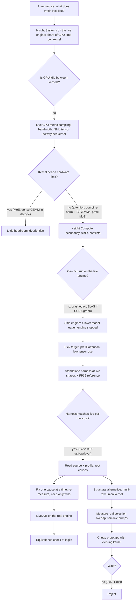

# Speeding up Qwen3.8 Flash Next on a DGX Spark: profiling and kernel work, 2026-11-18

**Status:** working draft, written during the investigation. Numbers are measured unless marked
*[estimate]* or *[inference]*. All times are UTC. Host: `spark-5` (DGX Spark, GB10, `sm_121`).

**Headline results**

| Result | Value |
|---|---|
| b12x sparse (QSA) paged attention, prefill, 4096-row chunk | **1.92× (16K context), 1.94× (32K)** in a standalone harness, max error 1e-4 vs FP32, same as the original |
| Same kernel, decode split path, 20–40 rows | 1.24–1.29×; equal at 1–5 rows |
| Live Flash Next, 14.5K-token real-text prefill | **6.55 s → 5.43 s (−17.1%)** cumulative: attention patch 6.26 s; + fused HC gate and Triton combine-norm 5.95 s (§13.4); + GDN identity fast path 5.72 s (§13.6); + fused q/k norm, RoPE and output gate 5.49 s (§13.7); + gate in place, no GDN zero fill 5.43 s (§13.7 v2) |
| Live Flash Next, random 16K-token TTFT | 7,066 → 6,710 ms (−5.0%) with the attention patch; **→ 5,800 ms (−17.9%)** with everything |
| Live decode throughput | unchanged (attention is ~1% of decode time) |
| Root causes fixed | no load/compute overlap; the (already online) softmax and QK ran on one warp of four; a swizzle that is 2-way conflicted on every shared-memory access |
| Tried and rejected | per-row TMA bulk-copy gather (0.54–1.12×); multi-row "union" attention (0.87–1.01×); `torch.compile`; MoE work-source/tile configs; MXFP8 HC weights (decode +2–3%, prefill −7%); 8K prefill chunks (−25% KV cache); b12x exhaustive autotune (host OOM) |
| Equivalence | every adopted change: logit differences equal the original's own run-to-run noise (§9.4, §13.4, §13.6, §13.7) |

---

## Contents

1. [Why we looked, and what the target is](#1-why-we-looked-and-what-the-target-is)
2. [The hardware: GB10 and why it matters](#2-the-hardware-gb10-and-why-it-matters)
3. [The model and the serving stack](#3-the-model-and-the-serving-stack)
4. [Triage: approach and decision flow](#4-triage-approach-and-decision-flow)
5. [Step 1 — what the live traffic looks like](#5-step-1--what-the-live-traffic-looks-like)
6. [Step 2 — where GPU time goes (Nsight Systems)](#6-step-2--where-gpu-time-goes-nsight-systems)
7. [Step 3 — is each kernel at the limit? (live GPU metric sampling)](#7-step-3--is-each-kernel-at-the-limit-live-gpu-metric-sampling)
8. [Step 4 — why each kernel behaves as it does (Nsight Compute)](#8-step-4--why-each-kernel-behaves-as-it-does-nsight-compute)
9. [Step 5 — the attention kernel: harness, root causes, fixes](#9-step-5--the-attention-kernel-harness-root-causes-fixes)
10. [Step 6 — multi-row attention: measured, then rejected](#10-step-6--multi-row-attention-measured-then-rejected)
11. [Kernel deep dive: original b12x selected-position attention](#11-kernel-deep-dive-original-b12x-selected-position-attention)
12. [Kernel deep dive: the patched kernel](#12-kernel-deep-dive-the-patched-kernel)
13. [Remaining opportunities](#13-remaining-opportunities)
14. [Tooling lessons and incidents](#14-tooling-lessons-and-incidents)
15. [Artifacts and reproduction](#15-artifacts-and-reproduction)

---

## 1. Why we looked, and what the target is

The work started from a course module on FlashAttention and a question: what do attention kernels on
consumer and workstation Blackwell (compute capability 12.x) actually look like, and can they be made faster?
An earlier study (`consumer-gpu-kernel-guide/guides/sm12x-attention/REPORT.md`) mapped the SM12x attention
kernels in vLLM, SGLang and FlashInfer. This document is the follow-up: take a real model served on a real
DGX Spark, find where its time goes, and improve what can be improved.

The target is **Qwen3.8-Flash-Next-NVFP4** served by vLLM (b12x fork) on `spark-5`, port 8112. It has no
consumers, so it could be stopped and restarted freely for experiments.

## 2. The hardware: GB10 and why it matters

### 2.1 Facts used in this work

| Property | GB10 (DGX Spark) | How we know |
|---|---|---|
| Compute capability | 12.1 (`sm_121`) | device query |
| SMs | 48 | device query; Nsight "waves" math matches |
| Shared memory per SM (configured) | **102,400 B (100 KB)** | Nsight Compute "Shared Memory Configuration Size 102.40 KB" |
| Shared memory reserved per block | **1,024 B** | Nsight Compute "Driver Shared Memory Per Block 1.02 KB" |
| Max blocks per SM | **24** | Nsight Compute "Block Limit SM 24" |
| Max warps per SM | 48 | occupancy 16.67% = 8 warps |
| Registers per SM | 65,536 | register block limits match |
| L2 cache | 24 MB | spec; consistent with 98% L2 hit rate on a 16 MB working set |
| Memory | 128 GB LPDDR5x, unified (CPU and GPU share it), ~121 GiB visible | `free`, `/proc/meminfo` |
| Memory bandwidth | 273 GB/s | spec; the highest live sample read exactly 273 GB/s |
| Tensor-core instruction | `mma.sync` (warp-level) only — no `wgmma`, no `tcgen05`, no TMEM | kernel source; SM12x ISA |
| TMA | available, no multicast | sm12x-attention report §2.3 |
| Nsight Compute DRAM counters | **none** (`dram__*` absent on GB20B) | `ncu --query-metrics --chip gb20b` |
| Nsight Systems GPU-metrics set | no memory counters in the stock `gb20b` set | the set's config file |
| Fabric | ConnectX-7, 2 × 100 Gb/s = 200 Gb/s line rate (~25 GB/s); ~170–180 Gb/s achieved (operator measurement); spark-5 has no ConnectX-7 link | fleet notes |

This settles the earlier SM12x report's open question (§2.5 there): **100 KB per SM, 1 KB reserved per block,
24 blocks per SM** — the programming guide's figures, not the tuning guide's 128 KB / 32.

### 2.2 How GB10 differs from other Blackwell GPUs

| | GB10 (DGX Spark) | RTX PRO 6000 Blackwell | B200 (data center) |
|---|---|---|---|
| Compute capability | 12.1 | 12.0 | 10.0 |
| SMs | 48 | 188 | 148 *[spec, not measured here]* |
| Shared memory per SM | 100 KB | 100 KB | 228 KB *[spec]* |
| Tensor-core path | `mma.sync` + `ldmatrix` | `mma.sync` + `ldmatrix` | `tcgen05` + TMEM *[spec]* |
| Memory | 128 GB LPDDR5x, unified | 96 GB GDDR7 | HBM3e *[spec]* |
| Bandwidth | 273 GB/s | 1,792 GB/s | ~8 TB/s *[spec]* |
| L2 | 24 MB | 128 MB | — |

GB10 is a consumer-class Blackwell SM (same ISA family as the RTX PRO 6000) attached to a small, slow,
**shared** memory system. Data-center kernels (FA3/FA4-style `wgmma`/`tcgen05` designs, large shared-memory
tiles) do not port; SM12x kernels written for the RTX PRO 6000 run, but are tuned for 188 SMs and 6.6× the
bandwidth.

### 2.3 How the hardware shaped today's choices

| Hardware fact | Consequence in this work |
|---|---|
| 100 KB shared memory per SM, 1 KB reserved per block | The attention kernel's 42.6 KB blocks fit **2 per SM** (2 × 43.6 KB); a 51 KB block would fit only 1. Every design had to stay ≤ ~49 KB to keep 2 blocks/SM (this ruled out a separate FP8 staging buffer for TMA, §9.5). |
| 64K registers per SM | The original kernel's 168 registers/thread would allow 3 blocks; the pipelined kernel's 246 allow 2 — free only because shared memory already limited it to 2. |
| `mma.sync` only | Operands go shared memory → `ldmatrix` → registers. Swizzle correctness for `ldmatrix` and 128-bit stores matters (§9.6). No warpgroup MMA to hide latency. |
| 48 SMs | 8,192 blocks (4,096 rows × 2 KV heads) at 2 per SM = 85 waves; per-block overheads dominate; tile choices tuned for 188 SMs do not transfer automatically. |
| 24 MB L2 | At ≤ ~24K context the whole FP8 KV cache of the 12 attention layers (~16 MB at 16K for one layer pair) stays in L2: 98% hit rate. **Attention is not DRAM-bound**, so the fixes had to target in-SM latency, not bytes. |
| 273 GB/s | Decode is bandwidth-bound (69% of peak on average, big kernels 70–82%); there is little decode headroom in the weight-streaming kernels. |
| Unified 121 GiB memory shared with the CPU | (a) Nsight Compute kernel replay saves and restores buffers in the same pool: a full 48-layer model could not be profiled (§8.2). (b) Side engines next to the live engine drove free memory to 1–2 GiB (§14). (c) The memory watchdog was essential. |
| No DRAM counters; no memory counters in the stock GPU-metrics set | Bandwidth had to be inferred from L2 misses (`lts__t_sectors_op_read_lookup_miss_realtime`) via a custom metric set (§7). |
| `cp.async.bulk` takes uniform-register operands | Per-lane divergent bulk copies serialize; per-row TMA gather lost (§9.5). |

## 3. The model and the serving stack

**Model** (`local-inference-lab/Qwen3.8-Flash-Next-NVFP4`, snapshot `6909a5bed089…`, architecture
`Qwen4ExpForConditionalGeneration`):

| | |
|---|---|
| Layers | 48: 36 Gated DeltaNet (linear attention) + 12 full attention (every 4th) |
| Hidden size | 2,560 |
| Attention | 24 query heads, 2 KV heads (GQA group 12), head dim 256 |
| Full attention type | **QSA sparse attention**: each query attends to ≤ 2,051 selected positions (512 groups of 4 tokens chosen by a learned indexer, plus ≤ 3 trailing tokens) |
| MoE | 512 experts, top-10, expert width 640, plus a shared expert of width 640, NVFP4 |
| HyperConnection | 4 residual streams per token, low-rank 320 (`hc_count=4`, `hc_lowrank=320`) |
| MTP | 1 draft layer, 4 speculative tokens |
| Vocabulary | 248,320 |

**Stack:** vLLM `0.1.dev21553+gab86b7073` (b12x fork), b12x 1.5.0, image `06e0b04bcba1`
(`vllm-node-b12x` / `eugr/spark-vllm-b12x`), eugr recipe `qwen3.8-flash-next-nvfp4-solo`. FP8 KV cache,
`max_model_len` 262,144, `max_num_seqs` 8, `max_num_batched_tokens` 4,096, `gpu_memory_utilization` 0.8,
b12x MoE/linear/GDN backends. The fork auto-enables breakable CUDA graphs, which forces
`CompilationMode.NONE` (no `torch.compile`).

**Kernel languages in the hot path:** b12x kernels are **CuTe DSL** (CUTLASS's Python DSL, JIT-compiled):
MoE, dense GEMM, attention, QSA scoring, GDN, HyperConnection combine-norm. Triton: `_gate_mean`,
`_gated_rmsnorm`, vLLM's top-k router, causal conv1d. cuBLAS/cuBLASLt (closed): the sm80 WMMA BF16 GEMM,
`nvjet_sm121`, gemv, split-K reduce. PyTorch: elementwise, copy, gather.

## 4. Triage: approach and decision flow

The rule we followed: **measure the real workload first, go deeper only where the measurement points, and
test every hypothesis with the cheapest experiment that can falsify it.**

| Step | Question | Tool | Why this tool | Outcome |
|---|---|---|---|---|
| 1 | What does real traffic look like? | vLLM `/metrics` (14 days) | Free, no restart | Prompt-heavy (31:1), prefill is ~half of request time |
| 2 | Where does GPU time go? | Nsight Systems, capture-range windows | Low overhead, every kernel, real engine | Attention 1% of decode, 14% of prefill; MoE and GEMMs dominate |
| 3 | Is each kernel at a hardware limit? | Nsight Systems GPU metric sampling, custom L2 set | Live, device-wide, no replay | Decode kernels 70–82% of bandwidth; prefill attention 4% bandwidth, 16% tensor |
| 4 | Why? | Nsight Compute | Per-kernel stalls, occupancy, conflicts | Live run crashed; side engine worked; attention limited by shared memory occupancy, latency, conflicts |
| 5 | Can we fix it? | Standalone harness + source | Fast iteration, exact shapes, FP32 check | 1.92× after three fixes |
| 6 | Does it carry to the real engine? | Live A/B | Ground truth | −4.5% to −5.0% prefill time |
| 7 | Is a bigger redesign worth it? | Live selection dumps + prototype | Overlap decides the design | Rejected |

## 5. Step 1 — what the live traffic looks like

From 14 days of the engine's own `/metrics` (since 2026-11-04):

| | |
|---|---|
| Requests | 3,347 |
| Average prompt / output | 8,538 / 273 tokens (31:1) |
| Prefix-cache hit rate | 55% of prompt tokens |
| Mean time to first token | 4.56 s (2.78 s prefill, the rest queueing) |
| Mean decode | 6.2 s per request, 44 tokens/s per request, 96 ms per step |
| MTP acceptance | 82% (by draft position: 92%, 86%, 79%, 72%); ~4.2 tokens per step |

**Conclusion:** half of each request's wall time is prefill. Prefill improvements matter as much as decode.

## 6. Step 2 — where GPU time goes (Nsight Systems)

Captured on the live engine with `nsys profile --capture-range=cudaProfilerApi --cuda-graph-trace=node`,
windows opened via vLLM's `/start_profile` and `/stop_profile` (`--profiler-config '{"profiler":"cuda"}'`).

Share of GPU kernel time:

| Category | Decode, 1 request | Prefill, 16K | Decode, 4 requests |
|---|---|---|---|
| Dense GEMMs (b12x + cuBLAS) | 58.5% | 41.1% | 39.4% |
| MoE | 31.6% | 23.8% | 44.7% |
| Linear attention (GDN) | 4.2% | 3.1% | 10.7% |
| **Full attention (QSA)** | **1.0%** | **13.7%** | **1.6%** |
| Norms, copies, gathers, sampling | 4.7% | 18.3% | 3.6% |

HyperConnection chain (attributed later, §13): **19.0%** of decode (1 request), 5.3% (4 requests), 15.1% of prefill.

The GPU was never idle between kernels (kernel-busy time ≈ window span), so gains must come from faster
kernels, not from removing launch gaps.

## 7. Step 3 — is each kernel at the limit? (live GPU metric sampling)

**Method.** The stock `gb20b` GPU-metrics set has no memory counter, and GB10 has no `dram__` counters at all.
A custom set (`gb20b-mem.config`) adds four L2 counters that support real-time sampling, notably
`lts__t_sectors_op_read_lookup_miss_realtime` (sectors/s × 32 B = bytes/s read from memory). Sampling is
device-wide, so a 40-second `nsys profile --trace=none --gpu-metrics-devices=0 --gpu-metrics-set=file:...`
attached to a dummy `sleep` measured the live engine **without a restart**. The decode peak sample read
exactly 273 GB/s, which validates the proxy. Then a restart with kernel tracing plus the same metrics at
20 kHz attributed samples to kernels.

**Whole windows:** decode (1 request) averaged 188 GB/s (69% of 273), SM issue 3.9%, tensor 4.1% →
bandwidth-bound. Prefill (16K) averaged 93 GB/s (34%), tensor 13.9%, SMs busy 88% → **neither limit**.

**Per kernel:**

| Kernel | Share | Memory read | SMs busy | Tensor |
|---|---|---|---|---|
| Decode bs1: dense GEMM (b12x) | 37.6% | 200 GB/s (73%) | 90% | 6% |
| Decode bs1: MoE (b12x) | 29.6% | 216 GB/s (79%) | 35% | 3% |
| Decode bs1: cuBLAS sm80 WMMA BF16 (HyperConnection) | 14.3% | 178 GB/s (65%) | 78% | 3% |
| Decode bs4: GDN decode | 10.3% | 46 GB/s (17%) | 92% | 0.2% |
| Prefill: MoE | 22.7% | 110 GB/s (40%) | 94% | 12% |
| Prefill: dense GEMM | 15.2% | 116 GB/s (43%) | 96% | 41% |
| **Prefill: paged attention (QSA)** | **10.9%** | **10 GB/s (4%)** | **99%** | **16%** |
| Prefill: combine-norm | 8.3% | 115 GB/s (42%) | 100% | 0.4% |
| Prefill: `_gate_mean` | 4.7% | 208 GB/s (76%) | 99% | 1% |

**Decision:** attention in prefill was occupied but neither memory- nor compute-bound — a latency/structure
problem, and the most relevant to the FlashAttention theme. It became the target.

## 8. Step 4 — why each kernel behaves as it does (Nsight Compute)

### 8.1 On the live engine: failed

`ncu` on the serving engine crashed it: the first profiled kernel, cuBLAS
`cutlass_80_wmma_tensorop_bf16_s161616gemm_bf16_16x16_128x1_tn_align8` inside a CUDA graph, logged
`Failed to profile "Kernel2"`, ncu shut the process down (exit 9). Lesson: Nsight Compute stops the world and
replays each kernel 20–40 times with memory save/restore; it is not a live-serving tool.

### 8.2 Side engine: what worked

| Attempt | Result | Why |
|---|---|---|
| 4-layer dummy-weight engine next to the live engine | startup failure | missing `if __name__ == "__main__"` guard (spawn) |
| same, fixed | killed by watchdog ×3 (1–2 GiB free) | b12x first-run autotuning memory spike, ~21 GiB free with the live engine up |
| real 48-layer model, live engine stopped | killed at the first profiled kernel | kernel-replay save buffers vs ~91 GB of engine buffers in a 121 GiB unified pool |
| **4-layer dummy, MTP k=4, eager, live engine stopped** | **334 + 44 kernels profiled** | small footprint; launch-config check confirmed the shapes match live |

### 8.3 Findings

| Kernel (phase) | Time | Memory | Tensor | Occupancy (achieved/theoretical) | Registers / smem | Top stalls |
|---|---|---|---|---|---|---|
| Paged attention (prefill) | 2.1 ms | 33% of peak | 14% | 16% / 17% | 168 / 42.6 KB | barrier, long scoreboard |
| QSA scoring (prefill) | 623 µs | 27% | 2% | 58% / 100% | 34 | **no_instruction** (instruction cache) |
| Combine-norm (prefill) | 343 µs | 38% of bandwidth | 0% | 36% / 100% | 40 | long scoreboard 58, barrier 23 |
| WMMA BF16 (decode) | 95 µs | 70% of bandwidth | 4% | 11% / 16% | 109 | long scoreboard |
| MoE (decode) | (unreliable under ncu) | — | 7% | 10% / 10% | 182 / 54 KB | sleeping (spin barriers) |

Shared-memory conflicts ("uncoalesced shared accesses"): paged attention 46–48% excess wavefronts
(128-bit stores 43%, `ldmatrix` 54%); MoE 17–35%, almost all from 48 scalar 16-bit loads (its `ldmatrix`
path is conflict-free thanks to padded/XOR-swizzled rows) — but MoE is limited by its spin barriers, not by
conflicts.

## 9. Step 5 — the attention kernel: harness, root causes, fixes

### 9.1 Harness

`attn_harness.py` calls b12x's `launch_selected_paged_gqa_direct` at the live shapes (24/2 heads, head dim
256, FP8 KV, 3,024-token pages, 4,096-row chunks), with selections generated like QSA (512 groups of 4 in
score order + tail), and checks sampled rows against an FP32 reference. Validation:

- correctness: max abs error 1e-4 (0.8% relative), LSE exact;
- **matches live**: 3.4 µs per row per layer vs 3.85 µs measured live;
- selection pattern (shared groups, independent, random) changes time by < 1% → not locality-bound;
- L2 hit rate 98% → not DRAM-bound;
- `kv_warps` sweep: 2 (live) is fastest (1: +25%, 4: +75%).

### 9.2 Root causes (source + Nsight Compute)

1. **No overlap**: per 32-row KV tile, position lookup → barrier → synchronous `ld.global.nc` → FP8→BF16
   convert → store to smem → barrier → math. Nothing prefetched.
2. **QK and the online softmax on one warp of four**: 3 warps wait at the barrier during QK. The kernel
   already used an online softmax (FlashAttention-2 style); the problem was how it was executed (§9.9).
3. **Occupancy capped by shared memory**: 42.6 KB + 1 KB reserved → 2 blocks/SM (8 of 48 warps).
4. **2-way shared-memory conflicts on every 128-bit store and `ldmatrix`** (cause found later, §9.6).

### 9.3 Fix 1 — software pipeline (1.62×)

Prefetch tile i+1's K/V into registers before QK(i); non-QK warps resolve tile i+2's positions into a
3-slot ring; convert and store after PV(i). Result: 13.94 → 8.60 ms (16K). Barrier stall 6.64 → 2.89,
memory stall 4.72 → 2.81, tensor 15.1% → 25.3%. Registers 168 → 246 (no occupancy loss).

### 9.4 Live A/B and equivalence

| | Original | Patched |
|---|---|---|
| Real-text 14.5K prefill (6 runs) | 6.54–6.57 s | 6.25–6.28 s (−4.5%) |
| Random 16K TTFT | 7,066 ms | 6,710 ms (−5.0%) |
| Random 8K TTFT, c=1 | 3,489 ms | 3,322 ms (−4.8%) |
| Real-text decode c=4, temperature 0 | 8.6–9.0 tok/s | 8.6–8.9 tok/s |
| MTP acceptance in that decode | 52% | 53–56% |

Greedy outputs differ between the arms (both coherent). **Equivalence check** (`lp_check.py`,
`lp_compare.py`; data in `data/logprob-check/`): teacher-forced `prompt_logprobs` (top-5) on a 6,975-token
real-text prompt, plus greedy generation with top-5 per step, for each arm — and, as a control, the
**original kernel against itself**:

| Comparison | Same top-1 token | Top-1 log-prob difference (median / p90 / p99) | Greedy divergence |
|---|---|---|---|
| Original vs original, after a restart | 96.72% | 0.0004 / 0.090 / 0.44 | step 0 |
| Original vs original, same process | 96.76% | 0.0004 / 0.095 / 0.45 | step 7 |
| Original vs patched | 96.70% | 0.0004 / 0.094 / 0.46 | step 23 |
| Original (restart) vs patched | 96.56% | 0.0004 / 0.094 / 0.46 | — |

**Conclusion:** the engine is not deterministic — the same request in the same process gives slightly
different log-probabilities, and greedy text can diverge from the first token (here 'The' −0.49 vs 'This'
−0.99 flipped between two original runs). The patched kernel's differences are indistinguishable from that
noise floor. *[inference]* The likely source is b12x's dynamic MoE kernels (b12x has a
`B12X_DYNAMIC_DETERMINISTIC_OUTPUT` switch); not confirmed.

### 9.5 Rejected — TMA per-row gather

`cp.async.bulk` + mbarrier per selected row (K into the Q tile's smem, free after the first QK; V in place
into the BF16 V tile's segment halves). Correct, but: TMA K+V 26.03 ms (0.54×), TMA K + register V
12.46 ms (1.12×), vs pipelined 8.69 ms. Cause: bulk copies take uniform-register operands, so 32 lanes each
copying a different row compile to a loop over lanes (`R2UR.BROADCAST` + loop `BRA` = 55% of stall samples);
160 small copies per tile serialize. TMA wants few, large copies; these rows are 256 B scattered.
A tensor-map design with 4-token boxes (QSA groups) is possible but would at best match register prefetch.

### 9.6 Fix 2 — split QK across warps, deferred position lookups

All 4 warps compute QK (8 columns each), and the existing online softmax is parallelised across them: the row
max is exchanged through shared memory (one barrier) and per-warp partial sums combine once at the end (valid
because the rescale factor depends only on the shared max) — details in §9.9. With every warp busy, position lookups became exposed; fix: issue the `selected_positions` load
for tile i+3 and the `block_table` load for tile i+2 at the start of tile i, consume after PV. Memory stall
2.81 → 0.60. On its own ≈ the pipelined kernel; it exposed shared-memory pipe pressure (`mio_throttle`).

### 9.7 Fix 3 — the swizzle bug (and the conflict you saw in the GUI)

Every 128-bit store and `ldmatrix` showed **exactly 2× the ideal wavefronts regardless of thread mapping** —
a layout problem, not a mapping problem. b12x builds its BF16 tiles from CUTLASS's stock `K_SW128` atom,
`S<3,4,3> ∘ (8,64):(64,1)`. CuTe applies that swizzle to **element** offsets; for 2-byte BF16 it XORs
32-byte units instead of 16-byte units, so pairs of rows collide. Fix: `S<3,3,3>` for Q/K/V (16-byte units),
the matching atom for P, and storing the odd 8-column chunk first in odd 64-column blocks.
Result: **0% excess wavefronts on every shared-memory operation**. A mapping that varies rows fastest also
removed conflicts but cost 28% via worse global-load coalescing, so it was not kept.

### 9.8 Final numbers

| Context (4,096 rows) | Original | Pipelined | + swizzle | + split QK |
|---|---|---|---|---|
| 16K | 14.04 ms | 8.68 | 7.77 | **7.31 (1.92×)** |
| 32K | 14.08 ms | 8.71 | 7.76 | **7.25 (1.94×)** |

Decode split path (+ merge): 1 row 48.5 → 49.6 µs, 5 rows 48.4 → 48.0, 20 rows 96.2 → 77.8, 40 rows
191.2 → 147.7. All variants max error 1e-4 vs FP32, LSE exact.

### 9.9 Online softmax: already present, still needed tuning

**It was there from the start.** b12x's kernel never materialises a full score row. It keeps a running max
`m`, running sum `l` and output accumulator `O` per head, and per 32-column tile computes
`m_new = max(m, max(S))`, `P = exp(S − m_new)`, rescales `l` and `O` by `exp(m − m_new)`, and accumulates
`O += P·V` — the FlashAttention-2 online softmax (Milakov & Gimelshein), via `Softmax.online_softmax`.
So the gains here did **not** come from introducing an online softmax; they came from fixing how this one ran.

**What was suboptimal about the original execution:**

| Issue | Effect |
|---|---|
| QK, masking, max, exponentials and running sum all on warp 0; warps 1–3 idle until the barrier | the softmax sat on a single-warp critical path every tile (barrier stall 6.64 cycles/issued instruction) |
| Position lookups (two dependent global loads) done on the same critical path | latency exposed once every warp joined the softmax |
| P written element by element (scalar 16-bit stores) into a tile with the wrong-granularity swizzle | 47% excess shared wavefronts on the P stores |
| P and the per-row rescale factors go through shared memory every tile | structural: 1 KB of P plus the factors, and a barrier, per tile |

**What we changed:**

- **Parallel online softmax** (`_split_online_softmax`): each of the 4 warps owns 8 of the 32 columns. Each
  warp reduces its partial row max within the quad, writes it to shared memory, and after one barrier every
  warp combines the four maxima. Exponentials and running sums stay local to each warp.
- **Deferred sum combine** (`_combine_split_row_sums`): the per-warp running sums are added once, at the end.
  This is exact because the rescale factor `exp(m − m_new)` depends only on the shared max, so all warps
  apply the same factor every tile; sums of rescaled partials equal the rescaled sum.
- **Position lookups moved off the softmax path**: issued one or two tiles ahead, consumed after `P·V`.
- **P-tile swizzle fixed** (16-byte units): 47% → 0% excess on the P stores.

**Result:** the softmax is no longer a one-warp serial section, and with the other two fixes the kernel went
from 14.04 ms to 7.31 ms at 16K (§9.8). Numerically it is the same algorithm: max error 1e-4 vs FP32, LSE
exact, and live logits within the engine's own run-to-run noise (§9.4).

**What remains:** the shared-memory round trip for `P`. FlashAttention-2 avoids it by splitting work across
warps by query rows — each warp owns its rows' QK and PV, and the QK accumulator layout feeds PV directly from
registers. This kernel has a single query row (12 heads padded to 16 MMA rows) per block, so warps must split
PV by output columns and each needs all of `P`. *[idea, untested]* A "split-K" PV — each warp multiplies its
own 8 columns of `P` by the matching 8 rows of `V` for all 256 output dimensions, then the four partial
outputs are summed once per block — would remove the per-tile `P` traffic and one barrier, at the cost of a
16×256 FP32 accumulator per warp (~128 registers per thread on top of Q) and one final reduction.

## 10. Step 6 — multi-row attention: measured, then rejected

FlashAttention is fast because many queries share K/V tiles. QSA gives each query its own positions, so the
kernel runs one query row per block. A k-row kernel would gather the union of k rows' selections and mask.

**Overlap, measured from live selection dumps** (14,536-token real-text prompt):

| Query positions | Adjacent-row Jaccard | k=2 useful | k=4 useful | k=8 useful |
|---|---|---|---|---|
| 0–4,095 (trivially high: rows select everything below 2,048) | 0.89–0.91 | 95% | 91–92% | 88–89% |
| 4,096–8,191 | 0.64–0.69 | 82–84% | 68–71% | 57–60% |
| 8,192–12,287 | 0.51–0.55 | 75–77% | 58–61% | 46–49% |
| 12,288–14,535 | 0.44 | 72% | 54% | 43% |

**Prototype:** pairs presented to the existing kernel as one row with 24 heads per KV head (its 32-row,
8-warp mode), over the real union, width = mean union: **1.01× (4–8K), 0.92× (8–12K), 0.87× (12–14.5K)**.
The structure buys ~1.23× per unit of work; the union costs 1.2–1.4× more work. Rejected for this model.

## 11. Kernel deep dive: original b12x selected-position attention

Source: `b12x/attention/paged/_selected_forward.py` (b12x 1.5.0, Apache-2.0,
`github.com/local-inference-lab/b12x`); caller `b12x/attention/qsa/_sparse_gqa.py`.

- **Entry points:** `launch_selected_paged_gqa_direct` (prefill, rows > 64, BF16 output + LSE) and
  `launch_sparse_gqa_split` + `launch_sparse_gqa_merge` (decode, rows ≤ 64, 16–64 splits, FP32 partials).
- **Grid:** `(rows, kv_heads, splits)`; **block:** 128 threads (4 warps) when heads per KV ≤ 16.
- **Tiles:** `tile_m = 16` (12 real heads of one GQA group, padded), `tile_n = 16 × kv_warps` (32 live).
- **Shared memory (live, 42.56 KB):** Q 16×256 BF16 (8 KB), K and V 32×256 BF16 (16 KB each), P 16×32 BF16
  (1 KB), row scale, two 32-entry int64 base arrays.
- **Per tile:** threads < `tile_n` resolve `selected_positions` → logical page → `block_table` → physical
  row base; barrier; all threads load 16 FP8 bytes each (`ld.global.nc.v4`), convert with
  `fp8x4_e4m3_to_bfloat2x2_native_sm120`, store two 16-byte BF16 chunks (`st.shared.v4`); barrier; warp 0:
  QK via `ldmatrix` + `mma.sync m16n8k16`, mask, online softmax, P → smem (scalar 16-bit stores); barrier;
  all 4 warps: P·V (each 64 of 256 output columns); barrier.
- **Finalize:** warp 0 computes 1/sum and LSE; all warps scale and store output.
- **Layouts:** `get_smem_layout_atom(ROW_MAJOR, BF16, 256)` → `K_SW128` → `S<3,4,3> ∘ (8,64):(64,1)`,
  tiled to `((8,4),(64,4)):((64,512),(1,2048))`.

## 12. Kernel deep dive: the patched kernel

Patch: `patch/_selected_forward.py` (+1,033 / −46 lines vs the original). All changes are behind switches and
compile under distinct spec versions; with switches off the original code runs.

| Switch | What it enables | Key functions |
|---|---|---|
| `B12X_SELECTED_PIPELINE=1` | register-prefetch pipeline, 3-slot position ring | `_resolve_tile_positions`, `_issue_fp8_gather`, `_store_fp8_gather`, `_pipelined_step` |
| `B12X_SELECTED_SPLITQK=1` | QK + softmax on all 4 warps, deferred two-stage position lookup | `_tiled_mma_qk` (1,4,1), `_split_online_softmax`, `_combine_split_row_sums`, `position_ring` |
| `B12X_SELECTED_SWZ333=1` | 16-byte-unit swizzle for Q/K/V and P, parity-ordered stores | `_shared_layouts`, `_store_fp8_one` |
| `B12X_SELECTED_TMA=1` (+`_TMA_V`) | rejected TMA experiment | `_tma_*` |
| `B12X_SELECTED_ROWMAP=1` | rejected row-fastest gather mapping | gather functions |

Pipelined tile i (split mode): issue global loads for i+1 → issue position loads for i+2 / i+3 → all warps
QK(i) + mask + partial softmax → write row max → barrier → combine max, exp, P → barrier → PV(i) → barrier →
finish position resolution → convert and store tile i+1 → barrier.

## 13. Remaining opportunities

| Where | Share | Problem | Next step |
|---|---|---|---|
| Prefill MoE | 22.7% (27% after other fixes) | per-kernel counters: 75% of achievable memory bandwidth, reads only 8% above unique weights (§13.12); top stall is TMA waits | configs, stage depth and hand-off barriers all ruled out (§13.2, §13.3, §13.12); remaining headroom ~10–15% of the kernel for a large rewrite — stopped |
| Prefill HyperConnection chain | 15.1% (+ part of 7.4% nvjet/sm80 GEMMs) | combine-norm latency-bound (38% bw); gated mean is a full extra pass | **done** (§13.4): fused up-projection + gated mean, Triton combine-norm — prefill −5% together |
| Prefill PyTorch glue | 9.6% | unfused elementwise/copy/gather; `torch.compile` unsupported by the model (§13.1) | **done for the two largest pieces**: GDN gathers/scatter (§13.6, −4.0%) and eager q/k norm + gate (§13.7, −4.0%); remaining small items in §13.8 |
| Decode HC low-rank GEMMs (cuBLAS sm80 WMMA) | 17.7% (1 request) | cuBLAS already 67–84% of bandwidth in isolation; bytes are the lever | MXFP8 weights tested (§13.4): +2–3% decode, −7% prefill; not adopted |
| Decode GDN at 4 requests | 10.3% | 17% bandwidth, latency-bound | rework state update |

### 13.1 Config experiment 1 — re-enable `torch.compile` (rejected)

Hypothesis: the 9.6% of prefill spent in unfused PyTorch elementwise/copy/gather kernels exists because the
fork's breakable CUDA graphs force `CompilationMode.NONE`; turning them off would let Inductor fuse the glue.

Test: patched kernel + `VLLM_USE_BREAKABLE_CUDAGRAPH=0`. The engine log shows the hypothesis cannot hold:

- "`torch.compile` is turned on, but the model … does not support it." Only the MTP draft head
  (`eagle_head`) was compiled (8.4 s).
- "Cudagraph mode FULL_AND_PIECEWISE requires piecewise capture, but the loaded model provides neither a
  compiled submodule nor breakable CUDA graphs. Overriding to FULL_DECODE_ONLY." Prefill loses CUDA graphs.

| Patched kernel | Default | `VLLM_USE_BREAKABLE_CUDAGRAPH=0` |
|---|---|---|
| Real-text 14.5K prefill | 6.25–6.28 s | 6.29–6.31 s |
| Random 16K TTFT | 6,710 ms | 6,799 ms |
| Real-text decode c=4 | 8.6–8.9 tok/s | 8.3–8.8 tok/s |

**Conclusion:** the glue can only be removed with hand-written fused kernels (e.g. the HyperConnection chain).

### 13.2 Config experiment 2 — b12x MoE work distribution (defaults win)

Hypothesis: the prefill MoE kernel's dominant stall ("sleeping" in its spin barriers) comes from its work
distribution; another b12x mode might suit large prefill batches. Each setting applied via the launcher's
`extra.env` (confirmed in the engine log), patched attention kernel in every run, fresh default baseline in
the same session:

| MoE setting | Real-text 14.5K prefill | Random 16K TTFT | Decode c=4 |
|---|---|---|---|
| Default (`materialized_queue`, multi-CTA on) | **6.23–6.26 s** | **6,705 ms** | 8.6–9.2 tok/s |
| `B12X_DYNAMIC_WORK_SOURCE=persistent_grid` | 6.31–6.33 s (+1.2%) | 6,803 ms | 8.6–8.9 tok/s |
| `B12X_DYNAMIC_WORK_SOURCE=ready_queue` | engine fails to start: b12x MoE compile error `PHASE_DYNAMIC_TO_STATIC_BOOL` ("Cannot use a Runtime value … where a Python value boolean is required") — a latent b12x bug | — | — |
| `B12X_DYNAMIC_ENABLE_MULTICTA=0` | 40.35–40.37 s (6.5× slower) | 41,824 ms | 2.6 tok/s (3.4× slower) |

**Conclusion:** the defaults are the best available work-distribution settings; multi-CTA is essential.

### 13.3 Config experiment 3 — MoE tile shape (no effect)

Hypothesis (based on a wrong assumption that the default tile was 128 rows; it is 32, see §13.12): with 4,096 tokens × 10 experts / 512 experts ≈ 80 rows per expert, a 128-row tile
would leave ~38% of each tile's rows empty *[estimate]*, so a smaller tile might help prefill. The dynamic kernel's
tile is set by `B12X_DYNAMIC_TILE_MN` (tile M ∈ {16, 32, 64, 128}, tile N fixed at 128; an explicit override
takes priority in `_select_dynamic_tile_mn`). `B12X_MOE_TILE_MN` only affects the separate micro kernel.

| MoE tile | Real-text 14.5K prefill | Random 16K TTFT | Decode c=4 |
|---|---|---|---|
| Default (tuner's choice; M = 32 per §13.12, originally mislabelled M = 128) | 6.23–6.26 s | 6,705 ms | 8.6–9.2 tok/s |
| `64x128` | 6.26–6.27 s | 6,737 ms | 8.5–8.9 tok/s |
| `32x128` | 6.27–6.28 s | 6,725 ms | 8.7–9.0 tok/s |

**Conclusion:** no measurable effect in either direction, so tile padding is not what limits the prefill MoE
kernel. *[inference]* The candidates left are its inter-phase spin-barrier coordination (its top stall) and
FP4 unpacking / routing work. Confirming that needs a profile of the MoE kernel under realistic routing, which
the dummy-weight side engine cannot provide.

### 13.4 HyperConnection projections and fusions

The HyperConnection (HC) mixer runs twice per layer (96 times per forward pass, plus MTP): grouped RMSNorm →
down projection 10,240 → 336 (320 low-rank + 4 injection + 12 padding) → scaled SiLU → up projection
320 → 10,240 → gated mean over 4 streams; the next mixer starts with a fused residual combine + RMSNorm. The
projections are plain BF16 `ReplicatedLinear`/`MergedColumnParallelLinear` built with `quant_config=None`,
so they run on cuBLAS; the down projection's padding exists "to ensure … performant implementation chosen by
CuBLAS heuristics". (Earlier sections attributed the sm80 WMMA kernel to the router; it is these projections.)

**Microbenchmark at decode shapes** (`hc_gemm_bench.py`; weights cycled through 8 copies > L2):

| Shape | M | cuBLAS BF16 (live) | b12x small-N BF16 GEMV | FP8 W+A `_scaled_mm` |
|---|---|---|---|---|
| down | 5 | 36.8 µs (187 GB/s) | 38.8 µs | 15.0 µs + 4.3 µs activation quantisation |
| up | 5 | 28.6 µs (230 GB/s) | not applicable (N > 1,024) | 9.9 µs + 4.3 µs |

In isolation cuBLAS already reaches 67–84% of bandwidth; only fewer bytes can help. (b12x's small-N GEMV
routing exists only in its FP6 quant path, `B12XFp6Config`, so it never applies to this model.)

**HC weights in FP8** (patched `hyperconnection.py`, live):
- vLLM's stock FP8 linear (`Fp8Config`, dynamic activations) does not start: "Failed to find a kernel that can
  implement the ScaledMM linear layer … B12xTensorFP8ScaledMMLinearKernel requires static per-tensor
  activation scales."
- Weight-only **MXFP8** via `Mxfp8OnlineLinearMethod(use_a16=True)` (b12x's kernel, as used for the LM head),
  switch `VLLM_HC_MXFP8=1`: decode 49.7 → 52.7 tok/s at c=1 (about half of it from higher MTP acceptance in
  that run; per-step gain ~2–3% *[estimate]*), c=4 unchanged, **prefill 6.26 → 6.72 s (+7%)**. Logits within
  noise (96.60% top-1 agreement, p99 0.457). **Not adopted**; a decode-only hybrid is possible.

**Fused up projection + gated mean** (`VLLM_HC_FUSED_GATE=1`, Triton `_hc_fused_up_gated_mean_kernel`): the
4 per-stream dot products over K = 320 stay in registers and the gated mean is applied in the epilogue, so the
T × 10,240 gate logits are never written. Harness (`hc_fused_bench.py`): **bit-identical** output; 1.10–1.14×
at decode sizes, **2.11× at 4,096 tokens** (1,471 → 698 µs). Live: prefill 6.26 → **6.06 s (−3.2%)**, decode
unchanged, logits within noise (96.69%, p99 0.45).

**Triton combine-norm for prefill** (`VLLM_HC_TRITON_COMBINE_NORM=1`, tokens > 64): one program per token
for all 4 streams, every row load issued up front. Harness (`hc_combine_norm_bench.py`, 4,096 tokens):
1,560 µs (171 GB/s, 62%) → **1,197 µs (222 GB/s, 81%)**; combined output differs in 0.001% of values (1 BF16
step, sigmoid rounding). Live with the fused gate: prefill 6.06 → **5.93–5.97 s (−1.8%)**, decode unchanged.
Logits: 96.47% top-1 agreement (control pairs 96.56–96.76%), p99 0.454 (control 0.44–0.46) — p99 inside the
noise range, top-1 agreement marginally below the four control samples; treated as noise but flagged.

**Cumulative live prefill (14.5K real text):** original 6.55 s → patched attention 6.26 s → + fused gate
6.06 s → + Triton combine-norm **5.95 s (−9.2%)**. Decode unchanged throughout.

### 13.5 Where the remaining PyTorch glue comes from (prefill, 9.6%)

Attributed from neighbouring kernels in the live 16K prefill trace:

| Source | Share of prefill |
|---|---|
| GDN prefill: fill → gather → `causal_conv1d_fwd`, and GDN prefill → gather → `layer_norm` | ~2.5% gather + ~1% fill |
| An RMSNorm done as separate PyTorch ops (`rsqrt` → elementwise → reduce chains) | ~1.5–2% |
| Router sigmoid / scaling before `topkGating` and `_quantize` | ~0.9% |
| Residual add between MoE and combine-norm | ~0.7% |
| BF16 copies, small fills, other | remainder |

Traced afterwards: the gathers come from `_forward_core_b12x_mixed` (§13.6), and the "RMSNorm as separate
PyTorch ops" is the per-head q/k norm in the full-attention layers (§13.7). The shares in this table came from
one chunk and understate both; see §13.6 for why.

### 13.6 GDN identity fast path (adopted, −4.0% prefill)

**Where.** Every prefill batch on this build goes through `_forward_core_b12x_mixed`
(`vllm/model_executor/layers/mamba/gdn/qwen_gdn_linear_attn.py`). The path is written so a CUDA graph can
capture it with fixed shapes: it always packs the non-speculative tokens with `index_select` (inputs `mixed_qkv`,
`a`, `b` and the output gate), runs the conv and the b12x prefill recurrence on the packed copy, zeroes
`core_attn_out` and scatters the result back. It then runs the speculative-verification branch even when there
are no verification rows. For a prompt with no MTP verification rows in the batch, the worklist is the identity
`[0, 1, …, n−1]`, so all of that copying is wasted.

Per GDN layer per 4,096-token chunk (from the original trace): `mixed_qkv` gather 794 µs, gate gather 591 µs,
`a`/`b` gathers 18 µs, zero fill 249 µs, scatter 472 µs, about 2.1 ms in all. The first estimate (~1%) counted
one chunk. **The engine runs prefill in 4,096-token chunks (`--max-num-batched-tokens 4096`), so a 16K prompt
passes through each of the 36 GDN layers four times:** ~2.1 ms × 36 × 4 ≈ 300 ms, ~4% of the prefill.

**Change** (`VLLM_GDN_IDENTITY_FASTPATH=1`, two files):
- `b12x_gdn_metadata.py`: `stage()` records two host-side facts already computed on the CPU, the live
  non-spec token count and whether the worklist is the identity with no verification rows. Both
  metadata-copy paths carry them across.
- `qwen_gdn_linear_attn.py`: when the batch is the identity and the stream is **not** capturing a graph, a new
  `_forward_core_b12x_identity` runs instead:
  - `causal_conv1d_fn` reads `mixed_qkv` in place. It accepts a strided channel-last input and an `out=`
    buffer, so no packed copy is needed.
  - The b12x recurrence runs unchanged.
  - The gated RMSNorm reads the output gate as a strided 2D view and writes straight into `core_attn_out`.
    It runs in `layer_norm_fwd`'s group mode (group = head dim, weight tiled across heads), which is the same
    math per head.
  - Rows past the live count are zeroed only if they exist.
  - Mixed batches and graph capture keep the original path.

**Results** (same code, switch off → on, one restart apart):

| | off | on |
|---|---|---|
| Real-text 14.5K prefill | 5.95–5.97 s | **5.71–5.73 s (−4.0%)** |
| Random 16K TTFT (mean of 4) | 6,379 ms | **6,122 ms (−4.0%)** |
| Decode c=1 / c=4 | 48.3 / 24–28 tok/s | 50.6 / 26–30 tok/s (tracks MTP acceptance, 49% vs 53%) |
| Logits vs earlier captures | — | top-1 agreement 96.62–96.97%, p99 0.43–0.46 (noise floor) |

Confirmed in a fresh trace of the full build (`D-prefill-16k-best`): the "GDN gather/scatter/fill" category
went from 243 ms to 0.

### 13.7 Fused q/k RMSNorm + mRoPE + output gate in the full-attention layers (adopted, −4.0% prefill)

**Where.** In each of the 12 full-attention layers, `_project_qkv_gate` in
`vllm/models/qwen4_exp/nvidia/b12x_qsa.py` splits the QKV projection, then calls `GemmaRMSNorm` on the
strided per-head query and key views. With `torch.compile` off (§13.1), that runs as eager PyTorch: an FP32
copy, `pow`, a reduce, `rsqrt`, two multiplies and a BF16 copy, each a full pass over a
4,096 × 6,144 BF16 tensor. Then come a separate mRoPE launch and a contiguous copy of the query. After
attention, `output * torch.sigmoid(gate)` is two more passes.

Per layer per chunk in the trace: **~4.0 ms of norm chain** (598 + 823 + 423 + 781 + 807 + 585 µs) plus a
430 µs copy, and 396 + 623 µs for the gate. × 12 layers × 4 chunks ≈ 250 ms per 16K prefill.

**vLLM already ships the fix.** `fused_qk_rmsnorm_rope_gate` (`model_executor/layers/fused_qk_norm_rope.py`)
does the split, the Gemma-style `(1 + w)` RMSNorm, interleaved mRoPE on the partial rotary dims and the gate
copy in one Triton launch. Qwen3-Next and Qwen3.5 use it, but the b12x QSA attention class never calls it.

**Change** (`VLLM_QSA_FUSED_QK_NORM=1`, `b12x_qsa.py`):
- `_project_qkv_gate` calls `fused_qk_rmsnorm_rope_gate` (norm_beta 1.0) when the rope is NeoX-style, BF16,
  and either plain or interleaved mRoPE with sections summing to `rotary_dim/2`. This model: `[11, 11, 10]`,
  rotary dim 64 of 256. The engine log confirms the path at startup.
- `_qsa_apply_gate`: one Triton kernel computes `bf16(out × bf16(sigmoid(gate)))`. It rounds exactly like the
  eager pair and replaces both `sigmoid(gate)` call sites.

**Standalone check** (`qk_fused_check.py`, real `MRotaryEmbedding` and `GemmaRMSNorm` at Flash Next shapes):

| Tokens | eager | fused | Differences |
|---|---|---|---|
| 5 | 311 µs | 22 µs | norm columns: 0.004% of values; rotary columns: 1 BF16 step in ~25% of values (RoPE rounding order); gate exact |
| 4,096 | 5,728 µs | **1,001 µs** | same pattern, max 0.031 |

**Live:**
- Real-text prefill 5.72 → **5.48–5.50 s (−4.0%)**.
- Random 16K TTFT 6,122 → **5,881 ms**.
- Decode: c=1 51.3 tok/s, c=4 27–30 tok/s per request (unchanged within MTP-acceptance noise).
- Logits: top-1 agreement 96.80–96.90% against three earlier captures, p99 0.45–0.47. That is inside the noise
  floor, so the RoPE rounding difference does not show.

**v2 cleanup (adopted, −1.1% prefill).** Two follow-ups, tested together:
- *Gate read in place.* A local copy of the fused kernel without the gate copy (`WRITE_GATE=False`).
  `_qsa_apply_gate` reads the gate straight from the packed per-head `[q | gate]` projection, which lives in
  the layer's dedicated QKV scratch buffer and is not reused before the gate is applied.
- *No GDN zero fill.* `forward_cuda` allocates `core_attn_out` with `torch.empty` when the identity path of
  §13.6 will run (it writes or zeroes every row), via a helper that mirrors the dispatch conditions.

Live:
- Real-text prefill 5.49 → **5.43–5.44 s**.
- Random 16K TTFT 5,881 → **5,800 ms**.
- Decode unchanged (c=1 53.8 tok/s at 57.8% MTP acceptance).
- Logits: 96.57–96.76% top-1 agreement, p99 0.45–0.47 (noise).

### 13.8 Prefill after all changes: what is left

Kernel time by category, 16K random prefill (one request, 4 chunks), original trace vs current build
(`D-prefill-16k-best`):

| Category | Original | Current | Note |
|---|---|---|---|
| Prefill window | 7,074 ms | 5,777 ms | (the current trace predates §13.7; expect ~5,550 ms with it) |
| MoE (b12x) | 1,405 ms | 1,366 ms | 27% of what remains — largest single item |
| Dense NVFP4 GEMM (b12x) | 830 ms | 733 ms | |
| HC combine-norm | 560 ms | 412 ms | §13.4 |
| PyTorch elementwise/fill | 434 ms | 374 ms | ~250 ms of this removed by §13.7 |
| Selected attention | 743 ms | 353 ms | §9 |
| HC gate + mean (incl. up-projection after fusion) | 321 ms | 319 ms | the fused kernel now also does the GEMM |
| GDN core (prepare + recurrence) | 320 ms | 308 ms | |
| cuBLAS GEMMs (HC down, MTP) | 503 ms | 271 ms | up-projection moved into the fused kernel |
| MTP prefill GEMM | 248 ms | 241 ms | |
| GDN gather/scatter/fill | 243 ms | 0 | §13.6 |

**The MoE kernel, sized against the hardware.** Per 4,096-token chunk and layer: 512 experts × top-10 =
40,960 token-expert pairs. Each expert has W13 = 2 × 640 × 2,560 and W2 = 2,560 × 640 NVFP4 weights, about
2.8 MB with scales, so roughly 1.4 GB if every expert is touched.

| Bound | Estimate per layer-chunk | Measured |
|---|---|---|
| Weight bytes at 273 GB/s | ~5.2 ms | |
| FP4 tensor math, 403 GFLOP | ~1–2 ms *[estimate; GB10 dense FP4 mma.sync peak not measured]* | |
| `MoEDynamicKernelSilu` | | **9.4–10.0 ms** |

The kernel launches a persistent grid of 48 CTAs (one per SM) of 160 threads, with 182 registers per thread
and 54 KB of shared memory: 5 warps per SM to hide memory latency.

The 8K-chunk experiment (§13.9) halved the weight passes but saved far less than 48 × 2 × 5 ms. The kernel
is therefore not weight-bandwidth bound; it is latency or synchronisation bound, as the earlier Nsight
Compute spin-barrier finding suggested. *[Later corrected in §13.12: per-kernel counters show it at 75% of
achievable memory bandwidth; why the 8K-chunk saving was smaller than a weight-bytes model predicts is not
established.]* Getting it to ~6 ms would save about 0.65 s of a 16K prefill
(~12%) *[estimate; superseded in §13.12: the kernel is already at 75% of achievable bandwidth, so ~3–4% is realistic]*. Configuration routes are exhausted (§13.2, §13.3), so that needs kernel-level work in
b12x's CuTe DSL MoE.

Smaller fusion targets still in the elementwise bucket (whole 16K prefill):
- residual add between MoE and combine-norm, which could fold into the Triton combine-norm: 42 ms;
- `torch.zeros` of `core_attn_out` before the GDN conv, unnecessary on the identity path: 27 ms;
- router scaling multiply before `topkGating`: 28 ms;
- query copy after mRoPE: 20 ms (likely gone with §13.7).

Together that is about 2% *[estimate]*.

### 13.9 Config experiment 4 — larger prefill chunks (rejected)

**Why.** Each 4,096-token chunk re-reads every expert's weights (~1 GB per MoE layer *[estimate]*) and all
dense weights, so fewer, larger chunks should amortise the weight traffic.

**How.** `--max-num-batched-tokens 8192`, via a new `ARG` line in the launcher's `extra.env` that replaces a
flag in the replayed command line.

| | 4,096 (production) | 8,192 |
|---|---|---|
| Real-text 14.5K prefill | 5.48–5.50 s | 5.36–5.37 s (−2.4%) |
| Random 16K TTFT | 5,881 ms | 5,988 ms (+1.8%) |
| KV cache available | 15.15 GiB | **11.4 GiB (−25%)** |
| Decode c=1 / c=4 | unchanged | unchanged |

The prefill result was mixed, and the server would lose a quarter of its KV cache. On a 262K-context server
that capacity matters more, so this was rejected. 16,384 would cost roughly twice the memory and was not tried.

### 13.10 Config experiment 5 — b12x exhaustive autotuning (rejected on the live host)

**Why.** b12x picks GEMM, GDN and attention launch configurations (tile M/N/K, load path, swap-AB, target
occupancy) through its own preparation-time tuner. `B12X_AUTOTUNE_EXHAUSTIVE=1` widens that search, and the
winners persist in b12x's selection cache (`~/.cache/b12x/compile/preparation/*.json`, keyed separately for
exhaustive queries). In principle that makes it a one-time cost.

**What happened.**
- The search is very large: after 27 minutes, 9 of 209 plans were ready. The GDN prefill plans alone had
  1,400–8,600 candidates each, with more than 12,000 measurements and 16,000 compilations.
- At 01:33 UTC the kernel OOM killer stopped the engine core: 4.5 GB resident on top of the 80% unified-memory
  budget already reserved for weights and KV cache, plus the tuner's compile workers.
- It also killed two small session processes (`gdm`'s and `spark`'s `sd-pam`), leaving `user@126.service`
  (the `gdm` greeter) failed. That is harmless on a headless host.

**Verdict.** Not viable within the production memory budget. If it is ever wanted, run it offline with a
lower `--gpu-memory-utilization` and fewer compiler workers, then serve from the cache it leaves behind
*[untested]*.

### 13.12 MoE kernel work (in progress)

The target is `MoEDynamicKernelSilu`: 27% of prefill and 9.4–10 ms per 4,096-token layer-chunk, against a
~5 ms weight-streaming floor (§13.8).

**How vLLM calls it.** `vllm/model_executor/layers/fused_moe/b12x.py`, `B12xExperts.apply()`:
- Quant mode `nvfp4` maps to b12x `ActivationMode.A4` (FP4 activations), source `modelopt_nvfp4`, W13 layout
  `w31`.
- One `fused_moe.plan_execution` per layer at capacity 4,096 tokens, with invocation
  `{"tuning_route_pattern": "shared_0_20_40_60_80_v1"}`.
- `fused_moe.bind(...)` and `fused_moe.run(...)` per call.
- b12x picks the kernel configuration by tuning on synthetic `shared_N` routes (`moe/fused_moe/workloads.py`),
  not on real routing.

**Live routing** (guarded dump hook in `apply()`, armed by a trigger file: 196 captures = 49 MoE layers incl.
MTP × 4 chunks of one 14.5K real-text prefill; `data/moe-routes/`). Statistics over the 147 full
4,096-token chunks (40,960 token-expert pairs each, 80 rows per expert on average):

| Statistic | Median | Range |
|---|---|---|
| Experts with at least one row (of 512) | 462 | 357–500 |
| Rows on the busiest expert | **1,980** | 670–4,093 |
| Share of pairs on the top 10% of experts | **53%** | 26–75% |
| 128-row tiles needed / ideal | 1.99 | 1.80–2.10 |

Real routing is heavily skewed. Some experts get close to one row per token in the chunk, so a few experts do
most of the work. The tuner's synthetic routes do not look like this.

**Kernel structure** (from reading `moe/_shared/kernels/dynamic.py` and `fused_moe/_impl.py` in b12x 1.5.0;
line numbers refer to that source, copied to `reference/b12x-1.5.0/`). One cooperative persistent kernel,
48 CTAs × (4 MMA warps + 1 TMA producer warp), runs in phases:

| Phase | What it does | Synchronisation after |
|---|---|---|
| P0 | zero counters **and the whole 21 MB BF16 output** | grid barrier 1 |
| P1 | histogram: one global atomic per (token, slot), 40,960 onto 512 counters | grid barrier 2 |
| P1b | prefix scan of tiles per expert, **one warp on CTA 0**; 47 CTAs wait | grid barrier 3 |
| P2 | route + quantise activations to NVFP4 (scalar BF16 loads); each packed row stored once **per routed expert** (10× fan-out, ~52 MB) | grid barrier 4 |
| P2b | publish the task list | grid barrier 5 |
| P3 | claim a task (atomic queue) → FC1 gate+up on one 128-column slice of the 640-wide intermediate → SiLU → re-quantise to NVFP4 in shared memory → FC2 partial for all 2,560 outputs → `red.global.add.bf16x2` into the output | none |

Things that look costly for a large prefill *[inference from the code, not yet measured]*:
1. **Split-K over the 5 intermediate slices, reduced with BF16 atomics.** Every output element gets
   10 experts × 5 slices = 50 atomic adds, about 1 GB of atomic traffic per call, accumulated in BF16
   (order-dependent rounding).
2. **Shallow pipeline:** 1 CTA per SM, 2 TMA stages, one producer warp, and a pipeline drain at every
   FC1→FC2 and task→task edge. FC2 runs only one K=128 step per output tile between waits. That is consistent
   with the 12% tensor-pipe activity measured earlier.
3. **Weights re-streamed per tile:** each task loads a 320 KB W13 slice and a 160 KB W2 slice. Hot experts with
   ~2,000 rows need ~60 tiles of 32 rows, which re-read the same weights (L2 helps only while the tiles run
   close together).
4. **Serial front end:** 5 grid barriers, two rounds of 40,960 global atomics, a single-warp scan.
5. **The "sleeping" stall** in Nsight Compute probably comes from waits on the TMA pipeline's mbarriers
   (`mbarrier.try_wait`), not from the grid barrier. The grid barrier spins on a single thread without
   nanosleep.

Open question: which tile M the live kernel runs. The launch's 54,272 B of shared memory matches the
M = 32 stage sizing better than M = 128 *[inference]*. That would also mean the "default (M = 128)" label in
§13.3 is wrong: the 32×128 run there may have repeated the default. To be confirmed by checking the selection
cache and testing `B12X_DYNAMIC_TILE_MN=128x128`.

**Tile confirmed.** b12x's selection cache (`~/.cache/b12x/compile/preparation/*.json`) shows the tuner
choosing dynamic tile M ∈ {16, 32, 64} with shared input for this MoE. The live launch's 54,272 B of shared
memory is the M = 32 footprint, so the "default (M = 128)" label in §13.3 was wrong: that experiment compared
32 and 64 against an M = 32 default.

**Live config tests:**
- `B12X_DYNAMIC_TILE_MN=128x128`: real-text prefill 5.43 → 5.77 s. The override also applies to decode, which
  dropped to 37.9 tok/s at c=1. **Rejected.**
- `B12X_DYNAMIC_DETERMINISTIC_OUTPUT=1`: the engine does not start; b12x cannot prepare the 1-token decode plan
  in that mode. Tested in the harness instead (below).

**Standalone harness** (`scripts/moe_harness.py`). It uses b12x's own planning path with an explicit
`MoeDecodeConfig` per run: random legal NVFP4 weights in the live layout (ModelOpt, W31, A4, static input
scales), 4,096-token calls, and 16 captured live route chunks plus b12x's synthetic `shared_40` and `disjoint`
routes. Mean µs per call:

| Config | Live routes | `shared_40` | `disjoint` |
|---|---|---|---|
| **tile 32, shared input (what serving runs)** | **9,174** | 11,047 | 7,580 |
| tile 64 | 9,160 | 11,153 | 7,866 |
| tile 16 | 10,164 | 13,017 | 7,882 |
| tile 128 | 10,723 | 12,864 | 9,079 |
| tile 32, no shared input | 9,389 | 11,294 | 7,750 |
| tile 32, deterministic output | 18,278 | 18,247 | 22,206 |
| tile 16 / 64, deterministic | 15,260 / 22,828 | | |

- The harness reproduces the live kernel time: 9.2 ms here vs 9.4–10 ms in the live trace.
- No configuration beats the serving one; deterministic output is 1.7–2.5× slower.
- Outputs agree between configs to ~6e-3 relative difference, which is the order-dependent BF16 atomic
  accumulation.
- b12x's synthetic routes give a different picture from live routing: 20% slower (`shared_40`) to 17% faster
  (`disjoint`).

**Nsight Compute on the harness** (tile 32, live routes, one launch, 8.95 ms):

| Metric | Value |
|---|---|
| Memory / L2 throughput | 30% of peak; L2 hit rate 72% |
| Compute (SM) throughput / issue slots busy | 11.6% / 8.7% |
| Tensor pipe active | 11% |
| Occupancy | 10.4% theoretical (1 CTA × 5 warps per SM; limited by shared memory) |
| No eligible warp | 92% of cycles |
| Global `red` instructions | 2.08 M (warp-level), consistent with 50 BF16 atomic adds per output element |

Warp stall samples: **sleeping 49%**, barrier 15%, long scoreboard 11%, wait 10%, selected 7%.

Per instruction, nearly all "sleeping" samples sit in `SYNCS.PHASECHK.TRANS64.TRYWAIT` + `NANOSLEEP.SYNCS`
loops on the TMA pipelines' mbarriers:
- ~27% of all samples on the first pipeline's two stage barriers: MMA warps waiting for FC1 weight and
  activation tiles;
- ~16% on the FC2 weight pipeline.

The grid barrier is not a factor.

**PM-sampling timeline** (counters over the kernel's runtime):
- The front end (zeroing, histogram, scan, routing and quantisation) takes the first ~8% (~0.75 ms). Tensor
  pipes are idle there, and the stall is long-scoreboard.
- The compute loop then runs at a flat 11–13% tensor activity, with "sleeping" dominant from start to end.

**Diagnosis.** The compute loop is starved for data, and the cause is specific to GB10.
- At tile 32 each task streams ~360 KB of FC1 tiles and 160 KB of FC2 tiles: about 3.8 GB per call
  *[estimate]*, mostly L2 hits, since hot experts' weights are re-read once per 32-row tile.
- Only 2 TMA stages fit. The A buffer is sized for a 128-row atom even at tile 32, and FC1 keeps two B buffers
  (gate and up), so a stage is ~27 KB, and only ~99 KB of shared memory is available per SM.
- That leaves ~54 KB in flight per SM. On parts with 228 KB the same kernel could keep ~4× more in flight.
- On top of that, the pipeline drains at every FC1 → epilogue → FC2 → next-task edge.

Configuration cannot change this (the stage count is derived, and tile and work-source knobs are exhausted),
so the remaining options are kernel changes:

| Option | Targets | Expected | Risk |
|---|---|---|---|
| **A. More bytes in flight:** size the A stage to the real tile (32 rows, not 128), use tile K = 64, aim for 2 CTAs per SM or 4+ stages | the 49% pipeline waits | largest *[estimate]* | layouts and TMA descriptors in a 9,800-line CuTe DSL kernel |
| B. All 5 intermediate slices per task: FP4 intermediate (~10 KB) in its own buffer, FC2 with K = 640 accumulated in registers | 5× fewer atomics and per-task overheads; better FC2 pipelining | moderate; atomics are not the top stall (lg_throttle 0.1%) | medium |
| C. Split hot and cold experts: tile 128 for experts with ≥128 rows, tile 32 for the rest | weight re-streaming for hot experts | uncertain | needs two launches over partitioned routes |

**Option A tested first, then the premise checked.**

1. *More stages.* `B12X_MOE_AB_STAGE` overrides the derived stage count (patch:
   `patches/b12x/dynamic.stage-override.diff`; a separate compile cache per setting). It applied: dynamic shared
   memory went from 54,272 to 97,280 B at 4 stages. Live-route time: 2 stages 9,035–9,234 µs, 3 stages 9,178,
   4 stages 9,127. **No gain.** Output stayed within the run-to-run noise floor of ~6e-3 relative, measured by
   running the same configuration twice.
2. *Upper bound for a buffer restructure.* The producer waits on `pass_gate_barrier` before FC2 weight loads
   (the W2 tiles reuse the gate staging buffers) and on `pass_final_barrier` before the next FC1 (the
   intermediate reuses the A buffer). A deliberately unsafe build replaced both barriers with no-ops, so the
   TMA warp runs ahead and output is wrong (0.25–0.38 relative error); only its time matters. Result:
   9,236 µs at 2 stages, 9,170 µs at 4. **No gain**, so dedicated buffers for the intermediate and W2 would
   not help either. Not implemented.
3. *Where the bytes go* (Nsight Compute counters):

| Counter | Per call | Rate |
|---|---|---|
| TMA loads into shared memory | 4.72 GB | 527 GB/s from L2 |
| L2 misses filled from memory (`lts__d_sectors_fill_sysmem`) | 1.59 GB | **178 GB/s** |
| L2 hit rate | 72% | |
| BF16 reduction requests to L2 | 8.19 M | L2 atomic unit 10% busy |

4. *Achievable bandwidth on this GB10* (`scripts/bw.py`, plain PyTorch streaming): read 236–238 GB/s,
   read+write 225 GB/s (theoretical 273).

**Corrected conclusion.**
- The MoE kernel fills L2 from memory at 178 GB/s, **75% of achievable bandwidth**. It reads only ~8% more
  than the 1.47 GB of unique weights plus activations that any implementation must read.
- The floor is ~6.2 ms against 8.95 ms measured, so the theoretical headroom is ~30% of the kernel. Pipeline
  depth and producer/consumer hand-offs are ruled out as the limit.
- Realistic remaining levers:
  - overlap the ~8% routing front end with weight streaming (e.g. an L2 prefetch of the first experts' weights);
  - improve DRAM access locality for the scattered 8 KB weight tiles.
- Together that is perhaps 10–15% of the kernel, about **3–4% of prefill** *[estimate]*, for a substantial
  CuTe DSL rewrite.
- The earlier "~12% of prefill" estimate (§13.8) assumed the kernel was at 40% of bandwidth. That figure came
  from live GPU-metric sampling shared with neighbouring kernels; the per-kernel counters here supersede it.

**Status: kernel rewrite stopped. The cost/benefit no longer justifies it.** All experiment-only changes were
removed from the container (`dynamic.py` and vLLM's `fused_moe/b12x.py` restored from `.orig`). The harness,
profiles and diffs are kept for anyone who picks this up.

### 13.13 FlashInfer v0.7.5 (released 2026-11-18): reviewed, not adopted

The container runs FlashInfer 0.7.1; Flash Next runs its attention, MoE, GDN and linear layers on b12x and
does not call FlashInfer on the hot path. Of the v0.7.5 items:
- **New modular operators for the SM12x NVFP4 MoE** (PR 6510): the shape-based choice applies only to 188-SM
  parts such as the RTX PRO 6000. A 48-SM GB10 keeps the monolithic kernel unless forced. That is another
  general-purpose NVFP4 MoE, while b12x's MoE is written for SM12x and its configurations are already swept
  (§13.2, §13.3).
- Batch-invariant attention, the W8A16 FP8 GEMM, GDN tree verification and the Qwen3.8 FP8 MoE shapes are
  datacenter-Blackwell or Rubin only.
- Token-strided Q/K/V reads in the CuTe KDA prefill are the same idea as §13.6, for a different kernel and
  architecture.

Nothing new for this workload on GB10, so no benchmark was run.

## 14. Tooling lessons and incidents

- **`vllm bench serve` inside the container without `HF_HUB_OFFLINE=1` moved the Hugging Face ref** to a
  4-file snapshot; the next restart failed. Fixed by resetting `refs/main`; benchmarks now run offline.
- **Restart-script race:** a health loop checked for the process before it existed and launched a second
  engine. Fix: require free memory and a 90-second grace period.
- **Nsight Compute on the live engine** crashed it (§8.1).
- **Side-engine memory:** watchdog kills ×3 with the live engine up; full model impossible under kernel replay.
- **Dump hook** broke startup on b12x's plan-only launches; fixed with guards and an `ARM` trigger file.
- **Shell quoting:** several analysis snippets failed inside `ssh '...'`; move Python into files.
- **Live bandwidth without a restart:** GPU metric sampling is device-wide — attach to a dummy process.
- **Exhaustive b12x autotune triggered the kernel OOM killer** on the live host (§13.10). The unified memory
  is shared by the GPU and every process on the host, so tuner workers compete with the 80% vLLM reservation.
- **nsys with `--capture-range-end=repeat`** writes its reports only when the profiled process exits; stop the
  engine (SIGINT) to get the `.nsys-rep`.
- **Estimating from one chunk:** with chunked prefill, per-layer costs repeat once per chunk (4× for a 16K
  prompt at 4,096 tokens per batch). The first GDN estimate missed this by about 3×.
- Outage windows are recorded in `homelab-build/RUNBOOK.md` (§Spark-5).

## 15. Artifacts and reproduction

Current locations (to be moved once the repo layout is decided):

| Artifact | Location |
|---|---|
| Patched kernel + diffs | `Kernel-Engg/output/attn-harness-20261118/patch/` |
| Harness, run/ncu scripts, harness ncu reports | `Kernel-Engg/output/attn-harness-20261118/`; spark-5 `~/ncu-side/harness/` |
| Nsight Systems captures (live, incl. GPU metrics) | `Kernel-Engg/output/nsys-flashnext-20261118/` |
| Nsight Compute side-engine reports | `Kernel-Engg/output/ncu-flashnext-20261118/` |
| Custom GPU-metrics set | `nsys-flashnext-20261118/gb20b-mem.config` |
| Live QSA selection dumps (8 × 33 MB) | spark-5 `~/.cache/vllm/nsys-flashnext/qsa-dump/` |
| A/B scripts and results | spark-5 `~/ncu-side/ab/` |
| Engine launcher (modes plain/nsys/nsysgm/ncu/dump/patched) | spark-5 `~/.cache/vllm/nsys-flashnext/launch.py` |
| Analysis scripts | `attrib.py`, `qsa_overlap.py`, `pair_proto.py`, `ab_real.py`, `lp_check.py` |
| vLLM-side patches (HC fusions, GDN fast path, fused q/k norm) — diffs + full files | `gb10-kernel-lab/patches/vllm/` |
| Benchmarks, checks, launcher, A/B and capture scripts | `gb10-kernel-lab/scripts/` |
| Logprob captures (all arms) | `gb10-kernel-lab/data/logprob-check/` |
| A/B outputs for §13.6–13.7 | `gb10-kernel-lab/data/exp-*.txt` |
| Current-build prefill capture | `gb10-kernel-lab/data/nsys/D-prefill-16k-best.nsys-rep` |
| Live MoE routes (49 layers × 4 chunks, one 14.5K prefill) and the dump hook | `gb10-kernel-lab/data/moe-routes/`, `patches/vllm/b12x_moe.route-dump.diff` |
| b12x 1.5.0 source as deployed (read-only reference) | `gb10-kernel-lab/reference/b12x-1.5.0/` |
| MoE harness, Nsight Compute reports (full, PM sampling), timeline/stall scripts | `scripts/moe_harness.py`; spark-5 `~/.cache/vllm/nsys-flashnext/moe-harness-t32*.ncu-rep`; `pm_timeline.py`, `ncu_stalls.py`, `sass_hot.py` |

**Switches on the current best build** (all default off; container files patched in place, originals kept as
`.orig`): `B12X_SELECTED_PIPELINE=1 B12X_SELECTED_SPLITQK=1 B12X_SELECTED_SWZ333=1` (attention, via launch mode
`patched`), `VLLM_HC_FUSED_GATE=1`, `VLLM_HC_TRITON_COMBINE_NORM=1`, `VLLM_GDN_IDENTITY_FASTPATH=1`,
`VLLM_QSA_FUSED_QK_NORM=1` (via `extra.env`).
